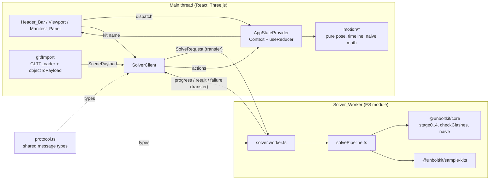
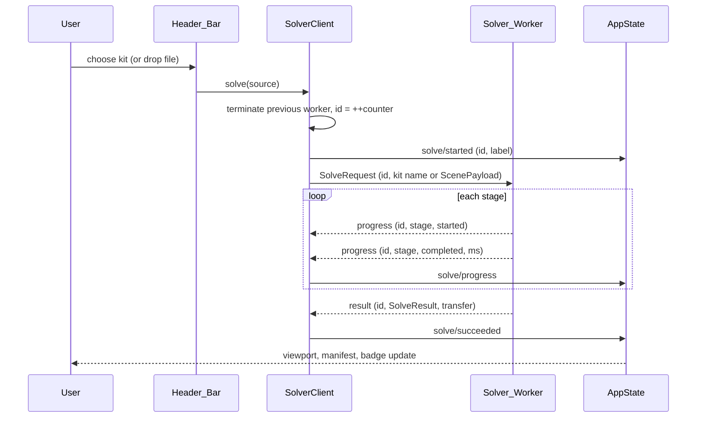

# Design Document: Guide Forge Part 1

## Overview

Guide Forge Part 1 turns `apps/guide-forge` into a light-blueprint CAD studio. A user opens one of five bundled kits or drops a `.glb`/`.gltf` file. A Web Worker runs the full `@unboltkit/core` pipeline, the independent clash oracle and the naive radial baseline. The main thread renders the result in a studio-lit Three.js viewport, animates the real motion primitives, and lists the steps and bill of materials in a right-hand manifest.

Design goals:

- **Correctness from geometry.** Every number on screen comes from Core output (plan, trajectory, oracle, naive report). The app never infers "Verified" from `plan.status`.
- **Strict thread split.** All Core stage calls, `checkClashes` and `computeNaiveRadialClashes` run in the worker. The main thread imports Core only to look up the motion-primitive `pose` functions (pure math, no BVH).
- **Pure, testable logic.** State, selectors, motion math, camera math, recovery mapping and the worker pipeline are plain TypeScript modules with no React or WebGL, so Vitest runs them in Node.
- **Part 2 ready.** One typed state shape and one action union, composed from slices, so the HTML exporter and the tool/torque/narration authoring add a slice and components without touching the worker pipeline.

The code examples use TypeScript, the language of the workspace.

## Resolved Design Decisions

These items were checked against the repository source. Where a claim was run rather than read, the text says so.

### D1. Package resolution, `tsc` and `vite build`

Facts read from source:

| Item | Finding |
|---|---|
| Root `package.json` | `workspaces: ["packages/*", "apps/*", "tools/*"]` |
| Workspace links | `node_modules/@unboltkit/core -> ../../packages/unbolt-core` and `node_modules/@unboltkit/sample-kits -> ../../packages/sample-kits` already exist (symlinks) |
| `@unboltkit/core` | `"type": "module"`, `"main": "src/index.ts"`, `"types": "src/index.ts"`, no `exports`, no `module`, no build step, no `dist` |
| `@unboltkit/sample-kits` | Same fields, `main` and `types` are `src/index.ts` |
| Hoisted dependencies | `three` 0.170.0, `@types/three` 0.170.0, `three-mesh-bvh` 0.8.3 (`module: src/index.js`, `types: src/index.d.ts`, no `exports`), all in the root `node_modules` |
| `tsconfig.base.json` | `moduleResolution: "Bundler"`, `strict`, `noUncheckedIndexedAccess`, `exactOptionalPropertyTypes`, `verbatimModuleSyntax`, `isolatedModules`, `skipLibCheck`, `lib: [ES2022, DOM, DOM.Iterable]` |
| `apps/guide-forge/tsconfig.json` | Extends the same base, `jsx: react-jsx`, `types: ["vite/client"]`, `include: ["src", "vite.config.ts"]` |
| DOM use in Core and Sample_Kits | None (`grep` for `window`, `document`, `navigator`, `HTMLCanvasElement`, `OffscreenCanvas` finds only comment words) |

Consequences:

1. Both packages are consumed as **TypeScript source**. Nothing points at `dist`, so there is no build ordering problem and no stale-output risk.
2. `tsc` follows the symlink and the `types` field to `packages/*/src/index.ts` and type-checks the imported Core and Sample_Kits files under the app's compiler options. Those options are identical to the packages' own (shared `tsconfig.base.json`), so no new diagnostics appear. `types: ["vite/client"]` only limits ambient `@types` auto-inclusion. Explicit imports (`three`, `three-mesh-bvh`, `vitest`, `fast-check`) still resolve.
3. Vite resolves the symlink to its real path under `packages/`, outside `node_modules`, so it transforms the files as source with esbuild. Linked workspace packages are not pre-bundled. The default `server.fs.allow` is the workspace root found by `searchForWorkspaceRoot`, which is the repository root because the root `package.json` has `workspaces`. No `fs.allow` override is needed.
4. `three` addons import with `three/examples/jsm/...` paths. The `exports` map of `three` 0.170 contains `"./examples/jsm/*"` and `@types/three` ships the matching `.d.ts` files (`controls/OrbitControls`, `loaders/GLTFLoader`, `environments/RoomEnvironment`, `lines/Line2`, `renderers/CSS2DRenderer`).

**Verified by running, not only reading.** A temporary probe inside `apps/guide-forge` imported `OrbitControls`, `GLTFLoader`, `RoomEnvironment`, `@unboltkit/sample-kits` and `@unboltkit/core` on the main side, and `stage0ParseScene`, `stage1Prepare`, `stage2BuildDbg`, `stage3Peel`, `stage4Compile`, `checkClashes`, `computeNaiveRadialClashes` plus a kit builder inside a worker created with `new Worker(new URL("./w.ts", import.meta.url), { type: "module" })`. Results with TypeScript 5.9.3 and Vite 6.4.6:

- `npx tsc --noEmit -p <probe tsconfig>` exited 0 with no diagnostics.
- `vite build` with `worker: { format: "es" }` finished with no error and emitted the worker as its own chunk (`assets/w-*.js`, 283 kB) next to the main chunk (652 kB). The only message was Vite's 500 kB chunk-size warning.
- The probe files and the temporary tsconfig were deleted afterwards. The workspace is back to its starting state.

Required changes (all inside `apps/guide-forge`, no file under `packages/` changes, which satisfies Requirement 1.8):

```jsonc
// apps/guide-forge/package.json (additions)
{
  "scripts": { "test": "vitest run" },
  "dependencies": {
    "@unboltkit/core": "*",
    "@unboltkit/sample-kits": "*",
    "three": "^0.170.0"
  },
  "devDependencies": {
    "@types/three": "^0.170.0",
    "fast-check": "^3.23.2",
    "vitest": "^3.2.4"
  }
}
```

`fast-check` and `vitest` use the same ranges as the sibling packages, so they dedupe against the hoisted copies. The version `*` matches the workspace packages at 0.1.0, so npm links the local workspaces and installs nothing from the registry for them.

```ts
// apps/guide-forge/vite.config.ts
import { defineConfig } from "vite";
import react from "@vitejs/plugin-react";

export default defineConfig({
  plugins: [react()],
  server: { port: 5173 },
  worker: { format: "es" },
  // three alone exceeds 500 kB minified. The limit silences only that size warning.
  build: { chunkSizeWarningLimit: 1000 },
});
```

```jsonc
// apps/guide-forge/tsconfig.json (only "include" changes)
{ "include": ["src", "test", "vite.config.ts", "vitest.config.ts"] }
```

```ts
// apps/guide-forge/vitest.config.ts
import { defineConfig } from "vitest/config";

export default defineConfig({
  test: { environment: "node", setupFiles: ["test/setup.ts"], testTimeout: 120_000 },
});
```

Two typing constraints follow from the existing config:

- `lib` contains `DOM` and not `WebWorker`, and mixing both libs causes duplicate-declaration errors. The worker entry therefore uses a small structural port instead of `DedicatedWorkerGlobalScope`:

```ts
// worker/solver.worker.ts
interface WorkerPort {
  onmessage: ((event: MessageEvent<SolveRequestMessage>) => void) | null;
  postMessage(message: WorkerOutMessage, transfer: Transferable[]): void;
}
const port = self as unknown as WorkerPort;
```

- `@types/node` is not installed, so tests cannot import `node:fs`. Source-scan smoke tests use `import.meta.glob("../src/**/*.{ts,tsx}", { query: "?raw", import: "default", eager: true })`, which is typed by `vite/client` and works in Vitest. The package.json and `vite.config.ts` smoke tests import those modules directly (`resolveJsonModule` is on).

The main chunk can still contain some Core code, because Core's `package.json` has no `sideEffects: false` and Requirement 1.8 forbids editing it. That does not break the thread rule. The rule is enforced at the import level (smoke test S1 below), and the main thread never calls a stage function, so no BVH is built there.

### D2. Naive Radial Explode travel distance

**Decision:** one shared constant, `NAIVE_TRAVEL_DISTANCE = Math.sqrt(3)` (about 1.732) in normalized units. The offset of a Part at slider value `s` is `s · D · u`, where `u` is the unit `direction` from the Naive_Report.

**Justification.** Every Part is in normalized coordinates, so the Assembly's AABB `A` has side lengths `e_k ≤ 1` (`maxExtent = 1.0`). For a unit direction `u`, the projection of `A` onto `u` has width `Σ_k |u_k|·e_k ≤ ‖u‖₁ ≤ √3`. Take any point `x` of a Part and its position after the move `x' = x + D·u`. Then `u·x' = u·x + D ≥ min_proj(A) + √3 ≥ max_proj(A)`. At `s = 1` every Part has therefore moved completely past the original assembly envelope along its own travel direction, for every direction and every assembly. That statement is testable (Property 8).

Alternatives considered:

| Option | Why rejected |
|---|---|
| `D = 1.0` (one assembly length) | Clears the envelope only for axis-aligned directions. A Part moving along a body diagonal can still overlap the original envelope at `s = 1`. |
| `D = 0.5` | Parts near the centre never leave the assembly, which hides the contrast with the DBG plan. |
| Per-Part `D_i` from OBB size or from DBG `escapeDistance` | Violates Requirement 13.1 (one fixed distance shared by all Parts) and couples the naive view to DBG data. |

Visual cost: at `s = 1` the exploded extent is at most about `1 + 2√3 ≈ 4.5` units. The Fit button frames the posed bounds (Requirement 3.8), so the view stays usable. The constant lives in `motion/naiveExplode.ts` and is the only place that holds it.

### D3. Stage 1 positions are already normalized

Confirmed from `stage1/normalizer.ts`, `stage1/stage1.ts`, `stage0/stage0.ts` and `stage3/peelSolver.ts`:

- `normalizeParts` computes the union AABB of all Parts, `maxExtent = max(side lengths)`, `scale = 1 / maxExtent`, `translation = -center · scale`, and writes `q = p · scale + translation[k]` into new `Float64Array`s. The assembly ends with `maxExtent = 1.0`, centred at the origin.
- `stage1Prepare` returns `parts` (sorted by Part_ID) with those normalized `positions`, and `normalization: { scale, translation }`.
- `stage3Peel` copies `stage1.normalization` into the plan (`cloneNormalization`), so `plan.normalization` equals `stage1.normalization`.
- Stage 0 `parts` are in **world** coordinates, never normalized. The worker must not build render data from Stage 0.
- Parts are never stride-reduced (`computeSamplingMetadata` comment), so the render mesh has full triangle resolution. Only the DBG sampler uses `stride`.
- `NormalizedPart.triangles` are outward wound after the mirrored-transform fix, and `cornerNormals` are unit world normals (a uniform scale and translation do not change them).

So the worker builds `PartRenderData` directly from `stage1.parts` and returns normalized coordinates. The viewport applies primitive poses in the same space (`x ↦ R·x + T`, Requirement 11.4). The Normalization_Transform stays in the result for display and for Part 2, and the viewport does not use it to move geometry.

### D4. Worker message and transfer rules

- `postMessage` is called with a transfer list that contains the `ArrayBuffer` of every typed array in `PartRenderData`. Each Part owns its arrays, and no two share a buffer, so no buffer appears twice (a repeated buffer throws `DataCloneError`).
- The Scene_Payload is built from **copies**. `GLTFLoader` shares geometry buffers between meshes, so transferring the loader's own arrays could detach buffers that another node still reads. Fresh `Float32Array`/`Uint32Array` copies avoid that.
- The main thread disposes the loaded glTF scene after conversion.

### D5. Part 2 seams

Part 2 adds features by adding, not by editing Part 1 logic:

1. **State:** a new `authoring` slice type, its actions in the union, and one extra line in the root reducer (see State Management).
2. **Data:** `SolveResult` already carries what an offline exporter needs: normalized render geometry, materials, plan, compiled trajectory, oracle and naive reports. An exporter is a pure function `buildManual(result, authoring) → string` in a new `export/` folder.
3. **UI:** `AppShell` composes `HeaderBar`, `StageArea` (viewport) and `ManifestPanel` through props. Part 2 adds a toolbar component and an export button next to them.
4. **Worker:** unchanged. The message protocol is a discriminated union, so a new message type is an additive change.

## Architecture





### Module layout

```
apps/guide-forge/
  index.html, vite.config.ts, vitest.config.ts, tsconfig.json, package.json
  src/
    main.tsx                      mounts <AppStateProvider><App/></AppStateProvider>
    App.tsx                       AppShell composition only
    protocol.ts                   all main<->worker message and data types (no DOM, no React)
    kits.ts                       KIT_NAMES, titles, groups (plain data)
    theme/tokens.css, app.css     light-blueprint theme (this app only)
    state/                        no React, no DOM, no three
      types.ts                    AppState, AppAction, slice types
      reducer.ts                  rootReducer composed from slice reducers
      solveSlice.ts, viewSlice.ts, feedbackSlice.ts
      selectors.ts                clash badge, manifest rows, BOM, deadlock model, control enablement
      recovery.ts                 buildRecoveryCard, buildNotice, classifyFile
      announce.ts                 visible and aria-live message text
      AppStateProvider.tsx        React Context, useReducer, hooks (the only React file here)
    motion/                       pure, no three, no React
      timeline.ts, playback.ts, naiveExplode.ts, highlightStyle.ts
      partTransforms.ts           pose and naive offsets to 4x4 matrices
      leaderSpline.ts
    scene/                        three, no DOM (used on both threads)
      materialDescriptor.ts       Material <-> MaterialDescriptor
      scenePayload.ts             objectToPayload (main), payloadToObject (worker)
    worker/
      solver.worker.ts            message handler only
      solvePipeline.ts            runSolve(request, deps) -> SolveResult, Node-testable
      buildKit.ts, renderData.ts, oracle.ts, failure.ts
    solver/solverClient.ts        Worker lifecycle, request ids, stale-message filter
    upload/gltfImport.ts          GLTFLoader on main, payload creation, disposal
    viewport/
      cameraViews.ts              pure view and fit math
      sceneController.ts          imperative Three.js scene (renderer injectable)
      ViewportCanvas.tsx, ViewportToolbar.tsx, DropZone.tsx, WebglUnavailable.tsx
    panels/                       ManifestPanel, StepRow, BomSummary, StatusCallout, LockedParts,
                                  InterlockBanner, RecoveryCardView, NoticeBar, ProgressStrip
    header/                       HeaderBar, KitSelector, UploadButton, HeroToggle, ClashBadge
    a11y/LiveRegion.tsx
    ui/icons.tsx                  inline SVG icon components
  test/
    setup.ts, arbitraries/, helpers/, properties/, unit/, smoke/
```

Dependency direction: `protocol.ts` and `kits.ts` depend on nothing. `state/` and `motion/` depend on `protocol.ts` only (type imports from Core are `import type`, erased at build). `worker/` depends on Core, Sample_Kits, `scene/`, `protocol.ts`. React components depend on `state/`, `motion/`, `viewport/`. Nothing under `state/` or `motion/` imports `react`, `three` or a DOM global.

## Components and Interfaces

### Shared protocol (`src/protocol.ts`)

One module defines every message and data shape that crosses the thread boundary. It has no DOM and no React import. Core types come in through `import type`.

```ts
import type {
  DisassemblyPlan, NaiveBaselineResult, TrajectoryStep, Vec3,
} from "@unboltkit/core";

export const STAGE_NAMES = ["stage0", "stage1", "stage2", "stage3", "stage4", "oracle", "naive"] as const;
export type StageName = (typeof STAGE_NAMES)[number];

export interface StageProgressEvent {
  stage: StageName;
  state: "started" | "completed";
  /** Milliseconds since the solve began. */
  elapsedMs: number;
  /** Duration of the stage. `null` on `started`. */
  durationMs: number | null;
}

/** Plain data for one surface. Colours are sRGB hex integers. */
export interface MaterialDescriptor {
  baseColor: number;
  metalness: number;
  roughness: number;
  transmission: number;
  opacity: number;
  emissive: number;
}

export interface ScenePayloadMesh {
  positions: Float32Array;
  normals: Float32Array | null;
  indices: Uint32Array | null;
  material: MaterialDescriptor;
}

/** Child order equals Object3D child order, so Core node paths match. No texture, image or DOM object. */
export interface ScenePayloadNode {
  name: string;
  position: Vec3;
  quaternion: [number, number, number, number];
  scale: Vec3;
  mesh: ScenePayloadMesh | null;
  children: ScenePayloadNode[];
}

export interface ScenePayload { root: ScenePayloadNode; meshCount: number }

export type SolveSource =
  | { kind: "kit"; kitName: string }
  | { kind: "scene"; fileName: string; scene: ScenePayload };

/** Label kept in app state. The payload is not kept. */
export type SolveLabel = { kind: "kit"; kitName: string } | { kind: "file"; fileName: string };

export interface SolveRequestMessage { type: "solve"; requestId: number; source: SolveSource }

export interface PartRenderData {
  partId: string;
  nodeName: string;
  nodePath: number[];
  /** Normalized coordinates (maxExtent 1.0). */
  positions: Float32Array;
  normals: Float32Array;
  indices: Uint32Array;
  material: MaterialDescriptor;
  /** OBB centre in normalized coordinates. Origin of the leader spline. */
  obbCenter: Vec3;
  aabb: { min: Vec3; max: Vec3 };
}

export interface OracleReport {
  perStep: { partId: string; clashCount: number }[];
  totalClashes: number;
}

export interface SolveResult {
  plan: DisassemblyPlan;
  /** `null` unless the plan is solved and stage 4 returned ok. */
  trajectory: TrajectoryStep[] | null;
  /** `null` unless the plan is solved. */
  oracle: OracleReport | null;
  /** `null` when the plan is an error. */
  naive: NaiveBaselineResult | null;
  /** Empty when the plan is an error. */
  parts: PartRenderData[];
  timings: { totalMs: number; stageMs: Partial<Record<StageName, number>> };
}

export interface SolveFailure { name: string; code: string | null; message: string }

export type WorkerOutMessage =
  | { type: "progress"; requestId: number; event: StageProgressEvent }
  | { type: "result"; requestId: number; result: SolveResult }
  | { type: "failure"; requestId: number; failure: SolveFailure };
```

`kits.ts` holds the `KIT_NAMES` tuple (the five names), their titles and the Showcase / Deadlock Cage groups. A unit test checks that `KIT_NAMES` equals the names in `SHOWCASE_KITS` and `DEADLOCK_CAGES`, so the list cannot drift from Sample_Kits.

### Solver_Worker

`solver.worker.ts` only wires messages. It calls `runSolve`, posts progress events as they occur, and posts either a result (with a transfer list) or a failure.

```ts
// worker/solvePipeline.ts
export interface PipelineDeps {
  now: () => number;                       // performance.now in the worker, a fake clock in tests
  checkClashes: typeof checkClashes;       // injectable so tests can force a clash or a throw
  onProgress: (event: StageProgressEvent) => void;
}

export function runSolve(request: SolveRequestMessage, deps: PipelineDeps): SolveResult;
```

Pipeline, in order (Requirement 5.1, 5.2, 5.7):

1. Resolve the root `Object3D`. For `kind: "kit"`, `buildKit(name)` looks the name up in `SHOWCASE_KITS` and `DEADLOCK_CAGES` and calls `build()`. A name outside the five throws `UnknownKitError` whose message names the rejected value (Requirement 6.8). For `kind: "scene"`, `payloadToObject(payload)` rebuilds the tree with local position, quaternion and scale and `BufferGeometry` meshes (Requirement 7.8).
2. `stage0ParseScene(root, SOLVER_CONFIG)`, `stage1Prepare(stage0, SOLVER_CONFIG)`. `SOLVER_CONFIG` is `{}`, so every field takes the Core default, including the default seed `0x5eed2027`. Each stage is wrapped by `timed(stage, fn)`, which posts `started` and `completed` events.
3. If stage 0 or stage 1 returned `status: "error"`, the error is the plan. The result has `parts: []` and `null` reports. This equals what `solveDisassembly` returns for the same input.
4. `stage2BuildDbg(stage1, stage1.config)`, `stage3Peel(stage1, graph, stage1.config)`. The plan object is returned as Core produced it.
5. Solved plan: `stage4Compile(plan, stage1, stage1.config)`. If it returns `ok: false`, the worker throws an error that carries the compile error `kind` as its `code`. Then `runOracle(...)`, then `computeNaiveRadialClashes(stage1, stage1.config)`.
6. Deadlocked plan: `computeNaiveRadialClashes` only. `stage4` and `oracle` are skipped and post no events.
7. Build `parts` with `buildRenderData(stage1.parts, materialByNodePath)`.

Because the stages run one by one, the plan must equal `solveDisassembly(root)` for the same root (Core documents this equivalence). Tests use that as an oracle (Property 17).

**Oracle** (`worker/oracle.ts`, Requirement 9):

```ts
export interface OracleJob { moving: string; dir: Vec3; statics: string[] }

/** Job i moves step i's Part along step i's dir against every Part whose step comes later. */
export function buildOracleJobs(steps: readonly PlanStep[]): OracleJob[];

export function runOracle(
  steps: readonly PlanStep[], parts: readonly NormalizedPart[],
  config: ResolvedSolverConfig, check: typeof checkClashes,
): OracleReport;
```

`NormalizedPart` already satisfies `ClashPart`, so stage 1 parts go to `checkClashes` unchanged, with `stage1.config`. The report holds `count` per step and `totalClashes` as the sum. Nothing reads `plan.status` to decide the total. Any thrown error propagates to the worker's failure path (Requirement 9.6).

**Render data** (`worker/renderData.ts`): for each stage 1 part, in Part_ID order:

- `positions`: `Float32Array.from(part.positions)` (already normalized, D3).
- `indices`: `part.triangles` copied to a fresh `Uint32Array` (already outward wound).
- `normals`: per Part-local vertex, sum the `cornerNormals` of every corner that references the vertex, then normalize. A vertex whose sum has zero length takes the `faceNormals` entry of its first triangle. For source meshes with per-vertex normals, corner normals at one vertex are identical, so hard edges keep their split vertices. For derived (flat) normals, shared vertices get smoothed normals, which is acceptable for display.
- `material`: the descriptor of the source mesh at `part.sourceNodePath`. The path is child indices from the root, so `descriptorAtPath(root, path)` walks `root.children[i]`. Descriptors come from `materialToDescriptor(mesh.material)`.
- `obbCenter`, `aabb`: from `part.frame.obb.center` and `part.aabb`.

**Failure shaping** (`worker/failure.ts`):

```ts
/** Core errors keep their `name` and `code`. Other Errors keep `name` and `message`, code is null.
 *  A non-Error throw becomes name "NonErrorThrown" with String(value) as the message. */
export function toSolveFailure(thrown: unknown): SolveFailure;
```

`solver.worker.ts` catches every throw from `runSolve`, converts it with `toSolveFailure` and posts it. This is handling, not swallowing: the UI shows a Recovery_Card from it (Requirement 5.12, 17.7).

### SolverClient (`src/solver/solverClient.ts`)

```ts
export interface SolverClient {
  /** Terminates any running worker, starts a new one, posts the request. Returns the new request id. */
  solve(source: SolveSource, label: SolveLabel, transfer?: Transferable[]): number;
  dispose(): void;
}

export function createSolverClient(
  dispatch: (action: AppAction) => void,
  makeWorker?: () => Worker,           // default: new Worker(new URL("../worker/solver.worker.ts", import.meta.url), { type: "module" })
): SolverClient;
```

- The request id is a monotonic counter owned by the client. No random numbers.
- `solve` terminates the old worker first (Requirement 5.11), creates a new one, dispatches `solve/started`, then posts the request.
- A message whose `requestId` differs from the current id is dropped in the client. The reducer also ignores it (Property 2), so a leak in either layer is still safe.
- `worker.onerror` and `worker.onmessageerror` dispatch `solve/failed` with a failure built from the event. Nothing is silently ignored.
- The provider calls `solve({ kind: "kit", kitName: "mechanical-keyboard-65" })` once on mount (Requirement 6.4) and `dispose()` on unmount. Under React strict mode the effect runs twice in development. The second call terminates the first worker and starts again, which is the specified supersede behavior.

### State management (`src/state/`)

React Context plus `useReducer`, no extra library (Requirement 4.1, 4.2). The state and action types are exported from `state/types.ts`.

```ts
export type LoadStatus = "idle" | "loading" | "ready" | "failed";
export type Mode = "dbg" | "naive";

export interface SolveSlice {
  status: LoadStatus;
  activeRequestId: number | null;
  label: SolveLabel | null;
  result: SolveResult | null;
  /** Latest event per stage. */
  progress: Partial<Record<StageName, StageProgressEvent>>;
}

export interface ViewSlice {
  mode: Mode;
  /** Step_Timeline position in [0, N]. */
  timelineP: number;
  /** Explode_Slider value in [0, 1] while mode is "naive". */
  naiveExplode: number;
  selectedStepIndex: number | null;
  playing: boolean;
  reducedMotion: boolean;
  /** Command with a sequence number, so the viewport reacts once per command. */
  cameraCommand: { seq: number; kind: "iso" | "front" | "top" | "fit" | "focus"; partId?: string } | null;
}

export interface FeedbackSlice {
  recovery: RecoveryCard | null;
  notice: Notice | null;
  announcement: { seq: number; text: string };
}

export interface AppState { solve: SolveSlice; view: ViewSlice; feedback: FeedbackSlice }

export type AppAction =
  | { type: "solve/started"; requestId: number; label: SolveLabel }
  | { type: "solve/progress"; requestId: number; event: StageProgressEvent }
  | { type: "solve/succeeded"; requestId: number; result: SolveResult }
  | { type: "solve/failed"; requestId: number; failure: SolveFailure }
  | { type: "recovery/raised"; card: RecoveryCard }
  | { type: "recovery/dismissed" }
  | { type: "view/modeSet"; mode: Mode }
  | { type: "view/timelineSet"; p: number }
  | { type: "view/explodeSet"; s: number }
  | { type: "view/stepSelected"; index: number }
  | { type: "view/playRequested" }
  | { type: "view/pauseRequested" }
  | { type: "view/tick"; deltaSeconds: number }
  | { type: "view/cameraRequested"; kind: "iso" | "front" | "top" | "fit" | "focus"; partId?: string }
  | { type: "env/reducedMotionChanged"; reduced: boolean };
```

Composition (the seam for Part 2):

```ts
type SliceReducer<S> = (slice: S, action: AppAction, previous: AppState) => S;

export function rootReducer(state: AppState, action: AppAction): AppState {
  return {
    solve: solveReducer(state.solve, action, state),
    view: viewReducer(state.view, action, state),
    feedback: feedbackReducer(state.feedback, action, state),
    // Part 2: authoring: authoringReducer(state.authoring, action, state),
  };
}
```

Each slice reducer is a pure function. It reads the previous complete state read-only (for example, `viewReducer` reads `previous.solve.result` to know `N`). Slices return the same slice object when nothing changes, so React skips re-renders.

Reducer rules:

- **Request gating.** `solve/progress`, `solve/succeeded` and `solve/failed` are ignored when `requestId !== solve.activeRequestId` (Property 2).
- **`solve/started`:** `status: "loading"`, sets `activeRequestId` and `label`, clears `result` and `progress`, resets the view (`mode: "dbg"`, `timelineP: 0`, `naiveExplode: 0`, `selectedStepIndex: null`, `playing: false`), clears `recovery` and `notice`.
- **`solve/succeeded`:** stores the result, `status: "ready"`. If `plan.status === "error"`, raises a Recovery_Card from `buildRecoveryCard(plan.error)`. If `plan.sampling.polyBudgetExceeded` and the plan is not an error, raises the oversize Notice (Requirement 8.5, 8.6). Announces completion.
- **`solve/failed`:** `status: "failed"`, raises a Recovery_Card from the failure.
- **`view/modeSet`:** ignored unless `selectModeToggleEnabled(state)` (a result exists and the plan is not an error). Never touches `solve` (Requirement 10.2).
- **`view/timelineSet`:** clamps `p` to `[0, N]`, ignored in naive mode, when `N = 0`, or when the plan is deadlocked. Sets `selectedStepIndex = activeStepIndex(p, N)`.
- **`view/explodeSet`:** in DBG mode `p = s · N` (same path as `timelineSet`). In naive mode `naiveExplode = clamp(s, 0, 1)`.
- **`view/stepSelected(i)`:** valid `i` in `[0, steps.length)`: `selectedStepIndex = i`, `timelineP = i + 1` when the plan is solved, and a `focus` camera command for `steps[i].partId` (Requirement 15.4). For a deadlocked plan the row only selects and focuses, because there is no trajectory to scrub.
- **`view/playRequested`:** ignored when `reducedMotion`, when `N = 0`, or when not in DBG mode. If `p >= N`, playback restarts from 0. Sets `playing: true`.
- **`view/tick`:** if `playing`, `p ← min(N, p + PLAYBACK_STEPS_PER_SECOND · min(deltaSeconds, MAX_TICK_SECONDS))`. When `p` reaches `N`, `playing: false`. Selection follows `activeStepIndex`.
- **`env/reducedMotionChanged(true)`:** sets `reducedMotion: true` and `playing: false`.

Constants: `PLAYBACK_STEPS_PER_SECOND = 1`, `MAX_TICK_SECONDS = 0.1` (a long frame, for example after a tab switch, cannot jump the timeline).

`activeStepIndex(p, N) = p <= 0 ? null : min(ceil(p) - 1, N - 1)`. It makes `stepSelected(i)` and the timeline agree: `activeStepIndex(i + 1, N) = i`.

`AppStateProvider.tsx` is the only React file in `state/`. It creates the reducer, the `SolverClient`, a `matchMedia("(prefers-reduced-motion: reduce)")` listener (dispatches `env/reducedMotionChanged`), the mount-time first solve, and a playback loop. The loop runs `requestAnimationFrame` only while `view.playing` is true and dispatches `view/tick` with the frame delta.

Hooks: `useAppState()`, `useAppDispatch()`, `useSolver()` (stable `solveKit(name)` and `solveFile(file)` callbacks). Components read state through the context and change it only by dispatch (Requirement 4.7).

### Selectors (`state/selectors.ts`)

Pure functions over `AppState` or `SolveResult`, used by components and tested directly.

```ts
export interface ClashBadgeModel { icon: "check" | "warn" | "interlock" | "none"; text: string }

/** Requirement 9.5, 10.3, 10.4, 10.5. */
export function selectClashBadge(result: SolveResult | null, mode: Mode): ClashBadgeModel;
```

| Condition | Badge text |
|---|---|
| DBG, solved, oracle total = 0 | `0 Clashes • Verified` |
| DBG, solved, oracle total = n > 0 | `n Clashes • Not Verified` |
| DBG, deadlocked | `Interlocked • No Valid Sequence` |
| Naive, naive report present | `X Clashes • Y Obstructed Parts` (X = `totalClashes`, Y = entries with `clashCount > 0`) |
| No result, or plan error | empty badge (`icon: "none"`, text `No plan loaded`) |

```ts
export interface ControlEnablement {
  heroToggle: boolean;      // result exists and plan is not an error
  timeline: boolean;        // DBG mode, solved plan, N >= 1
  explodeSlider: boolean;   // DBG: same as timeline. Naive: naive report present
  play: boolean;            // timeline enabled and not reducedMotion
}
export function selectControlEnablement(state: AppState): ControlEnablement;

/** Same value as `selectControlEnablement(state).heroToggle`. The reducer uses it to gate `view/modeSet` (Requirement 10.8, 13.7). */
export function selectModeToggleEnabled(state: AppState): boolean;

export interface ManifestRow {
  index: number;               // zero-based
  number: number;              // index + 1
  partId: string;
  name: string;
  primitive: string | null;    // null renders the "Not compiled" label
  escapeDistanceText: string;  // escapeDistance.toFixed(3)
  clashCount: number | null;   // naive mode only
  obstructed: boolean;         // naive mode and clashCount > 0
  interlocked: boolean;        // deadlocked part
  selected: boolean;
}
export function selectManifestRows(state: AppState): ManifestRow[];

export function partDisplayName(nodeName: string, partId: string): string; // humanized name or `Part ${partId}`

export interface BomSummary { totalParts: number; helical: number; linear: number; other: number }
export function selectBom(result: SolveResult): BomSummary;

export interface DeadlockModel {
  cycles: { number: number; partNames: string[]; edges: { from: string; to: string }[] }[];
  deadlockedPartIds: Set<string>;     // union of witness.sccs[*].partIds
  amberPartIds: Set<string>;          // unassigned and not deadlocked
  lockedPartIds: string[];            // deadlocked first, then amber, no duplicates
  unassignedCount: number;            // witness.unassignedPartIds.length
  peeledCount: number;                // plan.steps.length
}
export function selectDeadlockModel(result: SolveResult): DeadlockModel | null;

export type StageDisplay = { stage: StageName; state: "pending" | "started" | "completed" | "skipped"; elapsedMs: number | null };
export function selectProgressStrip(state: AppState): StageDisplay[]; // fixed STAGE_NAMES order
```

`partDisplayName` replaces `_` and `-` with spaces and capitalizes the first letter (`clock_gear_2` becomes `Clock gear 2`). A blank or whitespace-only `nodeName` gives `Part ` plus the Part_ID. The BOM counts `helical` and `linear` by exact primitive name and counts every other compiled primitive in `other`. For a deadlocked plan nothing is compiled, so the three counts are 0 and `totalParts` still counts the render parts.

`selectProgressStrip` marks a stage `skipped` when the solve is `ready`, the stage has no event, and the plan status explains it (stages after stage 0 or 1 on an error plan, `stage4` and `oracle` on a deadlocked plan).

### Recovery cards and notices (`state/recovery.ts`)

```ts
export type RecoveryKind =
  | "monolithic" | "empty-assembly" | "invalid-geometry" | "configuration"
  | "unsupported-extension" | "load-failure" | "worker-failure";

export interface RecoveryCard {
  kind: RecoveryKind;
  icon: "island" | "empty" | "geometry" | "config" | "file" | "worker";
  heading: string;
  body: string;                 // plain-language explanation with the specific numbers and paths
  details: string[];            // e.g. node paths, one per entry
  actions: { id: "load-sample-kit" | "open-file-picker"; label: string }[];
}

export interface Notice { kind: "poly-budget"; icon: "warn"; heading: string; body: string; actions: RecoveryCard["actions"] }

export function buildRecoveryCard(error: CoreError): RecoveryCard;
export function buildFailureCard(failure: SolveFailure): RecoveryCard;
export function buildLoaderFailureCard(message: string): RecoveryCard;
export function buildUnsupportedFileCard(fileName: string): RecoveryCard;
export function buildEmptyAssemblyCard(): RecoveryCard;
export function buildPolyBudgetNotice(sampling: SamplingMetadata): Notice;
export function classifyFile(fileName: string): "glb" | "gltf" | "unsupported";   // case-insensitive extension
```

Content rules (Requirement 8):

- `MonolithicMeshError`: heading states the model is one connected island, the body shows `totalTriangles` and the formatted `nodePath`, and says no separate parts exist to disassemble.
- `EmptyAssemblyError`: the file holds no triangles.
- `InvalidGeometryError`: the `reason` as a plain sentence (`non-finite` is "contains NaN or infinite coordinates", `malformed` is "has missing or inconsistent buffers", `zero-extent` is "has no size", `non-finite-scale` is "is too small or too large to scale"), and one `details` entry per node path.
- `ConfigurationError`: the Core message.
- Poly-budget notice: `totalTriangles`, the budget 150000 and the `stride`.
- **Every** card and the notice carry both actions: `load-sample-kit` (loads `mechanical-keyboard-65`) and `open-file-picker`. Every card has an icon, a heading and body text, so no state depends on colour or sound.

Handling the sample-kit action dispatches `recovery/dismissed` and calls `solveKit("mechanical-keyboard-65")` (Requirement 8.8). `RecoveryCardView` moves keyboard focus to the card when it mounts (`tabIndex={-1}` plus `ref.focus()` in an effect, Requirement 8.10).

### Upload (`src/upload/gltfImport.ts`, `src/scene/scenePayload.ts`)

```ts
export type ImportOutcome =
  | { ok: true; source: Extract<SolveSource, { kind: "scene" }>; transfer: Transferable[] }
  | { ok: false; card: RecoveryCard };

export async function importGltfFile(file: File, loader?: GltfParser): Promise<ImportOutcome>;
```

Flow:

1. `classifyFile(file.name)`; `unsupported` returns `buildUnsupportedFileCard` (names `.glb` and `.gltf`).
2. `file.arrayBuffer()`, then `GLTFLoader.parseAsync(buffer, "")` on the main thread (Requirement 7.4). GLTFLoader accepts both binary and JSON glTF as an `ArrayBuffer`.
3. A rejected parse is caught, and the loader message goes into `buildLoaderFailureCard(message)`. This catch handles the error in the UI (Requirement 17.7). Draco, KTX2 and meshopt compressed files fail here with the loader's own message, because Part 1 registers no decoders. A `.gltf` that references external `.bin` or image files fails the same way, since a single dropped file has no siblings.
4. `objectToPayload(gltf.scene)` walks the tree in child order and copies, per node, `name`, local `position`, `quaternion`, `scale`, and for meshes copies of `position`, `normal` and index buffers (using `getX/getY/getZ` so interleaved and normalized attributes work) plus `materialToDescriptor`. It returns `{ root, meshCount }` and the transfer list (the `ArrayBuffer` of every copied array).
5. `meshCount === 0` returns `buildEmptyAssemblyCard()` and posts nothing (Requirement 7.12).
6. The loaded scene is disposed (geometries, materials, textures, `ImageBitmap.close()` when present) before returning.

`payloadToObject` (worker) is the inverse: it rebuilds `Object3D` nodes with the local TRS and `Mesh` nodes with `BufferGeometry` and a `MeshStandardMaterial` or `MeshPhysicalMaterial` built from the descriptor. `materialToDescriptor` then returns the same descriptor, so kit scenes and uploaded scenes share one code path for render materials.

`DropZone` wraps the viewport region. It tracks drag enter and leave with a counter (nested elements fire extra events), shows a visible outline and the text "Drop a .glb or .gltf file to load it" while dragging, and passes the first dropped file to `solveFile`. The header's `UploadButton` is a visible button that triggers a hidden `<input type="file" accept=".glb,.gltf">`.

### Motion and pose math (`src/motion/`)

Pure functions with plain arrays. `three` is not imported here.

```ts
// timeline.ts
export const localParameter = (p: number, i: number): number => Math.min(1, Math.max(0, p - i));
export const sliderToTimeline = (s: number, n: number): number => s * n;
export const timelineToSlider = (p: number, n: number): number => (n === 0 ? 0 : p / n);
export const activeStepIndex = (p: number, n: number): number | null =>
  p <= 0 || n === 0 ? null : Math.min(Math.ceil(p) - 1, n - 1);

// naiveExplode.ts
export const NAIVE_TRAVEL_DISTANCE = Math.sqrt(3);
export const naiveOffset = (s: number, direction: Vec3): Vec3 =>
  [s * NAIVE_TRAVEL_DISTANCE * direction[0], s * NAIVE_TRAVEL_DISTANCE * direction[1], s * NAIVE_TRAVEL_DISTANCE * direction[2]];

// partTransforms.ts
export type Mat4 = number[]; // 16 numbers, column-major (Three.js order)
export function poseToMat4(pose: Pose): Mat4;              // R (row-major 9) and T into x -> R x + T
export function computePartTransforms(input: {
  result: SolveResult; mode: Mode; timelineP: number; naiveExplode: number;
}): Map<string, Mat4>;
```

`computePartTransforms`:

- **DBG, solved, trajectory present:** for step `i`, `t = localParameter(p, i)` and `pose = registry.get(step.primitive).value.pose(t, step.params)`, where `registry = createDefaultPrimitiveRegistry()` is created once per module. `poseToMat4(pose)` maps normalized coordinates directly. At `t = 0` the primitives return the identity pose, so the Part sits at its assembled position. At `t = 1` the Part holds `pose(1, params)`. A registry lookup failure or a `pose` throw is not caught here. It propagates to the viewport's error boundary, which shows a text error. Hiding it would mask a Core contract violation.
- **DBG, deadlocked or error:** an empty map (every Part keeps the identity transform, Requirement 14.9).
- **Naive, naive report present:** for each `perPart` entry, a translation matrix by `naiveOffset(naiveExplode, direction)`. Deadlocked plans use this path too (Requirement 14.10).

```ts
// leaderSpline.ts
export const LEADER_SAMPLES = 32;   // at least 16 required (Requirement 12.2)
export function sampleLeaderSpline(step: TrajectoryStep, center: Vec3, samples = LEADER_SAMPLES): Vec3[];
export function travelledSampleCount(localParam: number, samples: number): number; // samples with t <= localParam
```

`sampleLeaderSpline` evaluates `pose(k / (samples - 1), params)` for `k = 0..samples-1` and applies each pose to `center`. The first sample therefore equals the center, and the last equals the final position. The viewport draws the polyline, an arrowhead cone at the last sample oriented along the last segment, and a `CSS2DObject` label `Step n` at the first sample. The travelled part is the first `travelledSampleCount(t, samples)` samples, drawn thicker (Requirement 12.5).

```ts
// highlightStyle.ts
export interface PartHighlight {
  selected: boolean;
  emphasis: "none" | "clash" | "deadlocked" | "unassigned";
  animation: "none" | "steady" | "pulse" | "glow";
}
export function partHighlight(partId: string, ctx: HighlightContext): PartHighlight;
```

`animation` is `pulse` for `clash`, `glow` for `deadlocked`, `steady` for `unassigned`, and `none` for `none`. When `ctx.reducedMotion` is true, `pulse` and `glow` become `steady` (Requirement 13.5, 14.8, 16.6). `clash` applies only in Naive mode. `deadlocked` and `unassigned` apply while the plan is deadlocked, in both modes (Requirement 14.4, 14.5, 14.10). `selected` applies in DBG mode when `selectedStepIndex` points at the Part.

### Viewport (`src/viewport/`)

`ViewportCanvas.tsx` is a thin React wrapper. It creates a `SceneController` in an effect, forwards a derived view model on every relevant state change, and disposes the controller on unmount.

`sceneController.ts` is an imperative class with injectable factories (`createRenderer`, default `new WebGLRenderer({ antialias: true })`), so the failure path is testable in Node.

Scene setup (Requirement 3):

- `WebGLRenderer` with `toneMapping = ACESFilmicToneMapping`, `outputColorSpace = SRGBColorSpace`, `setPixelRatio(min(devicePixelRatio, 2))`.
- `scene.environment = pmrem.fromScene(new RoomEnvironment(), 0.04).texture`, with `PMREMGenerator` disposed after the render target is created.
- Ground grid: `GridHelper` in `#1E3A5F`, `material.transparent = true`, `opacity = 0.25`, placed just under the assembly bottom (`min.y` of the normalized bounds minus a small gap).
- `OrbitControls` with damping. Controls changes request a render.
- One `Mesh` per `PartRenderData`: `BufferGeometry` from the typed arrays and a `MeshPhysicalMaterial` from the descriptor (`color`, `metalness`, `roughness`, `transmission`, `emissive`; `opacity < 1` sets `transparent`). Transmissive materials get a fixed `thickness` so glass reads as glass. `matrixAutoUpdate = false`. Each frame of change sets `mesh.matrix.fromArray(mat4)`.
- Highlights: `selected` adds a `#1E3A5F` emissive tint and a thin `#1E3A5F` edge outline (`LineSegments` over `EdgesGeometry`, built lazily and cached). `clash` uses crimson emissive. `deadlocked` uses an amber-to-crimson emissive ramp. `unassigned` adds an amber edge outline. Pulse and glow are driven by a time uniform in the render loop. Steady states use a constant value.
- Leader spline: `Line2` with `LineMaterial` (`#1E3A5F`, world-width independent), a second thicker `Line2` for the travelled portion, a `ConeGeometry` arrowhead, and a `CSS2DObject` label. It exists only in DBG mode with a selected, compiled step.
- Render loop: renders on demand. A frame loop runs only while controls are damping, the camera is moving, or an animated highlight is active and `reducedMotion` is false.
- Context loss and creation: `createRenderer` throwing marks the controller `unavailable`. `ViewportCanvas` then renders `WebglUnavailable` ("WebGL is unavailable in this browser. The step list and bill of materials still work.") and the Manifest_Panel keeps working (Requirement 3.11).
- Resize: a `ResizeObserver` updates renderer size, camera aspect, pixel ratio and the `LineMaterial` resolution (Requirement 3.9).
- Dispose: traverses the scene and disposes geometries, materials and textures, the environment render target, `OrbitControls`, the `CSS2DRenderer` element, and the renderer, and disconnects the observer and cancels the frame loop (Requirement 3.10).

Camera math is pure (`cameraViews.ts`):

```ts
export type ViewKind = "iso" | "front" | "top";
export const VIEW_DIRECTIONS: Record<ViewKind, Vec3>;       // iso (1,1,1)/√3, front (0,0,1), top (0,1,0)
export interface Bounds { min: Vec3; max: Vec3 }
export interface CameraFrame { position: Vec3; target: Vec3; up: Vec3; distance: number }

/** Frames the bounding sphere of `bounds` so it fits the smaller of the vertical and horizontal fields of view. */
export function frameBounds(bounds: Bounds, direction: Vec3, vfovDeg: number, aspect: number, margin?: number): CameraFrame;
export function boundsOfPosedParts(parts: PartRenderData[], transforms: Map<string, Mat4>): Bounds;
```

`frameBounds` places the camera at `center + direction · distance`, with `distance = margin · r / sin(θ/2)`, where `r` is the half diagonal of the bounds and `θ = min(vfov, hfov)`. Every point of the bounds lies inside the bounding sphere, and a sphere at that distance lies inside the frustum, so all corners project into the view. `boundsOfPosedParts` transforms the 8 corners of every Part AABB by that Part's matrix and unions them, so Fit includes the current explode pose (Requirement 3.8). `top` uses `up = (0, 0, -1)` to avoid a degenerate up vector. Iso, Front and Top frame the posed bounds in the matching direction (Requirement 3.7). Focus on a Part frames that Part's posed AABB with a larger margin, keeping the current view direction (Requirement 14.6, 15.4). Camera moves are instant under reduced motion and a short eased move (about 300 ms) otherwise.

### Header, panels and accessibility

**HeaderBar** (`header/`): the app title, `KitSelector` (a native `<select>` with two `<optgroup>`s labelled "Showcase" and "Deadlock Cage", human titles), `UploadButton`, `HeroToggle`, and `ClashBadge`. `HeroToggle` is two `<button>`s labelled "UnboltKit DBG" and "Naive Radial Explode" with `aria-pressed`, disabled when `selectControlEnablement(...).heroToggle` is false. `ClashBadge` renders an inline SVG status icon and the text from `selectClashBadge`, in a monospace font.

**ViewportToolbar**: Iso, Front, Top and Fit buttons (text labels, so they are not icon-only), the `Explode_Slider`, play and pause, and the `Step_Timeline`. The timeline renders one tick per Step with the Step number as its label. Disabled controls keep a visible text reason ("Interlocked assembly: no valid sequence"). Play shows "Autoplay is off (reduced motion)" when the OS requests reduced motion.

**ManifestPanel**: contains, top to bottom, the `StatusCallout` (Verified, Not Verified, Interlocked, Obstructed, each with icon and text), the `BomSummary`, the step list, and for deadlocked plans the "Locked Parts" list. A `StepRow` is a `<button type="button">`, so Enter and Space work natively. The selected row has `aria-current="step"`. In Naive mode a row also shows the Part's `clashCount` and the text "Obstructed" when it is above 0. A deadlocked Part row shows an icon and "Interlocked". Peeled steps of a deadlocked plan show "Not compiled" in place of the Primitive_Badge. With no result or an error plan the panel shows the empty state that points to the Kit_Selector and the upload control.

**InterlockBanner**: heading "Unsolvable Interlock Detected", one numbered cycle per SCC with Part names and `from → to` edge pairs, the count of unassigned Parts and the count of peeled Steps. Each Part name is a `<button>` that dispatches a `focus` camera command.

**ProgressStrip**: seven chips in pipeline order, each with the stage name, a text state (`pending`, `running`, `done`, `skipped`) and the elapsed milliseconds in monospace.

**Accessibility** (Requirement 16):

- No audio API anywhere. Every cue is text or a visual signal.
- `feedback.announcement` holds the latest message (load started, stage completed, solve finished, recovery state, deadlock, mode change). It is rendered twice from the same source: in a visible status line under the header, and in a `role="status" aria-live="polite"` region (`LiveRegion`).
- Icon-only controls (such as the play/pause toggle's icon and the banner close icon) have `aria-label` and a `title` tooltip. Most controls carry visible text.
- `:focus-visible` outlines (`2px solid #1E3A5F`, offset 2px) on every interactive element.
- `@media (prefers-reduced-motion: reduce)` removes CSS transitions and animations, matching the JS `reducedMotion` flag.

### Theme (`src/theme/`)

Tokens live in `tokens.css` as custom properties and are the only place colour literals appear.

| Token | Value | Use |
|---|---|---|
| `--canvas` | `#F6F8FB` | page background |
| `--accent` | `#1E3A5F` | rules, buttons, focus, selection, grid |
| `--text` | `#0F172A` | body and headings |
| `--muted` | `#475569` | secondary text |
| `--panel` | `#FFFFFF` | manifest and cards |
| `--ok` / `--ok-bg` | `#14532D` / `#F0FDF4` | Verified callout |
| `--warn` / `--warn-bg` | `#92400E` / `#FFFBEB` | Interlocked, amber outline text |
| `--bad` / `--bad-bg` | `#9F1239` / `#FFF1F2` | Not Verified, Obstructed |

Computed WCAG contrast ratios: `#0F172A` on `#F6F8FB` 16.78, `#1E3A5F` on `#F6F8FB` 10.81, `#FFFFFF` on `#1E3A5F` 11.50, `#475569` on `#F6F8FB` 7.12, `#475569` on `#FFFFFF` 7.58, `#9F1239` on `#FFFFFF` 8.02, `#92400E` on `#FFFBEB` 6.84, `#14532D` on `#F0FDF4` 8.70. All exceed 4.5:1. A unit test recomputes every declared text/background pair from `tokens.css` and asserts at least 4.5.

Typography: a system sans stack for UI text and `ui-monospace, "SF Mono", Menlo, Consolas, monospace` for telemetry, badges and the Clash_Badge. No web font is fetched. Icons are inline SVG React components. The page uses a faint 8 px drafting grid on the canvas background. Nothing imports from `apps/unbolt-blitz`, and nothing under `packages/` receives theme code.

## Data Models

Beyond the protocol and state types above:

- **Part identity.** `partId` is a Core string such as `/0/3#0` (node path plus island index). It is the key for every map in the app (`Map<string, Mat4>`, highlight sets, naive lookup).
- **Naive lookup.** `Map<partId, perPart entry>` is built once per result by a selector, so rows and the viewport do not scan the list.
- **Step to Part mapping.** `plan.steps[i].partId` and `trajectory[i].partId` are the same Part (`stage4Compile` preserves order). The viewport keys on `partId`.
- **Units.** All lengths in `SolveResult` geometry are normalized units. `escapeDistance` is shown with three decimals and no unit conversion.

## Error Handling

| Situation | Where detected | Handling |
|---|---|---|
| Wrong file extension | `classifyFile` | Recovery_Card naming `.glb` and `.gltf`, with picker and sample-kit actions |
| `GLTFLoader` rejects (corrupt, compressed, external resources) | `importGltfFile` catch | Recovery_Card with the loader message |
| Loaded scene has no mesh | `objectToPayload` result | Empty-assembly card, no worker request |
| `MonolithicMeshError`, `EmptyAssemblyError`, `InvalidGeometryError`, `ConfigurationError` | Core returns `status: "error"` | Recovery_Card built from the error value; the plan is stored so the panel shows its empty state |
| `polyBudgetExceeded` | `plan.sampling` | Warning Notice with total, budget 150000, stride; results still shown |
| Core throws (`Stage1FailureError`, `DeadlockWitnessInvariantError`, `InvalidDirectionError`, ...) | Worker `catch` in `solver.worker.ts` | `toSolveFailure` → `failure` message → `solve/failed` → worker-failure card with name, code and message |
| `stage4Compile` returns `ok: false` on a solved plan | `runSolve` | Throws an error with the compile error `kind` as `code`; same failure path |
| `checkClashes` throws | `runOracle` | Propagates to the same failure path (Requirement 9.6) |
| Unknown kit name | `buildKit` | `UnknownKitError` naming the value; failure path |
| Oracle total above 0 on a solved plan | `runOracle` | Result is returned normally; the badge shows `Not Verified` with the count |
| Worker `onerror` / `onmessageerror` | `SolverClient` | `solve/failed` with the event message |
| Superseded request | `SolverClient`, reducer | Worker terminated; late messages ignored by id |
| WebGL context creation fails | `SceneController` | Text message in the viewport; manifest stays usable |
| Primitive lookup or `pose` throws on main thread | `computePartTransforms` | Not caught. A React error boundary around the viewport shows a text error with the message and a sample-kit action. Core's contract says compiled steps always have valid parameters, so this indicates a bug and must be visible |

No `catch` block in the app is empty. Each one either dispatches a state change that the UI shows, or rethrows (Requirement 17.7). A smoke test scans for empty `catch` bodies.

## Workspace Rule Compliance

| Rule | How the design complies |
|---|---|
| geometry-invariants: Core stays pure | No change under `packages/unbolt-core`. The app adds no DOM or WebGL dependency to it. |
| geometry-invariants: normalize to `maxExtent = 1.0` before DBG raycasting | The worker passes the scene to `stage0ParseScene` then `stage1Prepare`, which normalizes (D3). The oracle and naive baseline receive only normalized Stage 1 parts. A test measures the union AABB of the returned render data (Property 18). |
| geometry-invariants: BVH/DBG only in a Web Worker | `stage1Prepare` (BVH build), `stage2BuildDbg`, `stage3Peel`, `checkClashes` and `computeNaiveRadialClashes` are imported only under `src/worker/`. Smoke test S1 enforces it. |
| geometry-invariants: sample kits | Not changed. The app only calls the existing builders. |
| ui-separation: separate identities | Own theme under `src/theme`, no import from `apps/unbolt-blitz`, no shared shell. Smoke tests S2 and S3 enforce it. |
| ui-separation: mute-friendly | No audio code; every cue is text plus icon; `aria-live` region; steady highlights under reduced motion. |
| ui-separation: upload recovery states | Monolithic and oversize cases have cards and a notice, each with an explanation and the actions "Load sample kit" and "Choose another file". |
| no-spec-gaming | No hardcoded part ids, bounding boxes or step orders. Tests assert properties of the real result (oracle total, plan order versus `solveDisassembly`, SCC membership, normalized extent). Property tests use fixed seeds and no `Math.random`. No silent `catch`. |
| macos-shell-guard | Tasks and verification commands quote the workspace path (it contains a space), use `vitest run` and the tool `timeout` parameter, and run one shell command at a time. Long test runs set explicit timeouts, and `-1` exit codes are judged by the printed output. |

## Correctness Properties

*A property is a characteristic or behavior that should hold true across all valid executions of a system-essentially, a formal statement about what the system should do. Properties serve as the bridge between human-readable specifications and machine-verifiable correctness guarantees.*

Prework reflection: criteria with the same checked function were merged (for example the three clash-badge texts form one property, and the pose, assembled-pose and final-pose criteria form one). Criteria about styling, layout, WebGL objects and static configuration are covered by example or smoke tests in the Testing Strategy, not by properties.

### Property 1: Reducer purity

For any `AppState` and any `AppAction`, calling `rootReducer` twice with the same arguments gives deeply equal results, and the arguments are not mutated (they remain deeply equal to deep copies taken before the call).

**Validates: Requirements 4.5**

### Property 2: Stale solve messages are ignored

For any `AppState` with an active request id `a`, and any `solve/progress`, `solve/succeeded` or `solve/failed` action whose `requestId` is not equal to `a`, `rootReducer` returns a state deeply equal to the input state.

**Validates: Requirements 5.11**

### Property 3: Latest progress event per stage wins

For any sequence of `solve/progress` actions carrying the active request id, the reduced `solve.progress` map holds, for each stage that appeared, exactly the last event of that stage in the sequence, and holds no entry for stages that did not appear.

**Validates: Requirements 4.4, 5.6**

### Property 4: Timeline local parameter and slider mapping

For any step count `N ≥ 1`, any `p` in `[0, N]` and any step index `i` in `[0, N)`, `localParameter(p, i)` equals `clamp(p − i, 0, 1)`, is non-decreasing in `p`, equals 0 when `p ≤ i` and equals 1 when `p ≥ i + 1`. For any `s` in `[0, 1]`, `timelineToSlider(sliderToTimeline(s, N), N)` equals `s` within `1e-12`.

**Validates: Requirements 11.1, 11.2, 11.6, 11.7**

### Property 5: Playback advances monotonically and stops at N

For any initial state with `N ≥ 1`, `playing: true` and any sequence of positive `view/tick` deltas, `timelineP` never decreases, never exceeds `N`, advances by at most `PLAYBACK_STEPS_PER_SECOND · MAX_TICK_SECONDS` per tick, and once it reaches `N` it stays at `N` with `playing: false`. For any state with `playing: false`, any `view/tick` leaves `timelineP` unchanged. For any state with `reducedMotion: true`, `view/playRequested` leaves `playing` false.

**Validates: Requirements 11.8, 11.9, 11.10**

### Property 6: Pose matrices apply x ↦ R·x + T

For any rotation (generated from a seeded axis and angle), any translation and any point `x`, applying `poseToMat4({ rotation, translation })` to `x` equals `R·x + T` within `1e-9`. For any built-in primitive parameters (`linear_slide`, `helical_unscrew`, `two_step_l_slide`) and any point `x`, the matrix for `pose(0, params)` maps `x` to `x` within `1e-9`, and the matrix for any local parameter `t ≥ 1` equals the matrix for `pose(1, params)`. For any `helical_unscrew` parameters, `pose(t)` rotates by `2π · t · distance / pitch` about `axis` and maps `pivot` to `pivot + t · distance · dir`.

**Validates: Requirements 11.3, 11.4, 11.5, 11.6, 11.7**

### Property 7: Leader spline sampling

For any compiled trajectory step and any Part centre, `sampleLeaderSpline` returns at least 16 samples, the sample at index `k` is the centre transformed by `pose(k / (samples − 1))`, the first sample equals the centre within `1e-9`, the last sample equals the centre transformed by `pose(1)`, and for any local parameter `t` in `[0, 1]`, `travelledSampleCount(t, samples)` is between 0 and `samples`, is non-decreasing in `t`, and equals `samples` when `t = 1`.

**Validates: Requirements 12.2, 12.3, 12.5**

### Property 8: Naive offsets and envelope clearance

For any slider value `s` in `[0, 1]` and any unit direction `u`, `naiveOffset(s, u)` has length `s · NAIVE_TRAVEL_DISTANCE`, points along `u`, and is the zero vector when `s = 0`. For any assembly whose axis-aligned bounds have `maxExtent = 1` and any Part point `x` in it with any unit direction `u`, the moved point `x + NAIVE_TRAVEL_DISTANCE · u` has `u·(x') ≥` the maximum of `u·y` over the original assembly bounds `y` (within `1e-9`). For any deadlocked or solved result in Naive mode, `computePartTransforms` uses the same offsets.

**Validates: Requirements 13.1, 13.2, 14.10**

### Property 9: Clash badge text

For any result and mode, `selectClashBadge` returns: `0 Clashes • Verified` when the mode is DBG, the plan is solved and the oracle total is 0; `n Clashes • Not Verified` with `n` equal to the oracle total when that total is above 0; `Interlocked • No Valid Sequence` when the mode is DBG and the plan is deadlocked; and `X Clashes • Y Obstructed Parts` in Naive mode, with `X` equal to the naive `totalClashes` and `Y` equal to the number of `perPart` entries whose `clashCount` is above 0. The text is derived from the oracle and naive reports and not from `plan.status` alone.

**Validates: Requirements 9.5, 10.3, 10.4, 10.5**

### Property 10: Manifest rows mirror the plan

For any result, `selectManifestRows` returns one row per plan step in plan order, with `number = index + 1`, `escapeDistanceText` equal to `escapeDistance.toFixed(3)`, `primitive` equal to the trajectory primitive name when compiled and `null` when the plan is deadlocked, and `name` equal to `partDisplayName(nodeName, partId)`. For any `nodeName` that is blank, `partDisplayName` equals `"Part " + partId`, and for any non-blank `nodeName` it is not the fallback. In Naive mode each row's `clashCount` equals its `perPart` entry and `obstructed` is true exactly when that count is above 0. For any deadlocked result, a row is `interlocked` exactly when its Part is in a witness SCC. The BOM satisfies `helical + linear + other` equals the number of compiled steps, and `totalParts` equals the number of render parts.

**Validates: Requirements 13.4, 14.7, 15.1, 15.2, 15.3, 15.7, 15.8**

### Property 11: Deadlock classification and banner model

For any deadlocked plan, `deadlockedPartIds` equals the union of `partIds` over `witness.sccs`; `amberPartIds` equals `witness.unassignedPartIds` minus `deadlockedPartIds`; the two sets are disjoint; `lockedPartIds` contains every member of both sets exactly once; `cycles` has one entry per SCC, numbered from 1, with the SCC's Part names and one `{from, to}` pair per edge; `unassignedCount` equals `witness.unassignedPartIds.length`; and `peeledCount` equals `plan.steps.length`.

**Validates: Requirements 14.2, 14.3, 14.4, 14.5**

### Property 12: Control enablement and mode switching

For any state, the Hero_Toggle is enabled exactly when a result exists and its plan is not an error. For any state in which it is disabled, `view/modeSet` leaves the state unchanged. For any state in which it is enabled, `view/modeSet` changes only `view.mode` and leaves `solve` unchanged (no new request id, same result object). For any deadlocked plan in DBG mode, the timeline, the Explode_Slider and play are disabled and `view/timelineSet` and `view/explodeSet` leave `timelineP` at 0; in Naive mode the Explode_Slider is enabled.

**Validates: Requirements 10.2, 10.8, 13.7, 14.9**

### Property 13: Step selection and timeline agree

For any solved result with `N ≥ 1` steps and any index `i` in `[0, N)`, `view/stepSelected(i)` yields `selectedStepIndex = i`, `timelineP = i + 1`, and a `focus` camera command for the Part of step `i`. For any `p` in `[0, N]`, after `view/timelineSet(p)` the selected index equals `activeStepIndex(p, N)`, and `activeStepIndex(i + 1, N) = i`.

**Validates: Requirements 15.4, 12.1**

### Property 14: Recovery cards and notices are complete

For any `CoreError` of each of the four kinds, `buildRecoveryCard` returns a card with a non-empty icon, heading and body, and both actions `load-sample-kit` and `open-file-picker`. For any `MonolithicMeshError`, the body contains `totalTriangles` and the formatted `nodePath`. For any `InvalidGeometryError`, `details` lists every node path and the body states the reason. For any `SamplingMetadata` with `polyBudgetExceeded` true, the notice body contains `totalTriangles`, `150000` and `stride`, and carries both actions. For any file name, `classifyFile` is `glb` or `gltf` exactly when the lower-cased name ends with that extension.

**Validates: Requirements 8.1, 8.3, 8.5, 8.7, 8.9, 7.10**

### Property 15: Scene payload round trip

For any generated node tree (seeded names, local translation, quaternion, scale, nested children, meshes with position, optional normal and optional index buffers), `payloadToObject(objectToPayload(root).root)` has the same child structure, names, local transforms (within `1e-6` for the `Float32` payload fields), and mesh buffers equal to the source values. Every typed array in the payload owns a distinct `ArrayBuffer`, the transfer list contains each of them exactly once, `structuredClone` of the payload with that transfer list succeeds, and a walk of the payload finds only the permitted fields (no texture, image, canvas or function). The Core plan of the rebuilt tree equals the plan of the source tree.

**Validates: Requirements 5.9, 7.5, 7.6, 7.7, 7.8, 7.9**

### Property 16: Material descriptor round trip

For any descriptor with colours in `[0, 0xFFFFFF]` and `metalness`, `roughness`, `transmission`, `opacity` in `[0, 1]`, `materialToDescriptor(descriptorToMaterial(d))` equals `d` (colours exactly, scalars within `1e-6`).

**Validates: Requirements 3.5**

### Property 17: Worker pipeline fidelity on real kits

For any kit parameter combination in the finite kit domain (both Deadlock_Cages across their parameter ranges, the planetary gearbox across `planetsPerStage` 3 to 6, the lockbox across `gearCount` 2 to 5, and the default keyboard), `runSolve` posts `started` then `completed` for each executed stage in the order stage0, stage1, stage2, stage3, stage4, oracle, naive, and the returned `plan` deeply equals `solveDisassembly(buildKit(...))`. For every solved plan, `trajectory` has one entry per step in step order, and `oracle.totalClashes` equals the sum of `oracle.perStep[*].clashCount`, with one entry per step. For every deadlocked plan, `trajectory` and `oracle` are `null`, `naive` is present, no `stage4` or `oracle` event was posted, every `witness.sccs[*].partIds` has at least 2 members that are all Part_IDs of the render parts, and the peeled steps are a prefix-valid subset of the render parts with no repeated Part.

**Validates: Requirements 5.1, 5.2, 5.5, 5.7, 5.8, 9.3, 17.6**

### Property 18: Render data is in normalized coordinates

For any kit result with a non-error plan, the union AABB of all `PartRenderData.positions` has `maxExtent` equal to 1 within `1e-6` and is centred at the origin within `1e-6`, and for every vertex, `position / scale − translation / scale` (the inverse of `plan.normalization`) equals the corresponding Stage 0 world position within `1e-5`. Every `indices` triple references vertices inside its Part's position array.

**Validates: Requirements 5.8, 11.4**

### Property 19: Oracle jobs follow plan order

For any list of `n` distinct Part ids forming plan steps, `buildOracleJobs` returns `n` jobs; job `i` moves step `i`'s Part along step `i`'s `dir`, its static set equals exactly the Parts of steps `i + 1 … n − 1`, and the moving Part is not in its static set. For any list of per-step counts, the report total equals their sum. For a stub `checkClashes` that returns a count above 0 for a solved plan, the report total is above 0 whatever the plan status says.

**Validates: Requirements 9.1, 9.3, 9.4**

### Property 20: Failure shaping and kit-name rejection

For any thrown value, `toSolveFailure` returns a failure whose `message` is the error message (or `String(value)` for non-Errors), whose `name` is the error name, and whose `code` equals the Core `code` when the value is an `UnboltCoreError` and is `null` otherwise. For any string that is not one of the five Kit_Names, `runSolve` with that kit name throws an error whose message contains the string.

**Validates: Requirements 5.12, 6.8**

### Property 21: Camera views and fit contain the assembly

For any bounds, view kind, field of view in `(10°, 100°)` and aspect in `[0.3, 4]`, `frameBounds` returns a camera whose direction from the target equals the view's unit vector, whose target is the bounds centre, and from which all 8 corners of the bounds project inside the normalized device range `[-1, 1]` on both axes. For any set of Part boxes and per-Part matrices, `boundsOfPosedParts` contains every transformed corner.

**Validates: Requirements 3.7, 3.8**

### Property 22: Reduced motion yields steady highlights

For any Part context and any value of `reducedMotion`, `partHighlight` never returns `pulse` or `glow` when `reducedMotion` is true, returns `pulse` for `clash` and `glow` for `deadlocked` when it is false, and returns the same `emphasis` in both cases. `clash` emphasis appears only in Naive mode, and `deadlocked` or `unassigned` emphasis only for deadlocked plans.

**Validates: Requirements 13.5, 14.8, 16.6, 13.6**

## Testing Strategy

Dual approach. Property tests cover universal behavior of the pure logic and the real pipeline. Example and smoke tests cover styling, structure, configuration and the thread boundary.

### Tooling

- Vitest, `environment: "node"`, `vitest run` (no watch mode).
- `fast-check` with a global fixed seed and `numRuns: 100` set in `test/setup.ts` (`fc.configureGlobal({ seed: 0x5eed2027, numRuns: 100 })`). Every failure reproduces. No `Math.random` anywhere in `src` or `test`.
- Each property test carries the tag `Feature: guide-forge-part-1, Property N: <title>`.
- Arbitraries live in `test/arbitraries/` (app state, results, witnesses, node trees, bounds, primitive parameters). Generated results are built by assembling plain data, not by hardcoding Part ids or step orders from a fixture.
- No jsdom. Component structure checks use `react-dom/server` `renderToStaticMarkup` (labels, `aria-pressed`, `aria-current`, button elements, disabled states). Behavior that needs a real browser (drag events, focus movement, WebGL) is covered by manual verification in the tasks.

### Property tests (Properties 1 to 22)

Each property in the section above is one `fc.assert` test. Notes:

- Properties 17 and 18 run the real pipeline. The kit parameter domain is finite and small, so they enumerate it exhaustively instead of sampling 100 random runs. Their assertions are geometric and graph properties of the real result: plan equality with `solveDisassembly`, oracle total equals the sum of per-step counts, SCC membership, normalized extent. These tests use `testTimeout` 120 s and run in one file so the cost is paid once. The keyboard solve is the longest. The tasks measure it and adjust the timeout if needed.
- Property 15 uses `structuredClone(payload, { transfer })`, available in Node 17+, to check cloneability and transfer-list validity without a browser.
- Property 6 and 7 call the real Core primitives from `createDefaultPrimitiveRegistry()`, generating parameters from valid ranges (unit axes via normalized seeded vectors, positive distances and pitch).
- Property 8 generates assemblies as point sets scaled to `maxExtent = 1`, so the clearance claim is checked against the geometry and not against a fixture.

### Unit and example tests

- Reducer: the first-open flow (`solve/started` then `succeeded`), the poly-budget notice with results still shown (8.6), sample-kit action dismisses the card (8.8), reduced-motion change stops playback.
- Selectors for the four status callouts and the empty state.
- `kits.ts` equals the Sample_Kits registry names; `buildKit` returns a `Group` for each of the five names (6.3).
- Oracle injection: a stub `checkClashes` that throws produces a failure message (9.6).
- Contrast test: parses `tokens.css`, checks each declared text/background pair is at least 4.5:1 (2.7), and the three base colours equal `#F6F8FB`, `#1E3A5F`, `#0F172A` (2.1).
- `SceneController` with a throwing `createRenderer` reports `unavailable` (3.11).
- Static markup tests: Header_Bar contains the two toggle labels and `aria-pressed` (10.1, 10.7); toolbar has Iso, Front, Top and Fit (3.6); step rows are buttons with `aria-current` on the selected row (15.5, 15.6); timeline has N labelled ticks (11.11); live region and visible status line show the same announcement (16.2, 16.3).

### Smoke and static tests (`test/smoke/`, using `import.meta.glob(..., { query: "?raw" })`)

- **S1 thread boundary.** Outside `src/worker/`, no file imports a Core value other than `createDefaultPrimitiveRegistry`, and no file imports `three-mesh-bvh` (5.3, geometry-invariants). Only `src/solver/solverClient.ts` constructs a `Worker`, with `{ type: "module" }` (5.4). `GLTFLoader` is imported only in `src/upload/` (7.4).
- **S2 package roots.** No import specifier starts with `@unboltkit/core/` or `@unboltkit/sample-kits/` (1.4).
- **S3 app isolation.** No import path contains `unbolt-blitz`; no CSS or theme file exists under `packages/` (2.5, 2.6).
- **S4 module purity.** Files under `src/state/` (except `AppStateProvider.tsx`) and `src/motion/` import no `react`, `react-dom`, `three` or DOM global, and `src/protocol.ts` imports neither React nor DOM types (4.6, 17.4).
- **S5 hygiene.** No `Math.random` in `src` or `test`; no empty `catch` block; no `Audio`, `AudioContext` or `<audio>`; no ``, icon-font class or raster import (2.3, 16.1, 17.5, 17.7).
- **S6 scope.** No exporter or authoring modules exist in Part 1 (17.1, 17.2).
- **S7 config.** `package.json` dependencies and devDependencies match D1, and no state library appears (1.1, 1.2, 4.2); `vite.config.ts` has `server.port` 5173 and `worker.format` `"es"` (1.3).

### Integration checks (run once by the tasks, one command at a time, quoting the workspace path)

- `npm install` at the repository root resolves the workspaces (1.5).
- `npx tsc --noEmit` in `apps/guide-forge` reports zero errors (1.6).
- `npm run build` in `apps/guide-forge` succeeds and `dist/assets` contains a separate worker chunk (1.7).
- A checksum or diff of `packages/unbolt-core` before and after shows no change (1.8).
- Manual browser pass with `npm run dev` (started by the user, not by the agent): first solve loads the keyboard; each kit loads; the Hero toggle switches; scrubbing the timeline shows screws rotating; a deadlock cage shows the banner; dropping a monolithic `.glb` and a non-glTF file shows the recovery cards; the page stays responsive during a solve (5.10); the UI is usable with the OS set to reduce motion and with sound off.

### Workspace interaction

The root `package.json` runs `npm run test --workspaces --if-present`. Once `apps/guide-forge` gains a `test` script, a root `npm test` also runs the Guide Forge suite, including the real-pipeline tests (Properties 17 and 18). That is intended. The verification tasks run the app suite directly with `npx vitest run` and an explicit tool timeout. The existing `build` script (`tsc --noEmit && vite build`) type-checks before bundling, so a type error fails the build.

### Known limits

- Part 1 sets no hard file-size cap for uploads. Oversized models solve with stride sampling and a warning notice (Requirement 8.5), but a very large file can still exhaust main-thread memory during glTF parsing and payload copying.
- Compressed glTF (Draco, KTX2, meshopt) and multi-file `.gltf` are rejected by the loader and reported in a Recovery_Card.
- The oracle runs `checkClashes` once per step against all later Parts, so large assemblies take noticeably longer than the DBG build alone. Progress events show which stage is running.
