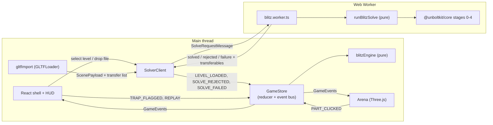
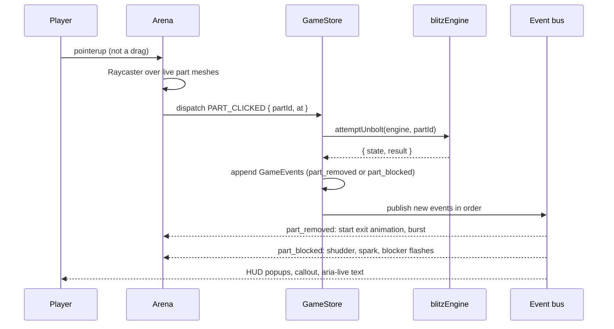

# Design Document: Unbolt Blitz Part 1

## Overview

Unbolt Blitz is a dark "Clockwork Arcade" disassembly puzzle game in `apps/unbolt-blitz`. The player orbits an assembly on a turntable, clicks parts to unbolt them, and either removes every part (Victory) or pulls the trap lever on a true interlock ("Interlock Exposed!"). A click on a blocked part costs 3 seconds and the combo.

Part 1 has four layers with one-way dependencies:

1. **Solver layer** (Web Worker). `runBlitzSolve` is a pure function that chains `stage0ParseScene → stage1Prepare → stage2BuildDbg → stage3Peel → stage4Compile`. The worker file only does message plumbing around it.
2. **Game layer** (pure TypeScript, `src/game`). `blitzEngine.ts` holds the rules. A pure reducer holds game state and appends plain-data `GameEvent`s. A small store publishes those events to subscribers.
3. **Presentation layer**. A Three.js `Arena` (viewport, picking, exit animations, effects) and a React HUD. Both react to `GameEvent`s through the event bus. Neither edits the reducer or the engine.
4. **Shell**. Level selection, upload, recovery screens, theme.

The design is shaped by three constraints:

- **geometry-invariants**: `packages/` is not modified, `@unboltkit/core` stays pure CPU, every level is solved in normalized coordinates (`maxExtent = 1.0`, enforced by `stage1Prepare`), and BVH and DBG builds run only in the Worker.
- **ui-separation**: no import from `apps/guide-forge`, no copied CSS, tokens or chrome. A hover/click/popup floating-HUD loop replaces any panel layout.
- **no-spec-gaming / macos-shell-guard**: tests compute expectations from geometry and graph algorithms, use seeded PRNGs, and never swallow errors. Shell commands run one at a time with quoted paths.

### Key Design Decisions

| # | Decision | Reason |
|---|----------|--------|
| D1 | The engine is a set of pure functions over an immutable `EngineState`. `attemptUnbolt(state, partId)` and `flagDeadlockTrap(state)` return `{ state, result }`. The requirement text `attemptUnbolt(partId)` is the same call with the engine state bound. | The reducer must be pure (Req 8.1), so the engine must not hold hidden mutable state. |
| D2 | The engine takes a `PrimitiveRegistry` and a `PrimitiveContext` by injection and imports `@unboltkit/core` with `import type` only. | Req 4.1 forbids Three.js imports in the engine, and a runtime import of `@unboltkit/core` pulls in `three` through its scene parser. The app composition root (`engineDeps.ts`) passes `createDefaultPrimitiveRegistry()` and a context built from `DEFAULT_SOLVER_CONFIG`. |
| D3 | Edges in `Solve_Result` are `{ from, to, dirIndex }`. The `dir` vector is read from `candidateAxes[dirIndex]`, and the `fromTriangles` and `toTriangles` lists are dropped. | Nothing in Part 1 reads the triangle lists, and the keyboard graph has thousands of edges. Part 2 can read the lists from the plan witness or extend the protocol. |
| D4 | The engine edge set is `graph.edges ∪ witness SCC edges`. | Stage 3 verifies each move exactly and may add edges that never appear in `graph.edges`. Those edges are only visible through the witness of a deadlocked plan. Without them a player could "legally" remove a part that the plan proves is stuck, and the trap flag would then misreport. |
| D5 | Exit travel is `max(escapeDistance, EXIT_TRAVEL_FLOOR)` with `EXIT_TRAVEL_FLOOR = 0.12` normalized units. The axis is still chosen by the unfloored Escape_Distance. | The last live part has Escape_Distance 0 (core does the same) and would not visibly move. Req 4.9 only requires that `params` describe the motion the Arena plays. |
| D6 | Aligned_Fastener uses Core's default tolerance, `DEFAULT_SOLVER_CONFIG.helicalAngularToleranceDeg` (5°). `engineDeps.ts` builds `PrimitiveContext = { config: DEFAULT_SOLVER_CONFIG }` with no override. The engine asks `registry.select(planStep, info, ctx)` for the primitive and then calls `primitive.buildParams`. | The engine and `@unboltkit/core` classify every step identically, and the app holds no angle constant that could drift from Core. `DEFAULT_SOLVER_CONFIG` is a runtime value, so only `engineDeps.ts` imports it by value. `blitzEngine.ts` keeps `import type` only and receives the context by injection (D2). With `secondary: null`, `select` can only return `helical_unscrew` (priority 20) or the `linear_slide` fallback (priority 0). |
| D7 | A `MonolithicMeshError` always maps to the `monolithic` recovery screen, whatever the triangle count. A multi-part scene above 150,000 triangles is not rejected: the solve runs all five stages, and `SolveResult.overBudget` carries the triangle count, the budget and the stride. The HUD shows it as a non-blocking Over_Budget_Notice. | A single solid piece cannot be disassembled at any polycount, and Core returns that error before it computes sampling metadata, so a triangle-count screen would hide the real cause. Core itself never rejects over-budget: Stage 0 sets `polyBudgetExceeded`, Stage 1 copies `sampling` through, and Stage 2 only samples every `stride`-th triangle. |
| D8 | Crimson text on `#161A23` plates uses a lighter tint `--crimson-text: #FF7A7E`. Crimson `#E5484D` is used for fills, borders and glows. | `#E5484D` on `#161A23` has contrast about 4.45:1, below the 4.5:1 of Req 15.5. A theme test computes the ratios. |
| D9 | Game state lives in a framework-free `GameStore` (reducer plus event bus). React reads it with `useSyncExternalStore`. | Events are published exactly once per dispatch, which stays correct under React StrictMode double effects. |
| D10 | A new level request terminates the in-flight worker and starts a new one. Results also carry `requestId`. | Req 2.10. Termination frees the CPU. The id check stays as a second guard in the client and in the reducer. |

## Architecture



Click flow for one part:



## Verified Core and Sample-Kit APIs

All signatures below were read from `packages/unbolt-core/src` and `packages/sample-kits/src`. The app imports them from the package roots `@unboltkit/core` and `@unboltkit/sample-kits`.

| Function / type | Signature (as implemented) | Notes used by this design |
|-----------------|----------------------------|---------------------------|
| `stage0ParseScene` | `(root: Object3D, config?: SolverConfig) => Stage0Result \| ErrorResult` | Returns `{ status: "ok", parts, totalTriangles, sampling }` or `{ status: "error", error }`. Errors are values: `ConfigurationError`, `InvalidGeometryError`, `EmptyAssemblyError`, `MonolithicMeshError` (has `totalTriangles`). Reads local TRS of each node, never `matrixWorld`. Part ids look like `/0/3#0`. |
| `computeSamplingMetadata`, `POLY_BUDGET` | `POLY_BUDGET = 150000`. `sampling = { stride, polyBudgetExceeded, totalTriangles, polyBudget }`. `polyBudgetExceeded` is `totalTriangles > 150000`, and `stride = ceil(totalTriangles / 150000)` when exceeded, else 1. | Core never rejects over-budget. Stage 0 returns `sampling` only on its `ok` path. A single-island scene returns `MonolithicMeshError { totalTriangles }` first, with no `sampling`, whatever the count. `stage1Prepare` copies `sampling` into its result unchanged and builds BVHs for every part. `stage2BuildDbg` samples every `stride`-th triangle, and parts are never reduced. The worker reports `polyBudgetExceeded` as a warning on the result (Req 3.3). |
| `stage1Prepare` | `(input: Stage0Result \| ErrorResult, config?) => Stage1Result \| ErrorResult` | Normalizes to `maxExtent = 1.0`, centered at the origin (`normalization: { scale, translation }`). Builds one `MeshBVH` per part. Returns `parts: NormalizedPart[]` sorted by `partId`, plus `config: ResolvedSolverConfig`. May throw `Stage1FailureError`. |
| `NormalizedPart` | extends `Part` with `aabb`, `frame: PartFrame`, `candidateAxes: Vec3[]` (32), `metrics: { isFastener, slenderness, extentsSorted }`, `bvh` | `frame.axes[0]` is the principal axis. `frame.obb` is `{ center, halfExtents }`. `positions: Float64Array`, `triangles: Uint32Array`, `cornerNormals`, `faceNormals`. `sourceNodeName` and `sourceNodePath` identify the source mesh. |
| `stage2BuildDbg` | `(input: Stage1Result, config: ResolvedSolverConfig, options?: DbgOptions) => BlockingGraph` | `BlockingGraph = { partIds, candidateAxes, edges: BlockingEdge[], stats }`. `BlockingEdge = { from, to, dirIndex, dir, fromTriangles, toTriangles }`. `from → to` with `dirIndex` means `to` blocks `from` along axis `dirIndex`. |
| `stage3Peel` | `(stage1: Stage1Result, graph: BlockingGraph, config: ResolvedSolverConfig) => SolvedPlan \| DeadlockedPlan` | Runs lazy exact step verification, so it can add edges that `graph.edges` lacks. `DeadlockedPlan.witness = { sccs: { partIds, edges: WitnessEdge[] }[], unassignedPartIds }`. Cages deadlock with 0 steps. |
| `stage4Compile` | `(plan: DisassemblyPlan, stage1: Stage1Result, config: SolverConfig, registry?) => { ok: true; steps: TrajectoryStep[] } \| { ok: false; error: CompileError }` | A non-solved plan returns `{ ok: false, error: { kind: "PlanNotSolved" } }`. So `trajectories` is `null` for deadlocked plans. |
| `TrajectoryStep` | `{ partId: string; primitive: string; params: PrimitiveParams }` | `PrimitiveParams` is a union keyed by `kind`: `linear_slide { dir, distance }`, `helical_unscrew { dir, distance, axis, pivot, pitch }`, `two_step_l_slide`. |
| `createDefaultPrimitiveRegistry` | `() => PrimitiveRegistry` with `register`, `get(name)`, `list()`, `select(step, part, ctx)` | `get` returns `RegistryResult<MotionPrimitive>` (`{ ok, value } \| { ok: false, error }`). `MotionPrimitive` has `name`, `priority`, `isApplicable`, `buildParams(step, part, ctx)`, `pose(t, params): Pose`. |
| `Pose` | `{ rotation: number[9] (row-major); translation: Vec3 }`, acting as `x ↦ R·x + T` | `pose(1, params)` moves the OBB center to `center + distance·dir` for both built-in primitives. `pose` throws `PrimitiveRangeError` outside `[0, 1]`. |
| `PrimitivePartInfo`, `PrimitiveContext`, `PlanStep`, `ResolvedSolverConfig` | `PrimitivePartInfo = { partId, isFastener, principalAxis, obbCenter, obbHalfExtents }`. `PrimitiveContext = { config: ResolvedSolverConfig }`, and the frozen `DEFAULT_SOLVER_CONFIG` is a valid `config`. `PlanStep = { partId, dir, dirIndex, escapeDistance, secondary }`. | Types are exported through `export type *`. `DEFAULT_SOLVER_CONFIG` is exported at runtime, and `createDefaultPrimitiveRegistry().select` reads `ctx.config.helicalAngularToleranceDeg` for `helical_unscrew`. Defaults: `helicalAngularToleranceDeg: 5`, `threadPitch: 0.01`, `fastenerSymmetryTolerance: 0.1`, `fastenerSlendernessThreshold: 2.0`. |
| `SHOWCASE_KITS`, `DEADLOCK_CAGES` | `readonly KitEntry[]`, `KitEntry = { name, build: () => Group }` | Names: `mechanical-keyboard-65`, `planetary-gearbox-3-stage`, `haunted-clockwork-lockbox`, `deadlock-cage-dumbbell-ring`, `deadlock-cage-ship-in-bottle`. Builders also take params, for example `buildHauntedClockworkLockbox({ gearCount: 2..5 })`. Mesh names look like `lid_fastener_1`. |

Known scaffold state (`apps/unbolt-blitz`): `package.json` has only React and Vite dependencies and no `test` script. `vite.config.ts` has no port and no worker format. `tsconfig.json` includes only `src` and `vite.config.ts`. `src` holds a placeholder `App.tsx` and `main.tsx`. The scaffold changes are listed under [Workspace Scaffold](#workspace-scaffold).

## Components and Interfaces

The app has four layers. Each subsection below describes the components of one layer and the interfaces between them. Data shapes are catalogued under [Data Models](#data-models).

### Module Layout

```
apps/unbolt-blitz/
  index.html                   (title, root div; no web fonts)
  package.json                 (deps per Req 1.1-1.2, scripts: dev, build, preview, typecheck, test)
  vite.config.ts               (port 5174, worker.format "es")
  vitest.config.ts             (node environment, seeded-test timeouts)
  tsconfig.json                (adds "test" and "vitest.config.ts" to include)
  src/
    main.tsx                   (mounts <App/>, imports theme css)
    App.tsx                    (composition root: store, client, arena host, HUD, recovery)
    engineDeps.ts              (createEngineDeps(): registry + PrimitiveContext { config: DEFAULT_SOLVER_CONFIG }, no override. Runtime import of core.)
    levels.ts                  (BUNDLED_LEVELS table: id, label, kitName. Plain data.)
    protocol.ts                (worker messages and plain-data types. import type only.)
    worker/
      blitz.worker.ts          (message handler only)
      runBlitzSolve.ts         (pure: runBlitzSolve, solveRoot, BlitzSolveDeps)
      buildKit.ts              (kit lookup in SHOWCASE_KITS / DEADLOCK_CAGES)
      renderData.ts            (NormalizedPart[] -> PartRenderData[])
      rejection.ts             (CoreError -> WorkerRejection, unexpected-error shaping)
      transfer.ts              (collectTransferables)
    solver/
      solverClient.ts          (Worker wrapper, latest-wins, terminate on supersede)
    upload/
      fileKind.ts              (classifyFile: .glb/.gltf/unsupported)
      gltfImport.ts            (GLTFLoader on main thread -> ScenePayload)
      dropTarget.ts            (window drop handling)
    scene/                     (data shared by both threads, three only, no DOM)
      scenePayload.ts          (objectToPayload / payloadToObject)
      materialDescriptor.ts    (Material <-> MaterialDescriptor)
    game/                      (pure TS. No DOM, React, three.)
      scoring.ts               (constants)
      axisMath.ts              (escapeDistance, vec helpers)
      displayNames.ts          (deriveDisplayNames)
      levelData.ts             (SolveResult -> EngineLevelInput, merges witness edges)
      blitzEngine.ts           (createEngineLevel, createEngine, attemptUnbolt, flagDeadlockTrap, queries)
      events.ts                (GameEvent union)
      gameState.ts             (GameState, GameAction, initial state)
      reducer.ts               (gameReducer)
      selectors.ts             (elapsedMs, score, progress, ...)
      eventBus.ts              (GameEventBus: subscribe / publish)
      store.ts                 (createGameStore: dispatch, getState, subscribe, bus)
    modules/
      registry.ts              (GAME_MODULES: GameModule[]; empty in Part 1. The Part 2 plug-in point.)
      types.ts                 (GameModule, ModuleContext)
    viewport/                  (Three.js; main thread only)
      Arena.ts                 (renderer, scene, lights, controls, loop, dispose)
      ArenaView.tsx            (React host: creates and disposes the Arena, wires callbacks)
      WebglUnavailableError.ts
      environment.ts           (RoomEnvironment + PMREM)
      pedestal.ts              (turntable pedestal)
      partMeshes.ts            (PartRenderData -> Mesh, own material per part)
      framing.ts               (frameBounds: pure)
      picking.ts               (Picker, isClick: pure core + Raycaster)
      exitAnimations.ts        (ExitAnimator: independent clocks, poseToMatrix)
      effects.ts               (burst, spark, shudder, flash envelopes, seeded particles)
      highlights.ts            (hover glow, blocker flash, SCC highlight)
      arenaBridge.ts           (subscribes the Arena to the event bus)
      resourceTracker.ts       (dispose bookkeeping)
      motion.ts                (reduced-motion policy: durations, effect kinds)
    hud/
      Hud.tsx                  (floating layout)
      LevelSelector.tsx, Stopwatch.tsx, ScoreCombo.tsx, ProgressBar.tsx, Counters.tsx
      TrapLever.tsx, NamePill.tsx, Popups.tsx, BlockerCallout.tsx, OverBudgetNotice.tsx
      LoadingPlate.tsx, CompletionOverlay.tsx, LiveRegion.tsx
      hudModel.ts              (pure: popupsFromEvent, calloutReducer, describeEvent, formatElapsed, overBudgetNoticeText)
    recovery/
      RecoveryScreen.tsx
      recoveryCopy.ts          (pure: recoveryCopyFor(cause))
      WebglUnavailable.tsx
    theme/
      tokens.css               (Palette as CSS custom properties)
      app.css                  (plates, lever, popups, overlay, keyframes)
  test/
    helpers/ (prng.ts, seeds.ts, solved.ts, syntheticLevel.ts, referenceModel.ts, deepFreeze.ts, sourceScan.ts)
    engine/ reducer/ worker/ viewport/ hud/ recovery/ static/
```

Dependency rules, enforced by static tests:

- `src/game/**` imports only relative modules and `import type` from `@unboltkit/core`.
- `stage1Prepare`, `stage2BuildDbg`, `stage3Peel` and `three-mesh-bvh` are imported only under `src/worker/`.
- Main-thread modules import only these runtime symbols from `@unboltkit/core`: `createDefaultPrimitiveRegistry`, `DEFAULT_SOLVER_CONFIG`, `POLY_BUDGET`. `DEFAULT_SOLVER_CONFIG` is imported by value only in `engineDeps.ts`.
- Nothing under `src/` resolves to `apps/guide-forge`.

### Workspace Scaffold

`apps/unbolt-blitz/package.json` (additions to the existing file):

```json
{
  "scripts": { "dev": "vite", "build": "tsc --noEmit && vite build", "preview": "vite preview", "typecheck": "tsc --noEmit", "test": "vitest run" },
  "dependencies": {
    "@unboltkit/core": "*", "@unboltkit/sample-kits": "*", "three": "^0.170.0",
    "react": "^19.1.0", "react-dom": "^19.1.0"
  },
  "devDependencies": {
    "@types/react": "^19.1.0", "@types/react-dom": "^19.1.0", "@types/three": "^0.170.0",
    "@vitejs/plugin-react": "^4.4.1", "fast-check": "^3.23.2", "typescript": "^5.9.3",
    "vite": "^6.3.5", "vitest": "^3.2.4", "@types/node": "^22.0.0"
  }
}
```

`vite.config.ts` adds `server: { port: 5174 }`, `worker: { format: "es" }` and `build: { chunkSizeWarningLimit: 1000 }`. `vitest.config.ts` uses `environment: "node"` and a `testTimeout` of 60 000 ms, which covers the real Lockbox and cage solves. `tsconfig.json` sets `types: ["vite/client", "node"]` and adds `test` and `vitest.config.ts` to `include`. `@types/node` is needed because the test helpers and static tests import `node:fs` and `node:path`, and it is not installed at the repository root today. With Node types loaded, `setInterval` and `setTimeout` return `NodeJS.Timeout` in the shared program, so `src/` code types timer handles as `ReturnType<typeof setInterval>`. The tsconfig `lib` has DOM and no WebWorker, so `blitz.worker.ts` reaches the global through a small structural `WorkerPort` interface.

The `three` dependency is imported on the main thread for the Arena and in the worker for scene reconstruction. The app declares no direct dependency on `three-mesh-bvh`. It arrives only through `@unboltkit/core`, and only the worker calls the stages that build BVHs.

### Worker and Protocol

#### Message protocol (`src/protocol.ts`)

`protocol.ts` has no React or DOM import. Core types come in with `import type`.

```ts
import type { SolvedPlan, DeadlockedPlan, TrajectoryStep, Vec3 } from "@unboltkit/core";

export type BundledLevelId = "lockbox" | "planetary-gearbox" | "keyboard-65" | "dumbbell-cage" | "ship-in-bottle";

export interface MaterialDescriptor { baseColor: number; metalness: number; roughness: number; transmission: number; opacity: number; emissive: number }

/** Plain scene data. Child order equals Object3D child order, so Core node paths match. */
export interface ScenePayloadNode {
  name: string; position: Vec3; quaternion: [number, number, number, number]; scale: Vec3;
  mesh: { positions: Float32Array; normals: Float32Array | null; indices: Uint32Array | null; material: MaterialDescriptor } | null;
  children: ScenePayloadNode[];
}
export interface ScenePayload { root: ScenePayloadNode; meshCount: number }

export type SolveSource =
  | { kind: "bundled"; levelId: BundledLevelId }
  | { kind: "scene"; fileName: string; scene: ScenePayload };

export interface SolveRequestMessage { type: "solve"; requestId: number; source: SolveSource }

export type StageName = "stage0" | "stage1" | "stage2" | "stage3" | "stage4";

/** Render_Data of one part, in normalized coordinates (maxExtent 1.0). */
export interface PartRenderData {
  partId: string;
  displayName: string;            // from deriveDisplayNames
  nodeName: string;
  positions: Float32Array;        // transferred
  normals: Float32Array;          // transferred
  indices: Uint32Array;           // transferred
  material: MaterialDescriptor;
  obb: { center: Vec3; halfExtents: Vec3 };
  aabb: { min: Vec3; max: Vec3 };
  isFastener: boolean;
  principalAxis: Vec3;            // frame.axes[0]
  candidateAxes: Vec3[];          // 32 unit vectors
}

export interface BlitzEdge { from: string; to: string; dirIndex: number }

/** Present when Core reports polyBudgetExceeded for a multi-part scene. The level stays playable. */
export interface OverBudgetWarning { totalTriangles: number; polyBudget: 150000; stride: number }

export interface SolveResult {
  parts: PartRenderData[];                 // ascending partId
  edges: BlitzEdge[];                      // every graph.edges entry
  plan: SolvedPlan | DeadlockedPlan;
  trajectories: TrajectoryStep[] | null;   // null unless the plan is solved
  overBudget: OverBudgetWarning | null;    // non-null exactly when stage0.sampling.polyBudgetExceeded
  timings: { totalMs: number; stageMs: Partial<Record<StageName, number>> };
}

export type WorkerRejection =
  | { reason: "monolithic"; totalTriangles: number }
  | { reason: "no-geometry"; errorKind: "EmptyAssemblyError" | "InvalidGeometryError"; message: string };

export interface SolveFailure { name: string; code: string | null; message: string }

export type WorkerOutMessage =
  | { type: "progress"; requestId: number; stage: StageName; state: "started" | "completed" }
  | { type: "solved"; requestId: number; result: SolveResult }
  | { type: "rejected"; requestId: number; rejection: WorkerRejection }
  | { type: "failure"; requestId: number; failure: SolveFailure };
```

Every outgoing message carries the `requestId` of its request. `rejected` covers the two recoverable cases (a single solid piece, no playable geometry). An over-budget multi-part scene is not rejected: it arrives in `solved` with `overBudget` set. `failure` covers anything thrown.

#### `runBlitzSolve` (pure, no Worker)

`runBlitzSolve` and `solveRoot` hold no DOM, worker-global or React reference. Vitest calls them in Node. The five stage functions and the clock are injectable, so tests can spy on call order and on whether `stage1Prepare` ran.

```ts
export interface BlitzSolveDeps {
  stage0ParseScene: typeof stage0ParseScene;
  stage1Prepare: typeof stage1Prepare;
  stage2BuildDbg: typeof stage2BuildDbg;
  stage3Peel: typeof stage3Peel;
  stage4Compile: typeof stage4Compile;
  now: () => number;
  onStage: (stage: StageName, state: "started" | "completed") => void;
}

export type BlitzSolveOutcome =
  | { kind: "solved"; result: SolveResult }
  | { kind: "rejected"; rejection: WorkerRejection };

/** Builds the root for the request (kit builder or payloadToObject), then calls solveRoot. */
export function runBlitzSolve(request: SolveRequestMessage, deps?: Partial<BlitzSolveDeps>): BlitzSolveOutcome;

/** Runs the pipeline on an existing root. Tests call this with kit builder parameters. */
export function solveRoot(root: Object3D, deps?: Partial<BlitzSolveDeps>): BlitzSolveOutcome;
```

`solveRoot` steps:

```ts
const stage0 = d.stage0ParseScene(root, {});
if (stage0.status === "error") return reject(mapCoreError(stage0.error));      // mono (any count) / empty / invalid
const stage1 = d.stage1Prepare(stage0, {});                                    // normalizes to maxExtent 1.0, first BVH build
if (stage1.status === "error") return reject(mapCoreError(stage1.error));      // zero-extent etc.
const graph = d.stage2BuildDbg(stage1, stage1.config);
const plan = d.stage3Peel(stage1, graph, stage1.config);                       // solved | deadlocked
let trajectories: TrajectoryStep[] | null = null;
if (plan.status === "solved") {
  const compiled = d.stage4Compile(plan, stage1, stage1.config);
  if (!compiled.ok) throw new CompileFailureError(compiled.error);             // surfaces as "unexpected"
  trajectories = compiled.steps;
}
const { sampling } = stage0;                                                   // Core's own flag, copied unchanged into stage1
const overBudget = sampling.polyBudgetExceeded                                 // Req 3.3: warn, never reject
  ? { totalTriangles: sampling.totalTriangles, polyBudget: sampling.polyBudget, stride: sampling.stride }
  : null;
return { kind: "solved", result: { parts: buildRenderData(stage1.parts, root), edges, plan, trajectories, overBudget, timings } };
```

`mapCoreError` rules:

- `MonolithicMeshError` always becomes `monolithic` with its `totalTriangles`, even above `POLY_BUDGET` (D7). `mapCoreError` has no over-budget case.
- `EmptyAssemblyError` and `InvalidGeometryError` become `no-geometry` with the core message.
- `ConfigurationError` throws `UnexpectedSolveError`, because the app always passes the default config. A bug must not look like a bad file.

Over-budget handling follows what Core does. The worker adds no early stop before `stage1Prepare`, because Core itself only returns early on `MonolithicMeshError`, `EmptyAssemblyError`, `InvalidGeometryError` and `ConfigurationError`. For an over-budget multi-part scene, Stage 1 normalizes to `maxExtent = 1.0` and builds the BVHs, and Stage 2 builds the DBG with the sampling stride. All of this runs inside the worker, so geometry-invariants hold: no BVH or DBG build on the main thread, and normalization before any DBG raycast. The cost is a longer solve. The loading plate stays visible while it runs, and the `solved` message carries the `overBudget` warning (`stride = ceil(totalTriangles / 150000)`).

`buildRenderData(stage1.parts, root)`:

- Copies `positions` (`Float64Array` to `Float32Array`) and `triangles`. Computes smoothed per-vertex `normals` from `cornerNormals`, falling back to `faceNormals`, then to `(0, 0, 1)`. Every part owns its buffers, so each buffer appears once in the transfer list.
- Reads the material at `sourceNodePath` through a path walk on the source root, and converts it to a `MaterialDescriptor`.
- Sets `displayName` from `deriveDisplayNames`, `isFastener` from `metrics.isFastener`, `principalAxis` from `frame.axes[0]`, `obb` from `frame.obb`, and `aabb` and `candidateAxes` as copies.

Stage 1 positions are already normalized, so Render_Data and the engine share one coordinate frame. The worker never uses Stage 0 positions for rendering.

`buildKit(levelId)` looks up the kit name in `BUNDLED_LEVELS` (`lockbox → haunted-clockwork-lockbox`, `planetary-gearbox → planetary-gearbox-3-stage`, `keyboard-65 → mechanical-keyboard-65`, `dumbbell-cage → deadlock-cage-dumbbell-ring`, `ship-in-bottle → deadlock-cage-ship-in-bottle`) and finds the entry in `[...SHOWCASE_KITS, ...DEADLOCK_CAGES]`. The sample-kits package builds its geometry with `ExtrudeGeometry` and `LatheGeometry` and is not changed.

#### `blitz.worker.ts` (message handler only)

```ts
port.onmessage = (event) => {
  const { requestId } = event.data;
  try {
    const outcome = runBlitzSolve(event.data, { onStage: (stage, state) => port.postMessage({ type: "progress", requestId, stage, state }) });
    if (outcome.kind === "rejected") port.postMessage({ type: "rejected", requestId, rejection: outcome.rejection });
    else port.postMessage({ type: "solved", requestId, result: outcome.result }, collectTransferables(outcome.result));
  } catch (thrown) {
    port.postMessage({ type: "failure", requestId, failure: toSolveFailure(thrown) });
  }
};
```

`collectTransferables(result)` returns each distinct `ArrayBuffer` behind every part's `positions`, `normals` and `indices` exactly once, because a repeated buffer in a transfer list throws `DataCloneError`. `toSolveFailure` keeps `name` and `code` of core errors, and turns a non-`Error` throw into `name: "NonErrorThrown"`.

#### Main-thread `SolverClient`

```ts
interface SolverClient {
  solve(source: SolveSource, transfer: Transferable[], handlers: SolveHandlers): number; // returns requestId
  dispose(): void;
}
```

- Each `solve` call increments `latestId`. If a solve is pending, the client calls `worker.terminate()` and creates a fresh `Worker` from `new URL("../worker/blitz.worker.ts", import.meta.url)` with `{ type: "module" }`. The earlier result can then never arrive (Req 2.10).
- `onmessage` drops any message whose `requestId !== latestId`.
- A worker `error` event becomes a `failure` handler call with the event message.

#### Custom upload (main thread)

`importGltfFile(file, loader?)` runs on the main thread (`GLTFLoader` needs DOM-adjacent APIs) in this order:

1. `classifyFile(file.name)`: case-insensitive `.glb` or `.gltf`, otherwise `unsupported-extension`.
2. Read the `ArrayBuffer` and call `loader.parseAsync(data, "")`. A thrown error becomes `unreadable-file` with the loader message. A scene with no mesh becomes `no-geometry`.
3. `objectToPayload(scene)` copies names, local position, quaternion, scale, and per-mesh `Float32Array` positions and normals and `Uint32Array` indices into fresh buffers. It returns a `transfer` list with each buffer once. The loaded scene is then disposed (geometries, materials, textures, `ImageBitmap.close()`).
4. Returns `{ source: { kind: "scene", fileName, scene }, transfer }`.

`payloadToObject` runs in the worker and rebuilds an `Object3D` tree with the same child order, so Core node paths of the rebuilt tree equal those of the source tree. These two modules are written fresh for this app, because the app must not import from `apps/guide-forge`.

### Game Engine (`src/game/blitzEngine.ts`)

#### Constants (`scoring.ts`)

```ts
export const BASE_POINTS = 100;
export const FASTENER_BONUS = 50;
export const COMBO_CAP = 8;
export const TRAP_BONUS = 1000;
export const FALSE_ALARM_PENALTY = 250;
export const TIME_PENALTY_MS = 3000;
export const EXIT_TRAVEL_FLOOR = 0.12;       // D5
export const ESCAPE_TIE_TOLERANCE = 1e-9;    // same value core uses for axis ties
```

#### Data structures

```ts
import type { PrimitiveRegistry, PrimitiveContext, PlanStep, TrajectoryStep, Vec3 } from "@unboltkit/core";

export interface Aabb { min: Vec3; max: Vec3 }

export interface EnginePart {
  partId: string; displayName: string; isFastener: boolean;
  principalAxis: Vec3; obb: { center: Vec3; halfExtents: Vec3 }; aabb: Aabb;
  candidateAxes: readonly Vec3[];
}
export interface EngineEdge { from: string; to: string; dirIndex: number }

/** What levelData.ts builds from a SolveResult. */
export interface EngineLevelInput {
  parts: readonly EnginePart[];
  edges: readonly EngineEdge[];                       // graph.edges ∪ witness edges, deduplicated (D4)
  deadlockSccs: readonly (readonly string[])[];       // plan.witness.sccs[].partIds, or [] for a solved plan
}

/** Static, built once per level. Holds indexes so queries are cheap. */
export interface EngineLevel extends EngineLevelInput {
  readonly partsById: ReadonlyMap<string, EnginePart>;
  /** blockers[partId][dirIndex] = sorted unique ids of parts that block it. Built from edges. */
  readonly blockers: ReadonlyMap<string, readonly (readonly string[])[]>;
  readonly registry: PrimitiveRegistry;
  readonly ctx: PrimitiveContext;                     // { config: DEFAULT_SOLVER_CONFIG }, injected by engineDeps.ts (D6)
}

export type LevelOutcome = "victory" | "interlock_exposed";

export interface EngineState {
  readonly level: EngineLevel;
  readonly removed: ReadonlySet<string>;
  readonly score: number;
  readonly combo: number;           // 1..8
  readonly mistakes: number;
  readonly falseAlarms: number;
  readonly penaltyMs: number;       // sum of Time_Penalties
  readonly outcome: LevelOutcome | null;
}
```

`createEngineLevel(input, deps)` validates and throws `RangeError` for duplicate part ids, an edge that names an unknown part, or a `dirIndex` outside that part's `candidateAxes`. A malformed level must fail loudly and not play wrongly. `createEngine(level)` returns the initial `EngineState` (score 0, combo 1, counters 0, `removed` empty, outcome `null`).

The set of Active_Edges is derived, not stored: `activeEdges(state) = level.edges.filter(e => !state.removed.has(e.to))`. Removing a part therefore drops every edge whose `to` end is that part, by construction. The state copies only the `removed` set (at most a few hundred ids) per click.

#### Results

```ts
export type UnboltResult =
  | { kind: "legal"; partId: string; axisIndex: number; dir: Vec3; escapeDistance: number;
      aligned: boolean; step: TrajectoryStep;
      points: number;            // 100 × combo before
      fastenerBonus: number;     // 50 or 0
      awarded: number;           // points + fastenerBonus
      comboBefore: number; comboAfter: number; completed: boolean }
  | { kind: "blocked"; partId: string; axisIndex: number; blockerIds: string[];  // sorted ascending
      comboBefore: number; comboAfter: 1; penaltyMs: 3000; mistakes: number }
  | { kind: "rejected"; partId: string; reason: "unknown_part" | "not_live" | "level_complete" };

export type TrapResult =
  | { kind: "exposed"; bonus: 1000; sccs: string[][]; scoreAfter: number; completed: true }
  | { kind: "false_alarm"; comboBefore: number; scoreBefore: number; scoreAfter: number;
      penaltyApplied: number;    // min(250, scoreBefore)
      penaltyMs: 3000; falseAlarms: number }
  | { kind: "rejected"; reason: "level_complete" };

export function attemptUnbolt(state: EngineState, partId: string): { state: EngineState; result: UnboltResult };
export function flagDeadlockTrap(state: EngineState): { state: EngineState; result: TrapResult };
```

#### Read-only queries (Req 4.12)

```ts
export function liveParts(s: EngineState): readonly string[];              // ascending partId
export function activeEdges(s: EngineState): readonly EngineEdge[];
export function unremovedBlockers(s: EngineState, partId: string): readonly (readonly string[])[]; // per axis
export function clearAxes(s: EngineState, partId: string): readonly number[]; // dirIndex with 0 unremoved blockers
export function genuineDeadlockSccs(s: EngineState): readonly (readonly string[])[];
export function allLiveBlocked(s: EngineState): boolean;
export function removedCount(s: EngineState): number;
```

Part 2 reads these without touching engine internals. A hint module can walk `liveParts` and `clearAxes` to find a legal part, or follow `plan.steps` from the loaded level.

#### Algorithms

**Unremoved blockers per axis.** `unremovedBlockers(s, p)[k] = level.blockers.get(p)[k].filter(id => !s.removed.has(id))`. The `blockers` index is built once from `edges`. A Clear_Axis is an axis with an empty list.

**Escape_Distance (`axisMath.escapeDistance`).** The glossary defines it as the travel along a Candidate_Axis before the part's AABB no longer overlaps the AABB of any other live part. A box moving by `s·d` overlaps another box `O` for `s` in an open interval, the intersection of the per-axis intervals:

```ts
export function escapeDistance(box: Aabb, dir: Vec3, others: readonly Aabb[]): number {
  let result = 0;
  for (const o of others) {
    let lo = -Infinity, hi = Infinity;
    for (let j = 0; j < 3; j++) {
      const d = dir[j] as number;
      if (Math.abs(d) < 1e-12) {                       // no motion on this axis: overlap now or never
        if (box.max[j]! <= o.min[j]! + TOUCH || box.min[j]! >= o.max[j]! - TOUCH) { hi = -Infinity; break; }
        continue;
      }
      const a = (o.min[j]! - box.max[j]!) / d, b = (o.max[j]! - box.min[j]!) / d;
      lo = Math.max(lo, Math.min(a, b));
      hi = Math.min(hi, Math.max(a, b));
    }
    if (hi - lo > TOUCH && hi > 0) result = Math.max(result, hi);   // still overlapping until s = hi
  }
  return result;                                        // 0 when there is no other live part
}
```

`TOUCH = 1e-9`, so boxes that only touch do not overlap. This differs from core's `escapeDistance`, which clears the union box of all others. The engine uses the per-part definition from the glossary. The cost is `O(live parts)` per axis, and only Clear_Axes are evaluated.

**Axis choice for a Legal_Unbolt.** Among the Clear_Axes, take the minimum Escape_Distance `m`. The chosen axis is the lowest `dirIndex` whose distance is `<= m + ESCAPE_TIE_TOLERANCE`. The comparison is always against the single minimum, as in core's `chooseDirection`, so the result does not depend on iteration order.

**Axis choice for a Blocked_Attempt.** Take the axis with the fewest Unremoved_Blockers, ties by the lowest `dirIndex`. `blockerIds` is that axis's list, sorted ascending by UTF-16 code units. Score, live set and `removed` do not change. Combo becomes 1, `mistakes` increases by 1, and `penaltyMs` increases by 3000.

**Primitive and trajectory.**

```ts
const distance = Math.max(escapeDist, EXIT_TRAVEL_FLOOR);
const planStep: PlanStep = { partId, dir, dirIndex: axisIndex, escapeDistance: distance, secondary: null };
const info = { partId, isFastener, principalAxis, obbCenter: obb.center, obbHalfExtents: obb.halfExtents };
const selected = level.registry.select(planStep, info, level.ctx);   // Core's rule, ctx.config = DEFAULT_SOLVER_CONFIG (5°)
if (!selected.ok) throw new RangeError(selected.error.message);      // internal invariant: linear_slide always applies
const primitive = selected.value;                                    // helical_unscrew or linear_slide, since secondary is null
const step: TrajectoryStep = { partId, primitive: primitive.name, params: primitive.buildParams(planStep, info, level.ctx) };
const aligned = primitive.name === "helical_unscrew";
```

The Aligned_Fastener decision belongs to Core: `helical_unscrew.isApplicable` accepts a fastener whose step direction is within `ctx.config.helicalAngularToleranceDeg` of either sign of `principalAxis`. The engine holds no angle constant and no copy of that predicate, so it cannot differ from `@unboltkit/core`, even at the tolerance boundary. The tolerance is 5° (the Core default). A test recomputes the angle independently and compares it to the chosen primitive (Property 4).

`params.dir` equals `candidateAxes[axisIndex]`, because `buildParams` copies `step.dir`. The step therefore describes the exact motion the Arena plays (Req 4.9).

**Scoring on a Legal_Unbolt.** `points = 100 × comboBefore`. `fastenerBonus = isFastener ? 50 : 0`, flat. `score += points + fastenerBonus`. `combo = min(8, comboBefore + 1)`. The part id is added to `removed`. If `removed.size === parts.length`, `outcome = "victory"` and `completed = true`.

**Trap flag.**

```ts
const sccs = level.deadlockSccs.filter(scc => scc.every(id => !removed.has(id)));   // Genuine_Deadlock
if (sccs.length > 0) → score += 1000; outcome = "interlock_exposed"; return exposed with sccs
else → combo = 1; applied = min(250, score); score -= applied; falseAlarms++; penaltyMs += 3000   // mistakes unchanged
```

D4 makes this sound. A witness SCC is a sink SCC of the live graph. Every axis of every member is blocked, and all blockers are members. By induction no member can ever be the first one removed, so an SCC that is fully live stays fully live.

**Rejections.** Unknown id, removed id, or `outcome !== null` returns `rejected` and the same `state` object. Nothing changes, including `penaltyMs`.

**Stalemate.** `attemptUnbolt` and `flagDeadlockTrap` never complete the level just because every part is blocked. Completion only comes from the last legal removal or a successful flag (Req 7.10).

**Display names (`displayNames.ts`).** `deriveDisplayNames(parts: { partId; nodeName }[]) => Map<partId, string>`. Split `nodeName` on `[_\-\s]+`, drop empty pieces, capitalize the first letter of each (`lid_fastener_1` becomes "Lid Fastener 1"). An empty name becomes "Part". Parts that share a base name get ` #k` in ascending `partId` order (k from 1). If a result still collides, ` (partId)` is appended, so names are unique within a level.

### Reducer, Events and the Part 2 Seam

#### State and actions (`gameState.ts`)

```ts
export type LevelRef = { kind: "bundled"; levelId: BundledLevelId } | { kind: "custom"; fileName: string };

export interface LoadedLevel {
  ref: LevelRef; label: string; epoch: number;               // epoch increases on every (re)load
  parts: readonly PartRenderData[];                           // Arena input
  plan: SolvedPlan | DeadlockedPlan;
  trajectories: readonly TrajectoryStep[] | null;
  displayNames: ReadonlyMap<string, string>;
  overBudget: OverBudgetWarning | null;                       // from SolveResult.overBudget; drives the HUD notice
}

export type Screen =
  | { kind: "idle" }
  | { kind: "loading"; ref: LevelRef; label: string; requestId: number }
  | { kind: "recovery"; cause: RecoveryCause }
  | { kind: "level"; loaded: LoadedLevel };

export interface GameState {
  screen: Screen;
  latestRequestId: number;
  engine: EngineState | null;                                 // score, combo, mistakes, falseAlarms, outcome live here
  clock: { accruedMs: number; runningSince: number | null };  // Elapsed_Time inputs
  finalElapsedMs: number | null;                              // set at completion
  nextEventSeq: number;
  events: readonly GameEvent[];                               // ordered, append-only per level
}

export type GameAction =
  | { type: "LEVEL_REQUESTED"; ref: LevelRef; label: string; requestId: number; at: number }
  | { type: "LEVEL_LOADED"; requestId: number; loaded: LoadedLevel; engineLevel: EngineLevel; at: number }
  | { type: "SOLVE_REJECTED"; requestId: number; cause: RecoveryCause; at: number }
  | { type: "SOLVE_FAILED"; requestId: number; failure: SolveFailure; at: number }
  | { type: "ARENA_READY"; epoch: number; at: number }        // starts the stopwatch (Req 13.10)
  | { type: "PART_CLICKED"; partId: string; at: number }
  | { type: "TRAP_FLAGGED"; at: number }
  | { type: "REPLAY"; at: number }                            // same level data, fresh engine, epoch + 1
  | { type: "RECOVERY_DISMISSED" };
```

The reducer reads no clock and sets no timer. Every time value arrives in the action as `at` (milliseconds from `performance.now()` supplied by the store's callers).

Behavior:

- `LEVEL_REQUESTED` sets `screen = loading`, `latestRequestId = requestId`, and resets `engine`, `clock`, `finalElapsedMs`, `events` (Req 8.7).
- `LEVEL_LOADED`, `SOLVE_REJECTED` and `SOLVE_FAILED` are ignored when `requestId !== latestRequestId` (second guard for Req 2.10). Otherwise `LEVEL_LOADED` creates the engine with `createEngine(engineLevel)`, sets `screen = level`, keeps the clock stopped, and emits `level_loaded`.
- `ARENA_READY` with the current epoch sets `clock.runningSince = at` and emits `level_started`.
- `PART_CLICKED` calls `attemptUnbolt`. It emits `part_removed`, `part_blocked` or `click_rejected`. If the result completes the level it also freezes the clock (`accruedMs += at - runningSince`, `runningSince = null`), sets `finalElapsedMs`, and emits `level_completed`.
- `TRAP_FLAGGED` calls `flagDeadlockTrap` and emits `trap_flagged` plus `level_completed`, or `false_alarm`.
- `REPLAY` rebuilds the engine from the retained `EngineLevel`, resets clock and counters, bumps `epoch`, and emits `level_loaded`. The Arena rebuilds its meshes when `epoch` changes. No new solve runs, because a custom upload cannot be re-solved without the file.
- The reducer has no field for animations, so an exit animation can never lock input (Req 11.6).

`elapsedMs(state, now) = clock.accruedMs + (clock.runningSince === null ? 0 : now - clock.runningSince) + engine.penaltyMs`. After completion it returns `finalElapsedMs`.

#### Events (`events.ts`)

Plain serializable data with a `kind` discriminant. Every event has `seq` (strictly increasing within a level) and `at`.

```ts
type GameEvent =
  | { kind: "level_loaded"; seq; at; epoch: number; label: string; totalParts: number }
  | { kind: "level_started"; seq; at; epoch: number }
  | { kind: "part_removed"; seq; at; partId: string; step: TrajectoryStep; points: number; fastenerBonus: number;
      awarded: number; comboBefore: number; comboAfter: number; scoreAfter: number; removed: number; total: number }
  | { kind: "part_blocked"; seq; at; partId: string; blockerIds: string[]; comboBefore: number; comboAfter: 1;
      penaltyMs: 3000; mistakes: number; scoreAfter: number }
  | { kind: "click_rejected"; seq; at; partId: string; reason: "unknown_part" | "not_live" | "level_complete" }
  | { kind: "trap_flagged"; seq; at; sccs: string[][]; bonus: 1000; scoreAfter: number }
  | { kind: "false_alarm"; seq; at; penaltyApplied: number; comboBefore: number; scoreAfter: number; penaltyMs: 3000; falseAlarms: number }
  | { kind: "level_completed"; seq; at; outcome: LevelOutcome; summary: CompletionSummary; sccs: string[][] };

interface CompletionSummary { score: number; elapsedMs: number; mistakes: number; falseAlarms: number; removed: number; total: number }
```

A Combo change is visible as `comboBefore !== comboAfter` on `part_removed`, `part_blocked` and `false_alarm`, so no separate combo event is needed.

#### Store and registration point

```ts
interface GameEventBus {
  subscribe(listener: (event: GameEvent) => void): () => void;   // returns unsubscribe
  publish(event: GameEvent): void;
}
interface GameStore {
  getState(): GameState;
  dispatch(action: GameAction): void;     // reduce, then publish events appended by this action, in order
  subscribe(listener: () => void): () => void;   // for useSyncExternalStore
  bus: GameEventBus;
}
```

`dispatch` computes `next = gameReducer(prev, action)`, stores it, then publishes the new events in order. If `prev.events` is a reference-equal prefix of `next.events`, the new events are `next.events.slice(prev.events.length)`. Otherwise the action reset the log (level requested, loaded, or replayed), and all of `next.events` are new. Listeners that throw are not swallowed: the error propagates from `dispatch`, so a faulty module is visible in development and tests.

Part 2 plug-in point (no edit to `reducer.ts` or `blitzEngine.ts`):

```ts
// modules/types.ts
export interface ModuleContext {
  getState(): GameState;
  engine(): EngineState | null;           // for hints: liveParts, clearAxes, unremovedBlockers, ...
}
export interface GameModule { id: string; onEvent(event: GameEvent, ctx: ModuleContext): void; dispose?(): void }

// modules/registry.ts
export const GAME_MODULES: readonly GameModule[] = [];   // Part 1: empty. Part 2 adds hints, audio, stars, high scores here.
```

`App` registers each entry of `GAME_MODULES` on the bus at startup. Ghost Extraction Hints read engine queries and the plan. The audio synthesizer and the localStorage high-score module listen to `part_removed`, `part_blocked`, `false_alarm` and `level_completed`. Star ratings read `level_completed.summary`. Part 1 contains no `AudioContext` and no `localStorage` access.

### Viewport (`src/viewport`)

#### Arena

`Arena` is an imperative class. `ArenaView.tsx` creates it in an effect, and its cleanup calls `arena.dispose()`.

- **Renderer**: `WebGLRenderer({ canvas, antialias: true })` with `toneMapping = ACESFilmicToneMapping`, `outputColorSpace = SRGBColorSpace`, pixel ratio `min(devicePixelRatio, 2)`. If the context cannot be created, the constructor throws `WebglUnavailableError`. `ArenaView` catches that specific error and renders `WebglUnavailable` (Req 9.10). Other errors rethrow to a React error boundary that shows the "unexpected" Recovery_Screen.
- **Scene**: `background = Color(0x0D0F14)`. Environment from `new PMREMGenerator(renderer).fromScene(new RoomEnvironment(), 0.04).texture`.
- **Lights**: brass key `DirectionalLight(0xD99B38)` from the upper front-left, teal rim `DirectionalLight(0x2DD4BF)` from behind-right, low ambient fill.
- **Pedestal**: a `CylinderGeometry` turntable with a thin bevel ring, `MeshStandardMaterial({ color: 0x1B1F2A, metalness: 0.9, roughness: 0.35 })`. Its top sits just below the assembly's lowest AABB point (normalized +Y is up).
- **Controls**: `OrbitControls` from `three/examples/jsm/controls/OrbitControls.js` with `enableDamping = true`, `dampingFactor = 0.08`, target at the origin (the assembly is centered by normalization).
- **Part meshes**: one `Mesh` per part from `PartRenderData`. The geometry uses the transferred buffers directly and no BVH is built. Each part gets its own `MeshPhysicalMaterial` from its descriptor, so highlights on one part never affect another. Mesh `name` and a `Map<Object3D.id, partId>` identify parts.
- **Framing** (`framing.ts`, pure): `frameBounds(aabb, fovDeg, aspect, margin = 1.25)` returns the camera distance `r·margin / sin(min(halfV, halfH))`, with `halfH = atan(tan(halfV)·aspect)`, plus `near` and `far`. The bounding sphere sits inside the smaller half-angle cone, which lies inside the frustum, so every corner of the assembly box is visible at any aspect ratio.
- **Loop**: one `requestAnimationFrame` loop updates controls, the `ExitAnimator`, effects and highlights, then renders. A `ResizeObserver` keeps size and aspect current.
- **Dispose**: cancels the loop, disconnects the observer, removes pointer listeners, disposes controls, every geometry, material and texture through the `ResourceTracker`, the PMREM render target and generator, the `RoomEnvironment`, and the renderer.

#### Picking and hover (`picking.ts`)

- Pointer handlers sit on the canvas. `pointerdown` stores `{ x, y, t }`. `pointerup` calls `isClick(down, up)`: primary button, drift `<= 5 px`, and elapsed `<= 600 ms`. Only a click raycasts and dispatches `PART_CLICKED`. A drag orbits the camera and dispatches nothing (Req 10.5).
- `Picker` owns an array of live part meshes. `part_removed` removes the mesh from the picker at click time, before its exit animation ends, so a flying part can be neither hovered nor clicked (Req 10.7, 11.8).
- Hover raycasts once per frame at the last pointer position, with `Raycaster.intersectObjects(liveMeshes, false)` and the nearest hit. The raycaster uses three.js brute-force triangle tests, since the main thread builds no BVH (Req 10.6). Per-mesh bounding spheres reject most meshes cheaply.
- A hover change calls `onHover(partId | null, clientX, clientY)`. The Arena applies a brass emissive glow (`emissive = 0xD99B38`, `emissiveIntensity = 0.45`) and the HUD shows the `NamePill`. A glow is removed on leave or when the part is removed.

#### Exit animations (`exitAnimations.ts`)

```ts
interface ExitAnimation { partId: string; mesh: Mesh; step: TrajectoryStep; startMs: number; durationMs: number }

class ExitAnimator {
  start(anim: ExitAnimation): void;
  update(nowMs: number): { finished: string[] };     // applies every pose, returns ids that reached t = 1
}
export function exitProgress(startMs: number, durationMs: number, nowMs: number): number; // clamp((now - start) / duration, 0, 1)
export function poseToMatrix(pose: Pose): Matrix4;   // rotation[0..8] row-major, translation
```

- On `part_removed` the Arena starts an animation with `startMs = event.at`. Several animations run at once, each with its own `startMs`, and none reads another's clock (Req 11.7). There is no animation lock anywhere in the click path (Req 11.6).
- Each frame, `t = exitProgress(...)`. The pose is `registry.get(step.primitive).value.pose(t, step.params)`. `poseToMatrix(pose)` is set on the mesh with `matrixAutoUpdate = false`. Mesh geometry is already in normalized world coordinates, so the pose applies directly and the helical pivot (the OBB center in the same frame) stays correct.
- A failed `registry.get` or a `pose` that throws is an internal error. It propagates to the error boundary and is not swallowed.
- When `t` reaches 1, the Arena removes the mesh from the scene and disposes its geometry and material.
- Durations: 600 ms normally, 150 ms under `prefers-reduced-motion: reduce` (`motion.ts`).

#### Effects and highlights

- **Unbolt burst** (teal `#2DD4BF`): a `Points` object at the part's OBB center, 28 particles with unit directions from a seeded PRNG at module load (no `Math.random`), 450 ms fade. Under reduced motion it becomes a one-frame flash.
- **Blocked feedback**: crimson shudder (a damped sine offset, 280 ms, along a fixed lateral axis, applied to the mesh matrix), crimson clash spark at the clicked part's OBB center, and each blocker flashes amber to crimson for 700 ms by lerping emissive. Under reduced motion the shudder is skipped and the highlights hold steady.
- **Interlock highlight**: on `level_completed` with `interlock_exposed`, every part in `sccs` gets a steady pulsing crimson-amber emissive.
- `arenaBridge.ts` is the only code that maps `GameEvent`s to Arena calls. It subscribes through the event bus.

### HUD (`src/hud`)

The HUD is a floating overlay of bevelled plates above the canvas. There is no panel layout, manifest list or step timeline.

| Component | Behavior |
|-----------|----------|
| `LevelSelector` | Six entries: Lockbox, Planetary Gearbox, 65% Keyboard, Dumbbell Cage, Ship-in-Bottle, "Custom .glb drop/upload". The last opens the hidden file input. Selecting a bundled entry calls the controller's `selectLevel`. |
| `Stopwatch` | `m:ss.t` with `font-variant-numeric: tabular-nums`. A `setInterval` of 50 ms re-renders it while the clock runs (Req 13.7). Value is `elapsedMs(state, performance.now())`. |
| `ScoreCombo` | Score and combo badge `x1` to `x8`. The badge pulses on any combo change and flashes crimson on a reset. |
| `ProgressBar` | `removed / total` bar with numbers. |
| `Counters` | Mistakes and a separate false-alarm count. |
| `TrapLever` | The "Flag Interlock Trap" button, styled as a brass lever. It dispatches `TRAP_FLAGGED`. It stays enabled while all parts are blocked, and the HUD shows no special state then (Req 14.8). |
| `NamePill` | Display_Name near the pointer while hovering. |
| `Popups` | Floating text from `popupsFromEvent`: `+N` (teal), `+3s` and `FALSE ALARM -250` (crimson). Each fades in about 1200 ms and is removed by the component. |
| `BlockerCallout` | "BLOCKED BY: A, B". Visible for 3000 ms from the latest `part_blocked`. A new blocked event replaces the text and restarts the window (Req 12.7, 12.8). |
| `LiveRegion` | `role="status" aria-live="polite"`. Receives `describeEvent(event)` for every `part_removed`, `part_blocked`, `false_alarm`, `trap_flagged` and `level_completed`. |
| `OverBudgetNotice` | Non-blocking plate shown while `loaded.overBudget` is non-null: `overBudgetNoticeText(overBudget)`, for example "OVER BUDGET: 212,340 triangles (budget 150,000). The level is playable, but blocking checks sample every 2nd triangle." It uses `role="status"`, takes no focus, sets `pointer-events: none` except on its **Dismiss** button, and never covers the lever or the stopwatch. Dismissal is HUD-local state keyed by `loaded.epoch`, so a new load or a replay shows it again. Nothing in the reducer or engine depends on it (Req 3.4, 3.10, 3.11). |
| `LoadingPlate` | Clockwork gear animation with "Loading <Level label>". |
| `CompletionOverlay` | Title "Victory" or "Interlock Exposed!", final score, Elapsed_Time, mistakes, false alarms, a **Replay** button and a **Choose level** button (Req 14.6). |

Pure functions in `hudModel.ts` carry the logic so it is testable in Node:

```ts
export function popupsFromEvent(e: GameEvent): Popup[];
export function describeEvent(e: GameEvent, names: ReadonlyMap<string, string>): string;   // aria-live text
export function calloutText(blockerIds: readonly string[], names: ReadonlyMap<string, string>): string; // "BLOCKED BY: A, B"
export function calloutReducer(prev: Callout | null, e: GameEvent, names): Callout | null;  // { text, expiresAt: e.at + 3000 }
export function calloutVisible(c: Callout | null, now: number): boolean;                    // now < expiresAt
export function formatElapsed(ms: number): string;                                          // floor to tenths
export function overBudgetNoticeText(w: OverBudgetWarning): string;                         // count (thousands-separated), "150,000", stride
```

Every audio-like cue has a text and a visual form: unbolt (burst, `+N`, live text), combo change (badge pulse), blocked (spark, callout, `+3s`), false alarm (`FALSE ALARM -250`, `+3s`), completion (overlay). The app plays no audio.

### Recovery Screens (`src/recovery`)

```ts
type RecoveryCause =
  | { reason: "monolithic"; totalTriangles: number }           // any count, including above 150,000
  | { reason: "no-geometry"; detail: string }                  // empty, unparseable, invalid geometry
  | { reason: "unsupported-extension"; fileName: string }
  | { reason: "unexpected"; message: string };
```

`recoveryCopyFor(cause): { title: string; body: string }` is pure:

| Cause | Copy |
|-------|------|
| `monolithic` | States that the file is a single solid piece and cannot be taken apart. The triangle count is mentioned only as a detail and never changes the cause. |
| `no-geometry` | States that the file holds no playable geometry, with the detail. |
| `unsupported-extension` | Names the accepted extensions `.glb` and `.gltf`. |
| `unexpected` | Includes the error message. |

`RecoveryScreen` renders the copy on a clockwork plate with two controls: **Load Lockbox** (loads a Bundled_Level and dismisses the screen) and **Try another file** (opens the file picker). `unreadable-file` from `GLTFLoader` maps to `no-geometry` with the loader message as detail. `WebglUnavailable` uses the same plate style and explains that WebGL is required.

### Theme (`src/theme`)

`tokens.css` defines the Palette as custom properties:

```css
:root {
  --obsidian: #0D0F14;  --plate: #161A23;
  --brass: #D99B38;     --amber: #F5B942;
  --teal: #2DD4BF;      --crimson: #E5484D;  --crimson-text: #FF7A7E;
  --text: #E8E2D4;      --text-muted: #B4AE9C;
  --font-display: "Rockwell", "Roboto Slab", Georgia, serif;
  --font-body: system-ui, -apple-system, "Segoe UI", sans-serif;
}
```

- Plates are bevelled with a chamfered `clip-path` and inset highlight shadows, filled with `--plate`. Brass and amber mark interactive states, teal marks burst and gain text, crimson marks errors.
- Titles use `--font-display` with uppercase letter-spacing. Numbers use `font-variant-numeric: tabular-nums`. No web font is loaded, so the app works offline.
- Declared text and background pairs reach at least 4.5:1: `--text`, `--text-muted`, `--brass`, `--amber`, `--teal` and `--crimson-text` on `--plate` and on `--obsidian`. A static test parses `tokens.css` and computes the WCAG ratios.
- `@media (prefers-reduced-motion: reduce)` disables shake and pulse keyframes in `app.css`. `motion.ts` reads the same media query for the Arena.
- Nothing is copied from `apps/guide-forge`. The app shares no class names or tokens with it.

## Data Models

| Model | Defined in | Crosses the worker boundary | Mutability | Purpose |
|-------|------------|-----------------------------|------------|---------|
| `SolveRequestMessage`, `SolveSource`, `ScenePayload` | `protocol.ts` | Main to worker (typed-array buffers transferred) | Plain data | Request for a bundled kit or an uploaded scene |
| `PartRenderData` | `protocol.ts` | Worker to main (buffers transferred) | Plain data | Normalized geometry, material, OBB, AABB, `isFastener`, `principalAxis`, 32 `candidateAxes`, `displayName` |
| `BlitzEdge` | `protocol.ts` | Worker to main | Plain data | Slim blocking edge `{ from, to, dirIndex }` |
| `SolveResult`, `OverBudgetWarning` | `protocol.ts` | Worker to main | Plain data | Render_Data, edges, plan, trajectories, over-budget warning (or null), timings |
| `WorkerRejection`, `SolveFailure` | `protocol.ts` | Worker to main | Plain data | Recoverable and unexpected failures |
| `RecoveryCause` | `recovery/recoveryCopy.ts` | No | Plain data | Union of worker rejections and main-thread causes (unsupported extension, unreadable file, unexpected) |
| `EngineLevelInput`, `EngineLevel`, `EnginePart`, `EngineEdge` | `game/blitzEngine.ts`, `game/levelData.ts` | No | Immutable, built once per level | Static level data plus indexes (`partsById`, `blockers`), the registry and the primitive context |
| `EngineState` | `game/blitzEngine.ts` | No | Immutable value, replaced on each call | `removed` set, score, combo, mistakes, false alarms, penalty, outcome |
| `UnboltResult`, `TrapResult` | `game/blitzEngine.ts` | No | Plain data | Result of one engine call, used to build events |
| `GameState`, `GameAction`, `Screen`, `LoadedLevel` | `game/gameState.ts` | No | Immutable value, replaced by the reducer | Whole app state: screen, engine, clock, events |
| `GameEvent`, `CompletionSummary` | `game/events.ts` | No | Plain serializable data with a `kind` discriminant | The Part 2 contract: everything presentation and modules observe |
| `Popup`, `Callout` | `hud/hudModel.ts` | No | Plain data | HUD view models derived from events |
| `ExitAnimation` | `viewport/exitAnimations.ts` | No | Owned by the `ExitAnimator` | One running exit with its own `startMs` |

Invariants of the data:

- Every `partId` in `edges`, `deadlockSccs`, `removed` and `GameEvent`s is a `partId` of `parts`.
- Every `dirIndex` is in `[0, candidateAxes.length)` of the `from` part.
- `combo` is in `[1, 8]`, `score >= 0`, `penaltyMs = 3000 × (mistakes + falseAlarms)`, and `removed` only grows within one level.
- `GameState.events` is cleared when a level is requested, loaded or replayed, and only appended to otherwise.
- All coordinates in `PartRenderData`, `EnginePart` and `TrajectoryStep` are in the normalized frame (`maxExtent = 1.0`, centered at the origin).

## Error Handling

| Failure | Where it is detected | Result |
|---------|----------------------|--------|
| Monolithic mesh, empty scene, invalid geometry | Worker, as `ErrorResult` values from Stage 0 or 1 | `rejected` message, matching Recovery_Screen |
| Single-island file at any triangle count, including above 150,000 | Worker, `MonolithicMeshError` from Stage 0 | `rejected` as `monolithic`, no BVH built |
| Multi-part file over 150,000 triangles | Worker, `sampling.polyBudgetExceeded` from Stage 0 | Not an error. `solved` with `overBudget` set, and the HUD shows the Over_Budget_Notice |
| Unsupported extension | `classifyFile` before any read | Recovery_Screen naming `.glb` and `.gltf`; no worker call |
| `GLTFLoader` failure or empty file | `importGltfFile` | Recovery_Screen with loader message |
| `Stage1FailureError`, `DeadlockWitnessInvariantError`, `CompileFailureError`, `UnexpectedSolveError`, `UnknownKitError`, `DataCloneError` | Thrown in the worker | `failure` message, "unexpected" Recovery_Screen with the message |
| Worker `error` event | `SolverClient` | Same as `failure` |
| Stale solve result | `SolverClient` (id check, termination) and reducer (id check) | Dropped |
| Malformed engine level (unknown part in an edge, bad `dirIndex`, duplicate id) | `createEngineLevel` | `RangeError`; surfaces as "unexpected" |
| Unknown primitive name or `pose` range error | `ExitAnimator` | Propagates to the React error boundary, which shows the "unexpected" screen |
| No WebGL context | `Arena` constructor | `WebglUnavailableError`, WebGL message screen |
| Event listener throws | `store.dispatch` | Error propagates, not swallowed |

No `catch` block is empty. Each one either maps the error to a typed value shown to the player or rethrows.

## Correctness Properties

*A property is a characteristic or behavior that should hold true across all valid executions of a system-essentially, a formal statement about what the system should do. Properties serve as the bridge between human-readable specifications and machine-verifiable correctness guarantees.*

Prework reflection merged these overlaps: the active-edge, removal and query checks into Property 2, the rejection checks (4.10, 7.12) into Property 5, the scoring, blocked and false-alarm arithmetic into Property 7, and the pose and trajectory checks into Properties 3 and 4. Requirements that are configuration, static, visual or process facts are covered by smoke tests and examples in the Testing Strategy.

### Property 1: Any valid removal order completes the level

For any engine level generated from an acyclic blocking graph and any removal order produced by repeatedly choosing a live part that has a Clear_Axis, every `attemptUnbolt` returns `legal`, each removed part had at least one axis whose blockers (read directly from the edge list) were all removed before it, and after the last part the outcome is `victory` with the live set empty. This holds for the order of the Lockbox Disassembly_Plan and for at least 2 other seeded orders on the real Lockbox graph.

**Validates: Requirements 4.2, 4.4, 7.11, 11.8, 17.1, 17.9**

### Property 2: Active edges and queries follow the removed set

For any engine level and any sequence of legal removals, `activeEdges(state)` equals the edges whose `to` end is not removed, `liveParts(state)` equals all parts minus the removed ones, and `clearAxes(state, p)` equals the set of axes of `p` with no active edge from `p` on that axis. A part is removed in the engine state at the moment `attemptUnbolt` returns, before any presentation work.

**Validates: Requirements 4.3, 4.4, 4.8, 4.12, 11.8**

### Property 3: The chosen exit axis has the smallest Escape_Distance

For any set of live part boxes, any moving part with at least one Clear_Axis, and the axis `k` chosen by the engine: `k` is a Clear_Axis; translating the part's AABB by `escapeDistance·dir + 1e-7·dir` leaves no overlap deeper than 1e-9 with any other live AABB; when `escapeDistance > 1e-4`, translating by `escapeDistance·dir - 1e-4·dir` overlaps at least one live AABB; the distance is within `1e-9` of the minimum over all Clear_Axes; and no Clear_Axis with a lower `dirIndex` is within `1e-9` of that minimum. The overlap test is an independent function in the test helpers, not the engine's interval formula.

**Validates: Requirements 4.5, 4.9**

### Property 4: The trajectory step matches the aligned-fastener rule and the geometry

For any part (fastener or not), any candidate axis set and any chosen axis: the step's `primitive` is `helical_unscrew` exactly when `isFastener` is true and the angle between the chosen axis and `principalAxis` (either sign) is at most `DEFAULT_SOLVER_CONFIG.helicalAngularToleranceDeg` (5°), computed by an independent angle function in the test helpers, and `linear_slide` otherwise. Seeded principal axes are placed within 0.1° on both sides of that tolerance to cover the boundary. `registry.select` under `createEngineDeps().ctx` returns the same primitive name, and that context's `config` is `DEFAULT_SOLVER_CONFIG`, with no override; `params.dir` equals `candidateAxes[axisIndex]`; `step.partId` equals the clicked part; `pose(0)` is the identity; and applying `pose(1)` to the OBB center gives `center + distance·dir` within `1e-9`.

**Validates: Requirements 4.6, 4.7, 4.9, 11.1**

### Property 5: Rejected calls change nothing

For any engine state, any part id that is unknown or already removed, and any call made after the level is complete (`attemptUnbolt` or `flagDeadlockTrap`), the result is `rejected` and the returned state is the same value as the input: score, combo, mistakes, false alarms, penalties, removed set and outcome are unchanged.

**Validates: Requirements 4.10, 7.12**

### Property 6: The engine is deterministic

For any level and any call sequence (clicks and flags), running the sequence twice from a fresh engine gives deep-equal results and deep-equal final states.

**Validates: Requirements 4.11**

### Property 7: Scoring, combo and penalties match an independent model

For any level and any seeded sequence of clicks and flags, the engine state after every call equals the state of a separate reference model that implements the rules from the requirements: a legal unbolt adds `100 × comboBefore` plus a flat 50 for a fastener and raises combo to at most 8; a blocked attempt resets combo to 1, adds 1 mistake and 3000 ms of penalty and leaves score and live set unchanged; a false alarm resets combo to 1, subtracts 250 with a floor of 0, adds 3000 ms and 1 false alarm and leaves mistakes and live set unchanged. At every step combo is in `[1, 8]`, score is at least 0, and `penaltyMs = 3000 × (mistakes + falseAlarms)`. A new engine starts at score 0, combo 1, 0 mistakes and 0 false alarms.

**Validates: Requirements 5.1, 5.2, 5.3, 5.4, 5.5, 5.6, 6.1, 6.2, 6.3, 6.6, 7.5, 7.6, 7.7, 7.8, 7.9, 17.3**

### Property 8: Blocked attempts report the real blockers

For any engine level, any removal prefix and any live part with no Clear_Axis, the returned `blockerIds` equal the unremoved `to` ends of the edges `(part, *, k)` for `k` = the axis with the fewest such blockers (lowest `dirIndex` on ties), computed directly from the edge list, sorted ascending, with no duplicates. This is checked on generated levels and on the real Dumbbell Cage graph.

**Validates: Requirements 6.4, 6.5, 17.2**

### Property 9: The trap flag agrees with an independent deadlock oracle

For any engine level and removal prefix, a Genuine_Deadlock exists exactly when some witness SCC has every member live, and then every member of that SCC fails the "has a Clear_Axis" test (so no legal call can remove it). In that case `flagDeadlockTrap` adds 1000 to the score, sets the outcome to `interlock_exposed`, and returns exactly the fully live SCCs. When no Genuine_Deadlock exists, `flagDeadlockTrap` records a false alarm and leaves the level in play. A level where every live part is blocked stays in play (outcome `null`) until a flag is raised.

**Validates: Requirements 7.1, 7.2, 7.3, 7.4, 7.10, 14.8, 17.4, 17.5**

### Property 10: The reducer is pure and its event log is ordered and serializable

For any seeded sequence of actions, the reducer does not mutate a deeply frozen previous state, returns equal output for equal input, appends events whose `seq` strictly increase, and every event survives `JSON.parse(JSON.stringify(event))` with deep equality and has a string `kind`. State holds the loaded level, engine state, clock inputs and outcome.

**Validates: Requirements 8.1, 8.2, 8.3, 8.4**

### Property 11: A new level resets state and the latest request wins

For any state reached by any action sequence, loading a level (or replaying) produces an engine with score 0, combo 1, zero counters, an empty removed set, a stopped clock with `accruedMs` 0, and an empty event list apart from the load event. For any interleaving of level requests and their results in any arrival order, the loaded level is the one of the highest `requestId`, and results with older ids never change the state.

**Validates: Requirements 2.10, 8.7, 14.7**

### Property 12: Elapsed time is the running time plus penalties

For any action sequence with timestamps that never decrease, `elapsedMs(state, now)` equals `accruedMs + (now - runningSince if running) + 3000 × (blocked attempts + false alarms)`. It is non-decreasing in `now` while running, 0 before the stopwatch starts, constant for every `now` after completion, and each blocked attempt or false alarm raises it by exactly 3000 at a fixed `now`.

**Validates: Requirements 6.3, 13.8, 13.9, 13.10, 7.7**

### Property 13: Concurrent exit animations are independent and never lock input

For any set of animations with distinct start times and durations and any `now`, each animation's progress equals `clamp((now - start) / duration, 0, 1)` and is unaffected by adding, removing or reordering the others. Progress is non-decreasing in `now`, reaches 1 exactly at `start + duration`, and the reducer's result for a click is identical whether zero or many animations are running, because reducer state has no animation field.

**Validates: Requirements 11.6, 11.7**

### Property 14: Pose matrices apply the rigid motion

For any step produced by the engine and any `t` in `[0, 1]`, `poseToMatrix(pose(t, params))` applied to any point equals `R·x + T` computed from the row-major rotation and translation, and its rotation block is orthonormal with determinant 1.

**Validates: Requirements 11.1, 11.2**

### Property 15: Picking resolves the nearest live part and ignores removed parts

For any seeded ray aimed at a triangle centroid of the real Lockbox render parts, the picked part id equals the owner of the nearest intersected triangle among live parts, found by brute force over all live triangles. After any sequence of removals, the set of pickable ids equals the live set, and a ray whose nearest hit is a removed part resolves to the next live part or to nothing.

**Validates: Requirements 10.4, 10.7**

### Property 16: Drags are never clicks

For any seeded pair of pointer-down and pointer-up records, `isClick` is true exactly when the buttons match the primary button, the drift is at most 5 px and the elapsed time is at most 600 ms. Any pair with more drift is not a click, and a non-click never produces a `PART_CLICKED` action.

**Validates: Requirements 10.5**

### Property 17: Framing shows the whole assembly

For any axis-aligned box inside `[-0.5, 0.5]³` and any aspect ratio from 0.4 to 3, a perspective camera placed by `frameBounds` and looking at the box center projects all 8 box corners inside normalized device coordinates `[-1, 1]` and in front of the near plane.

**Validates: Requirements 9.8**

### Property 18: The blocker callout names every blocker and times out from the latest event

For any non-empty list of blocker display names, the callout text starts with `BLOCKED BY: ` and contains each name in order. For any seeded sequence of blocked events with increasing times, the callout is visible at `now` exactly when `now < lastEventAt + 3000`, and its text is the text of the latest event.

**Validates: Requirements 12.4, 12.7, 12.8**

### Property 19: Every game event has a text and a visual cue

For any generated `GameEvent` of kind `part_removed`, `part_blocked`, `false_alarm`, `trap_flagged` or `level_completed`, `describeEvent` returns non-empty text, and `popupsFromEvent` or the completion model yields the visual cue the requirements name for that kind: `+N` for a removal, `+3s` for a blocked attempt, `FALSE ALARM -250` and `+3s` for a false alarm, and an overlay model with title, score, elapsed time, mistakes and false alarms for completion. The blocked text equals the callout text.

**Validates: Requirements 11.5, 12.5, 12.9, 14.2, 14.4, 14.5, 16.1, 16.2, 16.3, 16.4, 16.5, 16.6**

### Property 20: Elapsed-time formatting preserves tenths

For any non-negative millisecond value, `formatElapsed` returns `m:ss.t` with seconds in `[00, 59]`, one digit of tenths floored from the input, and parsing the text back gives a value within 100 ms below the input.

**Validates: Requirements 13.2**

### Property 21: Recovery copy states the facts the requirements name

For any triangle count, including counts above 150,000, the `monolithic` copy states that the file is a single solid piece and the recovery cause stays `monolithic`. For any error message string, the unexpected copy contains it. For any file name whose extension is not `.glb` or `.gltf` (compared case-insensitively), `classifyFile` returns unsupported and the copy contains both `.glb` and `.gltf`. Every cause offers the bundled-level and file-picker actions.

**Validates: Requirements 3.1, 3.5, 3.6, 3.7, 3.9**

### Property 22: Scene payloads round-trip

For any seeded random `Object3D` tree of meshes and empty nodes, `payloadToObject(objectToPayload(tree).root)` has the same child structure (so the same Core node paths), names, local position, quaternion and scale, and the same position, normal and index values for every mesh. The payload holds no Three.js objects, and the `transfer` list contains each `ArrayBuffer` exactly once.

**Validates: Requirements 2.6, 2.8**

### Property 23: Solved kits yield consistent, normalized, playable results

For any `gearCount` from 2 to 5, `solveRoot(buildHauntedClockworkLockbox({ gearCount }))` returns a `solved` plan; the Render_Data has one part per mesh node of the builder (13 for the default Lockbox); the union AABB of the parts has maximum extent 1.0 within `1e-9`; every edge names known parts and a `dirIndex` in `[0, 31]`; every `TrajectoryStep` and every plan step names a part in the Render_Data and each part appears once; and the plan step order is a valid dependency order under the returned edges (each step's part has an axis whose blockers are all in earlier steps, checked with an independent graph check). The stage functions are called in the order stage 0 to stage 4.

**Validates: Requirements 2.1, 2.4, 2.5, 2.7, 17.6, 17.7**

### Property 24: Deadlock cages are deadlocked and stuck from the first move

For any bundled cage kit (Dumbbell Cage, Ship-in-Bottle), the solve returns a `deadlocked` plan with `trajectories` null and a witness with at least 1 SCC of 2 or more parts. An engine built from the result has no legal click on any live part, stays in play after any number of blocked clicks, and a flag succeeds with 1000 points and outcome `interlock_exposed`.

**Validates: Requirements 7.1, 7.2, 7.10, 17.4, 17.5, 17.6, 17.8**

### Property 25: Over-budget multi-part scenes stay playable with a warning, and single solid pieces are always monolithic

For any multi-part scene (at least 2 islands) with total triangle count `T`, `solveRoot` calls `stage1Prepare` and returns a `solved` outcome, never a rejection. `result.overBudget` is non-null with `totalTriangles = T`, `polyBudget = 150000` and `stride = ceil(T / 150000)` exactly when `T > 150000`, and is null otherwise. This is checked at 150,000 and 150,001 and for seeded larger counts. The union AABB of the result parts has maximum extent 1.0 within `1e-9`, so normalization still precedes the DBG build. For any single-island scene with any `T` (below, at or above 150,000), the outcome is a `monolithic` rejection carrying `T`, and `stage1Prepare` is never called. For any warning, `overBudgetNoticeText` contains the thousands-separated count and `150,000`, and the notice model is absent when `overBudget` is null.

**Validates: Requirements 3.1, 3.3, 3.4, 3.11, 2.7**

### Property 26: Display names are readable and unique

For any list of parts with arbitrary node names (including empty, repeated and mixed separators), `deriveDisplayNames` gives every part a non-empty name, all names in the level are distinct, and a name such as `lid_fastener_1` maps to `Lid Fastener 1`.

**Validates: Requirements 10.2, 12.4**

## Testing Strategy

### Approach

Both kinds of tests are used. Property tests cover the universal rules (Properties 1 to 26). Example tests cover single scenarios, wiring and error paths. Static tests scan source text for architectural rules. Vitest runs in the `node` environment, so everything above the Three.js renderer is tested headless. `Arena`'s WebGL calls are verified manually: the pure parts of the viewport (`framing`, `picking`, `exitAnimations`, `motion`, `partMeshes`, `resourceTracker`) have their own tests.

### Determinism and no spec gaming

- All random input comes from seeded sources. `test/helpers/prng.ts` exports `mulberry32(seed)` and `shuffle(rng, array)`. `fast-check` runs use `{ seed: SEEDS[n], numRuns: 100 }` with fixed constants from `test/helpers/seeds.ts`. A static test fails the suite if `Math.random` appears anywhere under `src/` or `test/`.
- Expected values are computed from the geometry and the algorithm: blocker sets from the edge list, dependency order from an independent Kahn-style check, deadlock membership from an independent peel closure, overlap from an independent box function. No part id, bounding box or step order is hard-coded. The literals `13`, `1000`, `250`, `150,000`, `3000` and `8` appear only where the requirements state them as rules.
- A static test rejects trivial assertions such as `expect(true).toBe(true)`. No `catch` block is empty.

### Test levels and generators

- `syntheticLevel.ts` builds engine levels from seeded randomness: parts as boxes on a jittered grid, 32 axes as the canonical directions, edges drawn from a random DAG over a random part order (solvable) or a DAG plus an injected mutual-block pair (deadlocked, with the witness computed by an independent Tarjan in the helper). Some parts are flagged fasteners with a principal axis along a candidate axis.
- `referenceModel.ts` is the independent scoring and deadlock model for Properties 7 and 9.
- `solved.ts` memoizes real `solveRoot` calls per test file (Lockbox for `gearCount` 2 to 5, both cages), because each solve takes seconds. The default Lockbox is also solved through `runBlitzSolve({ type: "solve", requestId: 1, source: { kind: "bundled", levelId: "lockbox" } })`, which proves the request path works without a Worker.
- Over-budget scenes (Property 25) are built from `BufferGeometry` meshes whose triangle counts sit on both sides of 150,000 (for example 150,000 and 150,001, plus seeded counts above). A multi-part scene is a few disjoint, grid-tessellated closed boxes written in the test, so the real five stages run on it and finish within the 60 s timeout. The one-island monolithic case is a single closed grid-tessellated box with seeded counts on both sides of 150,000.

### Property test settings

- Minimum 100 iterations for properties over pure logic. Properties that run a real solve enumerate their finite domain (`gearCount` 2 to 5, two cages) and use a longer `testTimeout`.
- Each property test carries the tag `Feature: unbolt-blitz-part-1, Property N: <title>` in its `describe` or `it` name.

### Example and edge-case tests

- Initial boot requests the Lockbox (Req 2.3). Loading plate names the level (Req 2.9).
- Recovery: real `MonolithicMeshError`, `EmptyAssemblyError` and `InvalidGeometryError` inputs go through `solveRoot` and map to the right causes (Req 3.1, 3.2). A single-island scene above 150,000 triangles maps to `monolithic`, and a multi-part scene above 150,000 solves with `overBudget` set (Req 3.1, 3.3). The bundled-level control dismisses the screen and requests a level (Req 3.8).
- Solver order spies: the five stages are called in order, and `onStage` events pair up.
- `collectTransferables` lists each buffer once (Req 2.8).
- Reduced motion: shorter duration and flash effect kind (Req 11.9). Reduced-motion resolution is a pure function of a boolean.
- Event bus: a test module registered through `GAME_MODULES`-style registration receives events in order and stops after unsubscribe (Req 8.5).
- Completion summary values equal engine counters (Req 14.2, 14.5). Replay resets (Req 14.7).
- Level selector entries equal the six labels (Req 13.1).
- `WebglUnavailableError` is thrown when the canvas stub returns no context (Req 9.10).
- `ResourceTracker` disposes every tracked item once (Req 9.9, 11.3).

### Static and smoke tests

- `src/game/**` imports only relative paths and `import type` from `@unboltkit/core` (Req 4.1).
- `stage1Prepare`, `stage2BuildDbg`, `stage3Peel`, `three-mesh-bvh`, `computeBoundsTree` appear only under `src/worker/` (Req 2.2, 10.6).
- No import specifier or file path resolves into `apps/guide-forge`; no CSS file in `apps/unbolt-blitz` matches a guide-forge file by content hash (Req 1.5, 1.6).
- No `AudioContext`, `new Audio`, `localStorage` or `sessionStorage` under `src/` (Req 8.6, 16.7).
- `package.json` and `vite.config.ts` hold the required dependencies, port 5174 and worker format `es` (Req 1.1 to 1.4).
- `tokens.css` defines every Palette value, and the WCAG contrast of every declared text/background pair is at least 4.5:1 (Req 15.1 to 15.5).
- Arena configuration constants: tone mapping, background color, damping, light colors (Req 9.1 to 9.6).
- `packages/` is unmodified. The workspace is not a git repository, so the check compares file modification times of source files under `packages/` (skipping `node_modules`, `dist`, and `*.tsbuildinfo`, which tools may rewrite) against the time the spec was created, and lists any newer file (Req 1.7, 18.5).

### Repository checks (run once, one command at a time)

1. `npm install` at the repository root.
2. `npx tsc --noEmit` in `apps/unbolt-blitz`.
3. `npm run test` in `apps/unbolt-blitz` (uses `vitest run`, never watch mode).
4. `npm run build` in `apps/unbolt-blitz`, which must emit the worker chunk.

Commands quote the workspace path (it contains a space). A reported exit code of `-1` is judged by the printed output, and a failing command is retried at most twice. No dev server is started: the player-facing check is `npm run dev` run by the user in a terminal.

## Requirement Coverage Notes

| Requirement | Where it is addressed |
|-------------|-----------------------|
| 1 Scaffold | [Workspace Scaffold](#workspace-scaffold), static tests |
| 2 Off-main-thread solve | [Worker and Protocol](#worker-and-protocol), Properties 22, 23, 11 |
| 3 Recovery and over-budget notice | `solveRoot` mapping, [Recovery Screens](#recovery-screens-srcrecovery), the `OverBudgetNotice` row of the [HUD](#hud-srchud), Properties 21, 25 |
| 4 to 7 Rules, scoring, blocked, trap | [Game Engine](#game-engine-srcgameblitzenginets), Properties 1 to 9, 24 |
| 8 Reducer and seam | [Reducer, Events and the Part 2 Seam](#reducer-events-and-the-part-2-seam), Properties 10, 11, 12 |
| 9 to 12 Arena, picking, animations, blocked feedback | [Viewport](#viewport-srcviewport), Properties 3, 4, 13 to 18 |
| 13 to 14 HUD, lever, completion | [HUD](#hud-srchud), Properties 12, 19, 20 |
| 15 Visual identity | [Theme](#theme-srctheme), static tests |
| 16 Mute-complete cues | HUD model, Property 19 |
| 17 to 18 Tests and checks | [Testing Strategy](#testing-strategy) |

## Open Assumptions for Review

1. **Monolithic always wins, and over-budget only warns.** `MonolithicMeshError` shows the single-solid-piece screen at any triangle count. A multi-part scene above 150,000 triangles stays playable and shows a non-blocking notice naming the count and 150,000 (D7). Core samples with a stride for such scenes, so blocking data is approximate and the solve is slower.
2. **Exit travel floor** of 0.12 normalized units so the last part still visibly leaves (D5).
3. **Triangle lists are dropped** from edges sent to the main thread (D3).
4. **Witness edges are merged into the engine edge set** so the trap flag stays sound (D4).
5. **Per-part Escape_Distance** follows the glossary and differs slightly from core's union-box distance used inside Stage 3.
6. **Crimson text tint** `#FF7A7E` is used for text on plates, to meet 4.5:1 (D8).
7. **Scene payload and material code is written anew** in this app, because the app must not import from `apps/guide-forge` and `packages/` must not change.
8. **`attemptUnbolt(partId)` and `flagDeadlockTrap()`** are exposed as pure functions that take the engine state as the first argument (D1).
9. **Aligned_Fastener tolerance is Core's default of 5°**, read from `DEFAULT_SOLVER_CONFIG.helicalAngularToleranceDeg` through `engineDeps.ts` and applied by `registry.select`, so the engine matches `@unboltkit/core` identically. (D6)
