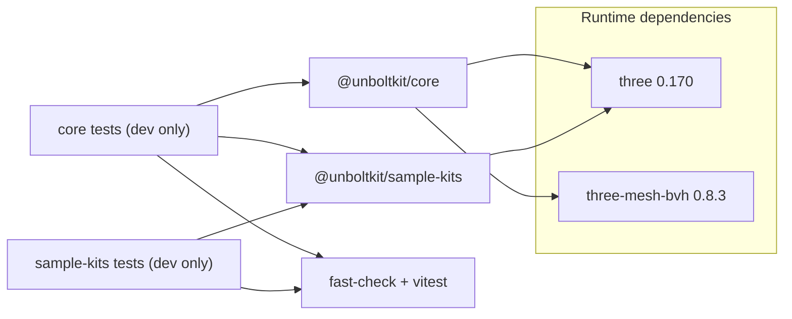
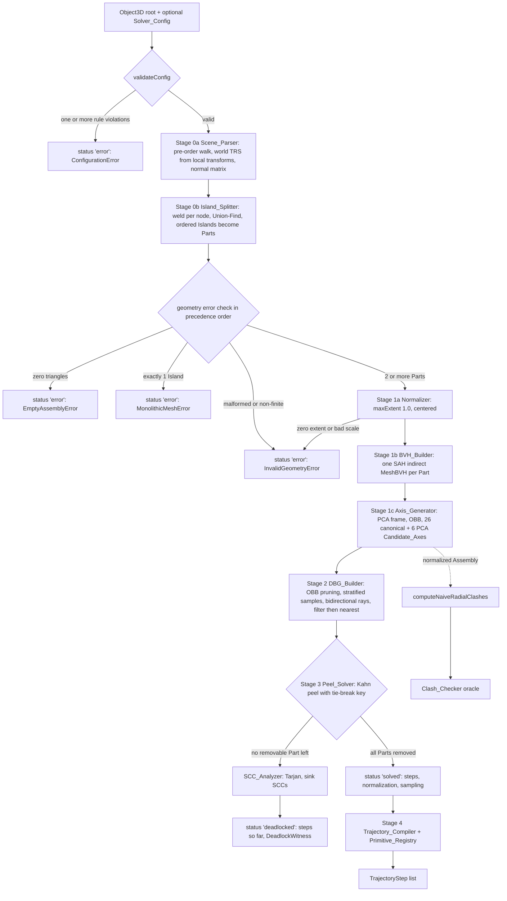

# Design Document: UnboltKit Core Engine

## Overview

This design covers `packages/unbolt-core` (`@unboltkit/core`) and `packages/sample-kits` (`@unboltkit/sample-kits`). Everything under `apps/*` and `tools/*` is out of scope.

The Core_Engine is a synchronous, pure-CPU TypeScript library. It takes a `THREE.Object3D` hierarchy and an optional Solver_Config and returns a plain-data Disassembly_Plan. The work runs in five stages:

| Stage | Components | Output |
|---|---|---|
| 0 | Scene_Parser, Island_Splitter | `Stage0Result`: mesh records, Parts, diagnostics, or a structured error |
| 1 | Normalizer, BVH_Builder, Axis_Generator | `Stage1Result`: normalized Parts with one SAH `MeshBVH`, a PCA frame, an OBB and 32 Candidate_Axes each |
| 2 | DBG_Builder (OBB pruning, stratified sampler, bidirectional rays, hit classifier) | `BlockingGraph` (plain data) |
| 3 | Peel_Solver, SCC_Analyzer | `DisassemblyPlan` (`solved` or `deadlocked`) |
| 4 | Primitive_Registry, Trajectory_Compiler, Naive_Baseline | `TrajectoryStep[]`, `NaiveBaselineResult` |

An independent Clash_Checker oracle sits beside the pipeline. It shares no sampling code and no PRNG with the DBG_Builder. Tests use it to check solver output, and the Naive_Baseline uses it to count clashes.

The Sample_Kits package builds five deterministic procedural assemblies in code: three showcase kits (65% Mechanical Keyboard, 3-Stage Planetary Gearbox, Haunted Clockwork Lockbox) and two Deadlock_Cages.

### Key design decisions

| # | Decision | Rationale |
|---|---|---|
| D1 | Every stage function is synchronous and returns its result directly. Only `three` and `three-mesh-bvh` are runtime dependencies. | Req 1. The same code runs in a Web Worker, Vitest and Node CI. |
| D2 | Public results (plans, witnesses, errors, trajectory steps, baseline) use only tuples, arrays, typed arrays and plain objects. `MeshBVH` and other `THREE` objects stay inside `Stage1Result`, which is never part of a public result. | Req 1.5, 1.6. |
| D3 | Each `MeshBVH` is built with `{ strategy: SAH, indirect: true }` over a private `BufferGeometry` whose `position` attribute is a `Float64Array`. | `indirect: true` leaves the index buffer untouched, so `faceIndex` is the Part-local triangle index (Req 9.10). `Float64Array` keeps ray-triangle tests in double precision. |
| D4 | Rays use `bvh.raycast(ray, DoubleSide, 0, Infinity)`, which returns every intersection. The engine computes hit normals from its own outward face-normal table, then applies filter-then-nearest. `raycastFirst` / `firstHitOnly` is never used. | Req 13.5, 13.6, 20.8, 20.9. Hits on back faces have to be visible so they can be classified and discarded. |
| D5 | The DBG is built once per solve. The Peel_Solver keeps a per-(Part, direction) count of unremoved blockers and decrements it as Parts are removed. | Blocking_Edges do not depend on which Parts have been removed (Req 14.1). This avoids recomputing the DBG on every iteration. |
| D6 | Each Part draws one stratified sample set of N samples per solve, from a PRNG substream keyed by `(seed, Part_ID)`. The set is reused for every direction and every partner. Ray sets are memoized by `(origin Part, target Part, exact direction bits)`, so the B-origin rays of `(A, B, d)` and the A-origin rays of `(B, A, −d)` are cast once. | Determinism (Req 3, 12.7). A Part's samples do not depend on how many other Parts exist. The memo is exact and roughly halves the canonical-direction ray work. |
| D7 | The Axis_Generator uses Jacobi eigen-decomposition, then the Intrinsic_Frame_Rule for tied eigenspaces, then a fixed fallback chain F1 → F2 → F3 for Frame_Ambiguous_Parts. Every frame records whether it is Frame_Unique, together with its smallest decision margin. | Req 9.5 to 9.9, 23.11, 27.8. Tests can then assert Frame_Unique status instead of assuming it. |
| D8 | The Clash_Checker lives in `src/oracle/`. It may import only `three`, `three-mesh-bvh`, the type definitions, and `math/vec3.ts` and `math/aabb.ts`. It has its own vertex-normal, ray-origin and hit-filter code. A static test walks its import graph. | Req 20.11. An oracle that shares classification code with the solver could not catch a classification bug. |
| D9 | Config errors, InvalidGeometryError, EmptyAssemblyError and MonolithicMeshError are returned as values. Violated internal invariants and misuse of a stage function called directly throw typed `Error` subclasses. | Req 6.7, 30.7, 12.8, 16.7, 18.7, 20.12, 20.13, 21.7. |
| D10 | Sample_Kits use no randomness at all. Every Part is a single connected Watertight_Solid_Part (closed, outward-wound, thicker than Micro_Shrink) with deliberate asymmetric outline features, minimum gaps of `1e-3 × maxExtent` between Parts, and minimum wall thickness of `1e-3 × maxExtent`. Each kit mesh records its Construction_Axis in `userData`, which the Core_Engine never reads. | Req 22, 23.6, 23.11, 23.12, 24, 29.2. These gaps and thicknesses survive any rotation from the SE3_Arbitrary. |
| D11 | The DBG_Builder can optionally collect per-triple Sample_Ray hit counts into a sorted plain-data `diagnostics` field. Collection is off by default and never changes edges or statistics. | Req 22.17, 22.18. The kit coverage diagnostic needs the counts, and the default solve output stays unchanged (Req 30.6). |
| D12 | The Full_Keyboard run count is parsed from `UNBOLT_FULL_KB_RUNS` by a test helper, never by solver code. | Req 25.10 to 25.12, 1.7. `src/` must not read `process` or any Node built-in. |

### Research findings

- **three-mesh-bvh 0.8.3** (checked in `node_modules/three-mesh-bvh/src`; upstream: [three-mesh-bvh on GitHub](https://github.com/gkjohnson/three-mesh-bvh)):
  - Default options are `strategy: CENTER, maxLeafTris: 10, indirect: false`. `SAH` is the constant `2`.
  - With `indirect: false`, building the BVH reorders the geometry's index buffer in place. With `indirect: true`, the BVH keeps a separate `_indirectBuffer`, and `raycast` reports `faceIndex` as the original triangle index (`intersectTri(geometry, …, vi, …)` with `vi = _indirectBuffer[i]`). This is why D3 uses indirect mode.
  - `raycast(ray, side, near, far)` collects every intersection in the BVH. `intersection.normal` is the interpolated vertex normal, flipped to face the ray, so it cannot be used as the outward hit normal. The engine looks up its own face normal by `faceIndex`.
  - Node bounds and per-triangle bounds are stored in `Float32Array` and padded outward by `FLOAT32_EPSILON` (see `computeBoundsUtils.js`). Traversal is therefore conservative. `getBoundingBox()` returns the padded float32 root box. Because the padding is outward, that box always contains the exact double AABB, and for normalized coordinates (`|x| <= 0.5`) it exceeds it by about `1e-7` at most, which is inside the `1e-6` bound of Req 9.2. A unit test checks both the containment and the `1e-6` bound on every kit Part.
  - The package root (`src/index.js`) exports GPU helper modules that build `DataTexture` objects, but nothing touches `window` or `document` when the module loads. A Node import check confirmed `typeof window === 'undefined'` after import.
- **Measured ray throughput** (this machine, Node v25.4.0, 10 cores, a 1,024-triangle SAH indirect BVH with a Float64 position attribute): building took about 8 ms. All-hit `raycast` with `DoubleSide` took about **2.1 µs per ray** when rays hit (average 1.6 hits) and about **0.15 µs per ray** when they missed the root box. The ray budget below uses these numbers.
- **fast-check 3.23.2** and **vitest 3.2.7** are installed. `fc.assert(prop, { seed, numRuns })` reports the seed, the replay `path`, the shrunk counterexample and the number of runs. Passing `{ seed, path }` replays the same counterexample ([fast-check docs](https://fast-check.dev/)). `fc.integer` accepts any safe-integer bounds, so `fc.integer({ min: 0, max: 0xFFFFFFFF })` covers the full seed range.
- **Algorithms used**: Kahn-style topological peeling; Tarjan's SCC algorithm, written iteratively so deep graphs cannot overflow the stack ([Tarjan 1972](https://doi.org/10.1137/0201010)); cyclic Jacobi eigenvalue iteration for symmetric 3×3 matrices, which is deterministic and accurate for near-degenerate spectra; and, only for fallback F3, the branchless orthonormal basis of [Duff et al. 2017, JCGT](https://jcgt.org/published/0006/01/01/).

## Architecture

### Package dependency graph



`@unboltkit/sample-kits` never imports `@unboltkit/core`. Kit tests that need solver functions (island counts, Fastener classification, thickness, cage clash checks) live in the core test suite, where the core package lists the kits as a dev dependency.

### Pipeline



`solveDisassembly()` runs the config check and Stages 0 to 3. Stage 4 and the Naive_Baseline are separate exported calls that take the plan and/or the `Stage1Result`. Calling the exported stage functions in order gives a deep-equal plan (Req 30.6), because `solveDisassembly()` is written as exactly that sequence.

### Determinism strategy

- The only randomness is in `stage2/sampler.ts`, which draws from `prng.ts`. The generator is `sfc32`, seeded through `splitmix32`. Each Part gets a substream with seed `splitmix32(config.seed ^ fnv1a32(partId))`, where `fnv1a32` hashes UTF-16 code units.
- Iteration order is fixed everywhere: Parts in ascending Part_ID by code unit (`a < b`, never `localeCompare`), directions by Candidate_Axes index, samples by stratum index, triangles by Part-local index. No result ever depends on `Map` or `Set` insertion order. Where a `Map` is used internally, its keys are sorted before anything iterates over it.
- Wall-clock APIs, `Math.random` and `crypto` are never used. A static scan test enforces this for both packages (Req 3.2).
- Floating-point work is ordered the same way on every run, so two runs on the same JS runtime give `Object.is`-equal numbers (Req 3.3).

### Performance and ray budget

**Full 65% keyboard sizing assumptions.** The default layout has 68 keycaps, 68 switches, a bottom case, a top frame, a plate, a PCB and 6 case screws, for **P = 146 Parts**. The triangle target is at most about 30,000 triangles. That leaves about 50% headroom under the 60,000-triangle showcase cap of Req 22.13 and keeps the stride at 1.

| Quantity | Estimate | Notes |
|---|---|---|
| Ordered `(A, B, d)` triples | 146 × 145 × 32 ≈ **677k** | Each one gets an OBB pruning test. The 1D test (Req 11.3) runs first, then a bounding-circle quick accept, then the exact 2D hull distance. Projected hulls are cached per (Part, canonical direction). Estimated total under 0.5 s. |
| Unpruned triples, keycaps and switches | 142 × 32 × about 9 partners ≈ 41k | ±Z pass through about 0 to 4 Parts. Lateral and diagonal directions pass through about 8 to 16 neighbors in the same row, plus the frame and case. |
| Unpruned triples, the 4 large Parts (case, frame, plate, PCB) | 4 × 32 × about 100 ≈ 13k | These Parts overlap most of the board in projection. |
| Ray sets, before memoization | 2 × 54k ≈ 108k sets × 48 rays ≈ **5.2M rays** | |
| Ray sets, after the D6 memo | about 60 to 65% of that ≈ **3.2 to 3.4M rays** | For the 26 canonical directions, the B-origin set of `(A, B, d)` is the A-origin set of `(B, A, −d)`. |
| Cost per ray | 0.15 µs (exact slab cull against the target OBB) to about 2 µs (BVH traversal with hits) | Measured (see Research). Most unpruned rays miss the target's actual triangles. |
| **DBG time per keyboard solve** | **about 1.5 to 5 s** | |
| Clash_Checker per keyboard plan (Invariant 1 oracle) | about 0.2 to 1 s | Exact swept-AABB culling of whole static Parts. About 40k welded vertices and centroids in total, almost all culled. |

With pruning disabled, the keyboard would need about 677k × 96 ≈ 65M rays, roughly 1 to 2 minutes per solve. Req 11.6 already excludes that run. Unpruned soundness checks run only on the two cages, the lockbox (about 12 Parts), the gearbox (about 25 Parts, about 3M rays) and the 2×3 Keyboard_Fixture (20 Parts, about 1.2M rays). Together they take a few seconds.

**Keyboard_Fixture sizing.** 6 keycaps, 6 switches, case, frame, plate, PCB and 4 case screws give 20 Parts, under 10,000 triangles (Req 22.14). With pruning, a solve casts roughly 0.2M to 0.5M rays, about **0.2 to 0.6 s** including the oracle check.

**What the property suite costs (CPU time, before parallelism, default `UNBOLT_FULL_KB_RUNS`):**

| Suite | Solves | Estimated CPU |
|---|---|---|
| Invariant 1, Full_Keyboard (Full_Keyboard_Run_Count = 10) | 10 | 20 s to 1 min |
| Invariant 2, Full_Keyboard (10 runs) | 10 transformed + 1 untransformed (memoized; the seed is fixed per property) | 20 s to 1 min |
| Invariant 4, Full_Keyboard (10 accepted subsets) | up to 20 (unmerged + merged per run) | 10 s to 2 min |
| Invariants 1 and 2, Keyboard_Fixture (100 runs each) | 200 + 1 | 1 to 2.5 min |
| Invariants 1 and 2, gearbox and lockbox (100 runs each) | 400 small solves | 1 to 3 min |
| Invariant 3, cages (100 runs per cage) | 200 tiny solves | under 30 s |
| Invariant 4, lockbox, gearbox, Keyboard_Fixture (100 accepted subsets each) | up to 600 small solves | 1 to 3 min |
| Kit sample-coverage diagnostic (all 5 kits + Keyboard_Fixture) | 6 DBG builds + oracle calls per candidate triple | 0.5 to 2 min (dominated by the Full_Keyboard) |
| Everything else | small generated assemblies | under 2 min |

The total is roughly **6 to 17 CPU-minutes**. Vitest runs each invariant per kit in its own file (`pool: 'forks'`), so on a 10-core machine the wall time is about **2 to 4 minutes**. Each additional Full_Keyboard run adds about 5 to 25 s of CPU across Invariants 1, 2 and 4, so `UNBOLT_FULL_KB_RUNS=100` (for example in a nightly job) adds about 8 to 40 CPU-minutes.

**Coverage diagnostic cost.** The diagnostic determines Expected_Blocking_Edges by running the Clash_Checker for every ordered pair `(A, B)` and every one of A's 32 Candidate_Axes, which is about 677k oracle calls on the Full_Keyboard. The oracle's exact swept-AABB cull rejects most of them before any ray is cast. The remaining roughly 50k calls cast a few hundred rays each, mostly culled by the per-ray slab test.

**Mitigations included in this design (none of them changes a requirement):**

1. Build the DBG once per solve and update it incrementally during peeling (D5).
2. Exact OBB pruning, an exact per-ray slab cull against the target OBB before calling the BVH, and exact swept-AABB culling in the Clash_Checker. Each cull only skips work whose result is provably "no hit", so outputs are unchanged.
3. Memoize ray sets across `(A, B, d)` and `(B, A, −d)` (D6).
4. Keep kits low-poly. Ray cost grows roughly with log(triangles), but the oracle's ray count grows linearly with vertices and triangles.
5. Inner loops allocate nothing: one reused `THREE.Ray`, scratch typed arrays, and no per-hit object allocation in engine code.
6. In Invariant 2, memoize the untransformed solve per kit. The test fixes the Solver_Config seed per property and draws only the SE3_Transform, so the untransformed solve has the same deterministic result in every run (Req 3.3).
7. A deterministic budget test asserts that `stats.raysCast` for the default keyboard solve stays at or below 6M. This catches cost regressions without timing anything.
8. The Full_Keyboard runs Full_Keyboard_Run_Count times per Invariant 1, 2 and 4 property (default 10), while the Keyboard_Fixture carries the 100-run coverage of the keyboard design (Req 25.2, 26.2, 27.1, 29.3).

### Source layout

```text
packages/unbolt-core/
  package.json            # "@types/three" moves to devDependencies (Req 1.1)
  tsconfig.json           # include ["src", "test"]
  vitest.config.ts        # environment 'node', no setupFiles, pool 'forks', globalSetup test/helpers/fullKeyboardRuns.global.ts
  src/
    index.ts              # public exports + UNBOLT_CORE_VERSION
    types.ts              # all public plain-data types
    config.ts             # DEFAULT_SOLVER_CONFIG, validateConfig, resolveConfig
    errors.ts             # structured error builders + thrown Error subclasses
    prng.ts               # sfc32, splitmix32, fnv1a32, substream()
    pipeline.ts           # solveDisassembly()
    math/
      vec3.ts             # tuple vector helpers (no THREE)
      aabb.ts             # AABB build, union, slab tests
      eigen3.ts           # cyclic Jacobi for symmetric 3x3
      hull2d.ts           # monotone-chain hull, convex polygon distance
      onb.ts              # Duff et al. basis (pruning plane basis; frame fallback F3)
    stage0/
      sceneParser.ts      # traversal, world matrices, normals, validation
      weld.ts             # spatial-hash welding
      unionFind.ts
      islandSplitter.ts   # Islands to Parts, Part_IDs
      stage0.ts           # stage0ParseScene(): composes the above + error precedence
    stage1/
      normalizer.ts
      bvhBuilder.ts
      axisGenerator.ts    # PCA, Intrinsic_Frame_Rule, fallback, OBB
      candidateAxes.ts    # CANONICAL_DIRECTIONS + per-Part assembly
      partMetrics.ts      # slenderness, Fastener classification (shared by stages 3 and 4)
      stage1.ts           # stage1Prepare()
    stage2/
      obbPruning.ts
      sampler.ts          # stratified sampler (the ONLY importer of prng.ts)
      rayCast.ts          # castAllHits(): wraps MeshBVH.raycast(DoubleSide)
      hitFilter.ts        # DBG filter-then-nearest
      dbgBuilder.ts       # stage2BuildDbg(), optional per-triple ray-count collector
    stage3/
      escapeDistance.ts
      tieBreak.ts         # key computation + tolerance cascade
      peelSolver.ts       # runPeel() (with optional trace) + stage3Peel()
      tarjan.ts           # iterative Tarjan
      sccAnalyzer.ts      # sink-SCC witness
    stage4/
      trajectoryCompiler.ts  # stage4Compile()
      naiveBaseline.ts       # computeNaiveRadialClashes()
    primitives/
      types.ts            # MotionPrimitive, Pose, params types
      se3.ts              # pose math (rotation about axis, compose)
      registry.ts         # createPrimitiveRegistry(), createDefaultPrimitiveRegistry()
      linearSlide.ts
      helicalUnscrew.ts
      twoStepLSlide.ts
    oracle/
      clashChecker.ts     # checkClashes(); imports only three, three-mesh-bvh, ../types, ../math/vec3, ../math/aabb
  test/
    arbitraries/          # se3.ts (THE shared SE3_Arbitrary), assemblies.ts (watertight generator), hierarchies.ts, configs.ts, graphs.ts, primitives.ts
    helpers/              # snapshot.ts (mutation checks), applySe3.ts, failWith.ts, fullKeyboardRuns.ts (+ .global.ts), watertight.ts, kitGeometry.ts, reference/ (brute-force raycaster, SCC reference, escape reference)
    static/               # purity.test.ts, clash-independence.test.ts, no-swallow.test.ts, determinism-sources.test.ts
    unit/                 # example and edge-case tests per component
    properties/           # *.property.test.ts per component
    kits/                 # cross-package kit guarantees (islands, thickness, watertightness, gaps, frames, PCA tilt, fasteners, cages, sample coverage)
    invariants/           # invariant{1,2,4}-<kit>.property.test.ts for each Invariant_Kit (lockbox, gearbox, keyboard-fixture, full-keyboard), invariant3-cages.property.test.ts
packages/sample-kits/
  package.json            # add "test": "vitest run"; devDependencies vitest, fast-check
  vitest.config.ts
  src/
    index.ts              # Kit_Builder exports + KIT registry + KEYBOARD_FIXTURE_LAYOUT
    shared/               # params.ts (validation), naming.ts, materials.ts, geometry.ts (ensureIndexed, dropCollapsedTriangles, outline helpers, gear outline, keyed lathe screw), constructionAxis.ts
    keyboard65.ts
    planetaryGearbox.ts
    hauntedLockbox.ts
    cageDumbbellRing.ts
    cageShipInBottle.ts
  test/                   # determinism, structure, naming, materials, params, budgets, no-DOM
```

### Package manifest changes

- `@unboltkit/core`: move `@types/three` from `dependencies` to `devDependencies`, so `dependencies` is exactly `three` and `three-mesh-bvh` (Req 1.1). Add `"@unboltkit/sample-kits": "*"` to `devDependencies` (npm workspace link). Keep `fast-check`, `vitest` and `typescript` in devDependencies. Keep `"test": "vitest run"`.
- `@unboltkit/sample-kits`: keep `three` and `@types/three` (Req 22.6 allows types). Add devDependencies `vitest` and `fast-check`. Add `"test": "vitest run"`.
- The root `npm test` already runs `--workspaces --if-present`, so both suites run there.

## Components and Interfaces

### Configuration (`config.ts`)

```ts
export interface SolverConfig {
  weldTolerance?: number | undefined;
  microShrink?: number | undefined;
  clearanceEpsilon?: number | undefined;
  tau?: number | undefined;
  samplesPerPartPerDirection?: number | undefined;
  fastenerSymmetryTolerance?: number | undefined;
  fastenerSlendernessThreshold?: number | undefined;
  helicalAngularToleranceDeg?: number | undefined;
  threadPitch?: number | undefined;
  seed?: number | undefined;
}
export type ResolvedSolverConfig = { readonly [K in keyof SolverConfig]-?: number };
export const DEFAULT_SOLVER_CONFIG: ResolvedSolverConfig;
export function validateConfig(input: unknown): { ok: true; config: ResolvedSolverConfig } | { ok: false; error: ConfigurationError };
```

**Defaults.** Req 2.12 and 2.10 fix the first five. This design chooses the rest.

| Field | Default | Unit / meaning | Why |
|---|---|---|---|
| `samplesPerPartPerDirection` | `48` | rays per Part per direction | Fixed by Req 2.12 |
| `microShrink` | `1e-4` | normalized units | Fixed by Req 2.12 |
| `clearanceEpsilon` | `5e-5` | normalized units | Fixed by Req 2.12. Satisfies `< microShrink`. |
| `tau` | `0.05` | dot-product threshold | Fixed by Req 2.12 |
| `helicalAngularToleranceDeg` | `5` | degrees | Fixed by Req 2.10 |
| `weldTolerance` | `1e-6` | fraction of the Assembly world AABB diagonal | Float32 source data rounds at about 6e-8 relative, and kit duplicates are bitwise copies (LatheGeometry seams differ by about 1e-16). Kit gaps are at least 1e-3, so the margin to the nearest unrelated vertex is 1000×. |
| `fastenerSymmetryTolerance` | `0.1` | relative: `abs(e2 − e3) <= tol × max(e2, e3)` over the two shorter OBB full extents | A relative test does not depend on scale. 10% accepts keyed screw heads (see the kits section) and rejects plates, keycaps, gears and PCBs, whose two shorter extents differ by more than 50%. |
| `fastenerSlendernessThreshold` | `2.0` | ratio | Kit screws measure 2.4 to 2.8. Keycaps, switches and gears measure at most about 1.6. The spacebar is slender (about 9.4) but fails the symmetry test. |
| `threadPitch` | `0.01` | normalized units per revolution | A typical keyboard screw escape distance of about 0.03 gives about 3 visible turns. The real M2 pitch (about 0.0012 normalized) would give about 25 turns, which is too fast to read. |
| `seed` | `0x5EED2027` (= 1592598567) | uint32 | A fixed constant, exported as `DEFAULT_SEED` (Req 3.7). |

**Validation.** `validateConfig` never mutates its input and never throws.
- `undefined` (or an omitted argument) means "all defaults". `null` or a non-object input gives one issue with field `"(config)"`.
- For each known key, a value of `undefined` means "use the default". Otherwise the rules of Req 2.4 to 2.10 apply. A value whose `typeof` is not `'number'` always violates its rule.
- Req 2.6 (`clearanceEpsilon >= microShrink`) is checked only when both values pass Req 2.5. It then adds one issue with `fields: ['clearanceEpsilon', 'microShrink']`.
- Unknown keys are ignored, and the TSDoc says so.
- All issues are collected, sorted by field name, and returned as one `ConfigurationError` (Req 2.11). The rejected value is stored as a deterministic string (`formatRejected(value)`: `"NaN"`, `"Infinity"`, `"-0"`, `JSON.stringify` for primitives, `"[object]"`/`"[function]"` for others). This keeps the error plain data.

### Seeded PRNG (`prng.ts`)

```ts
export interface Prng { nextUint32(): number; nextFloat(): number /* [0, 1) = u32 / 2^32 */ }
export function createPrng(seed: number): Prng;              // sfc32 state from splitmix32(seed)
export function substreamSeed(seed: number, key: string): number; // splitmix32(seed ^ fnv1a32(key)) >>> 0
```

Only `stage2/sampler.ts` imports this module. The static independence test checks that `oracle/clashChecker.ts` cannot reach it.

### Stage 0a: Scene_Parser (`stage0/sceneParser.ts`)

```ts
export interface MeshRecord {
  nodePath: number[];          // child indices from the provided root ([] = root itself)
  nodeName: string;
  worldMatrix: number[];       // 16, column-major, computed fresh
  positions: Float64Array;     // world-space, 3 per source vertex
  normals: Float64Array;       // world-space unit normals per source vertex, or per-corner derived normals (see below)
  normalsDerived: boolean;
  triangles: Uint32Array;      // 3 per triangle, source vertex indices; non-indexed => 3k, 3k+1, 3k+2
  windingFlipped: boolean;     // det(worldMatrix) < 0
}
export function parseScene(root: Object3D): { meshes: MeshRecord[]; diagnostics: Diagnostic[]; invalid: InvalidGeometryIssue[] };
```

- **Traversal** (Req 4.1). An iterative stack visits nodes in pre-order, with children in ascending index order. `visible` is ignored. A node counts as a mesh when `(node as Mesh).isMesh === true`. For `InstancedMesh` and `SkinnedMesh`, the base geometry is used with the node's own transform, and a diagnostic of code `instancing-ignored` or `skinning-ignored` is added.
- **World matrix** (Req 4.2). `W(node) = W(parent) · compose(position, quaternion, scale)`, starting from the provided root's own local transform. Fresh `Matrix4` instances are used. `matrixWorld` is never read and `updateMatrixWorld` is never called, so the parser does not mutate anything (Req 4.7).
- **Positions and normals** (Req 4.3, 4.4). `p' = W · p`. `n' = normalize(N · n)` with `N = inverse(transpose(upper3x3(W)))`, computed with `Matrix3.getNormalMatrix`. Attributes are read through `getX/getY/getZ`, which handles interleaved and normalized attributes. `drawRange`, `groups` and morph targets are ignored, and the TSDoc says so.
- **Winding.** If `det(W) < 0`, the corner order of every triangle is changed from (a, b, c) to (a, c, b) when building Parts. This keeps face normals outward after a mirroring transform. `sourceTriangleIndices` still reports the original triangle indices.
- **Exclusions** (Req 4.6). A non-Mesh node, or a Mesh with 0 triangles, gets a diagnostic `{ code: 'excluded-node', nodePath, nodeType }`. Its children are still visited.
- **Missing normals** (Req 4.10). The parser derives one unit normal per triangle from the CCW winding in world space, after the winding correction, and stores it on all three corners. It adds `{ code: 'derived-normals', nodePath }`. A zero-area triangle gets a derived normal of `[0, 0, 0]`. Its normal is not used anywhere, because zero-area triangles are never sampled or used as ray sources.
- **Validation** (Req 4.9, 5.10, 6.5). The whole tree is checked before anything returns:
  - missing `position` attribute, index count not a multiple of 3, non-indexed position count not a multiple of 3, or an index ≥ the vertex count: `malformed` issue;
  - any non-finite source or world component of a position or normal: `non-finite` issue.

  Issues are collected for every mesh node in traversal order.

### Stage 0b: Island_Splitter (`stage0/weld.ts`, `unionFind.ts`, `islandSplitter.ts`)

```ts
export function splitIslands(meshes: MeshRecord[], weldTolerance: number): Part[];
```

1. **Weld radius.** `h = weldTolerance × diag`, where `diag` is the length of the world AABB diagonal over every vertex referenced by any triangle in the Assembly.
2. **Welding per mesh node** (Req 5.1, 5.2, 5.5). Vertices are inserted in ascending source index into a spatial hash with cell size `h`. Integer cell keys are packed into a string key, and lookups happen in index order. Each vertex is compared with the vertices in the 27 neighboring cells and unioned with every one at distance `<= h`. Union-Find makes the relation transitive. When `h = 0`, the hash keys are exact coordinates (with `-0` mapped to `0`), so only identical positions weld. Nodes are never welded to each other.
3. **Triangle connectivity** (Req 5.3). For each triangle, including zero-area ones, its three corner vertices are unioned.
4. **Islands** (Req 5.4, 5.6 to 5.9). Triangles are grouped by the Union-Find root of their first corner. Islands are ordered by their smallest triangle index and numbered from 0. Each Island becomes one `Part`:
   - `partId = "/" + nodePath.join("/") + "#" + islandIndex`. The root mesh is `"/#0"`. A mesh at child path [0, 3] is `"/0/3#1"`. Names, `uuid` and `id` are not used (Req 3.4).
   - Triangles are stored in ascending source triangle order.
   - Part-local vertices are the distinct source vertices those triangles reference, in ascending source index. `weldIds` maps each local vertex to its weld cluster. `weldRepresentatives` holds the smallest-index member of each cluster.
5. Union-Find uses union by rank with path halving, and the smaller root always becomes the representative. Any partition-dependent choice is therefore made by smallest index.

### Stage 0 composition and error precedence (`stage0/stage0.ts`, `pipeline.ts`)

```ts
export function stage0ParseScene(root: Object3D, config?: SolverConfig): Stage0Result | ErrorResult;
```

The order of checks follows Req 6.6:
1. `validateConfig`. On failure, return ConfigurationError and do not read any geometry.
2. `parseScene`. If any issue was found, return InvalidGeometryError with `nodePaths` = every offending mesh path in traversal order. `reason` is `'non-finite'` when any non-finite issue exists, otherwise `'malformed'`.
3. If no mesh has a triangle, return EmptyAssemblyError (with diagnostics).
4. `splitIslands`. If the result is exactly 1 Part, return MonolithicMeshError `{ totalTriangles, nodePath, message }`.
5. Otherwise return `Stage0Result { parts, meshes, diagnostics, totalTriangles, sampling }`.

`computeSamplingMetadata(totalTriangles)` returns `{ stride: T <= 150000 ? 1 : ceil(T / 150000), polyBudgetExceeded: T > 150000, totalTriangles, polyBudget: 150000 }` (Req 7.1 to 7.3). It is a pure function, so it can be property-tested without building huge meshes.

### Stage 1a: Normalizer (`stage1/normalizer.ts`)

- The AABB covers all Part positions. `maxExtent = max(size.x, size.y, size.z)`.
- `maxExtent === 0` gives InvalidGeometryError `reason: 'zero-extent'`. If `scale = 1 / maxExtent` is not finite or not `> 0` (for example a subnormal extent), the result is `reason: 'non-finite-scale'` (Req 8.6, 8.7).
- `translation = −center × scale`. Each component is normalized as `q = p × scale + translation[k]`, always computed in that order. The inverse is `p = (q − translation[k]) / scale` (Req 8.5).
- The Normalizer writes new `Float64Array`s. Areas scale by `scale²`. Face normals do not change, because the transform is a uniform positive scale plus a translation.

### Stage 1b: BVH_Builder (`stage1/bvhBuilder.ts`)

- For each Part, it creates a private `BufferGeometry` with `position = new BufferAttribute(normalizedPositions /* Float64Array */, 3)` and `index = new BufferAttribute(triangles /* Uint32Array */, 1)`. It then builds `new MeshBVH(geom, { strategy: SAH, indirect: true, maxLeafTris: 10, setBoundingBox: false, verbose: false })`.
- If construction throws, the error is rethrown as `Stage1FailureError { partId, component: 'BVH_Builder', cause }`. Nothing is swallowed (Req 9.11, 25.5).
- The BVH's root box is float32 and padded outward. It therefore contains the exact float64 AABB on every coordinate and exceeds it by at most `1e-6` per coordinate, as Req 9.2 requires (about `1e-7` in practice for normalized coordinates). After building, `bvhBuilder.ts` checks both conditions against `part.aabb` and throws `Stage1FailureError { component: 'BVH_Builder' }` if either fails, so a future library change cannot silently break the guarantee. The exact double AABB is stored separately as `part.aabb`, and every test that needs exact bounds uses `part.aabb`.

### Stage 1c: Axis_Generator (`stage1/axisGenerator.ts`, `candidateAxes.ts`)

```ts
export interface PartFrame {
  axes: [Vec3, Vec3, Vec3];          // PCA1, PCA2, PCA3 (right-handed)
  variances: [number, number, number];
  centroid: Vec3;
  obb: { center: Vec3; halfExtents: Vec3 };  // aligned to axes
  frameUnique: boolean;              // Frame_Unique_Part per glossary
  minRelativeMargin: number;         // smallest decision margin (for diagnostics/tests)
  decisions: FrameDecision[];        // which rule fixed each axis and sign: 'eigen' | 'farthest' | 'largest-face' | 'skew' | 'farthest-sign' | 'F1' | 'F2' | 'F3'
}
```

**Vertex set.** The frame uses the weld-cluster representatives of the Part, in normalized coordinates and in cluster order. This makes the frame the same whether the mesh is indexed or has duplicated corners.

**Algorithm:**
1. Compute the centroid `c` and the covariance `C = mean((v − c)(v − c)ᵀ)` in two passes. Run cyclic Jacobi (at most 64 sweeps, stopping when the off-diagonal sum is 0 or below `1e-300`) to get eigenvalues `λ1 >= λ2 >= λ3` with their eigenvectors.
2. **Tie detection.** Walk the sorted eigenvalues from the top and grow a group while every pair in the group differs by at most `1e-9 × λ1`. If `λ1 = 0`, all three values form one group (all vertices coincide). If a gap between neighbors is above `1e-9 × λ1` but below `1e-6 × λ1`, the eigenvectors are still used, but `frameUnique` is set to false.
3. **Untied eigenvalues.** Use the eigenvector directly. Its sign is decided in step 6.
4. **Tied group of dimension k ≥ 2** (Req 9.5). Let `S` be the group's subspace. Repeat while `dim(S) >= 2`:
   1. **Farthest vertex.** Measure each vertex by its distance from `c` projected into `S`: `r(v) = |P_S(v − c)|`. Let `rmax` be the largest value. The candidates are every vertex with `r >= rmax − 1e-9 × rmax`. Score each candidate by the sum of the areas of the triangles that touch its weld cluster, and keep those within `1e-9` (relative) of the best score. The direction is `u = normalize(Σ P_S(v − c))` over the remaining candidates. The sum does not depend on the order of the candidates, so vertex index order never decides the result.
   2. If `|Σ| <= 1e-9 × rmax`, or if `rmax = 0`, use the largest-area-face step instead. Take every triangle whose area is within `1e-9` (relative) of the largest area, sum their unit outward normals, and project the sum into `S`.
   3. If both projections are at most `1e-9` in length, the Part is a **Frame_Ambiguous_Part**. Go to the fallback chain.
   4. Otherwise the normalized projection is the next axis. Remove it from `S` and continue. When `dim(S)` reaches 1, the last axis comes from cross products.
5. **Fallback chain for Frame_Ambiguous_Parts** (Req 9.5, last bullet). The remaining axes of `S` are found from the first vector, in this order, whose projection into `S` has length above `1e-9` normalized units:
   - **F1.** The Part's own vertices in triangle order (triangle 0 corners a, b, c, then triangle 1, …), each as `v − c`.
   - **F2.** The other Parts' vertices, taken in ascending Part_ID order and then in triangle order, each as `w − c`. This case occurs when the Part is collinear or coincident but the Assembly is not.
   - **F3.** Reached only when F1 and F2 both fail, which happens only in an All_Collinear_Assembly. Take the line direction `ℓ`, which an earlier step derived from the vertices, and complete the frame with the Duff et al. orthonormal basis of `ℓ`. **This is the explicit and sole exemption of Req 9.7.** It is the only place where world-frame components can affect a frame. Before using F3, the Axis_Generator confirms that the Assembly is an All_Collinear_Assembly: every vertex of every Part lies within `1e-9` (normalized units) of the line through the Part centroid along `ℓ`. F2 rejects a vector only when its projection into `S` is at most `1e-9` normalized units long, so reaching F3 already implies this condition, and the check is an invariant assertion: if it ever fails, the Axis_Generator throws `Stage1FailureError { component: 'Axis_Generator' }` instead of using F3, so the exemption cannot reach any other Assembly. Inside `stage1/`, only the F3 branch of `axisGenerator.ts` may call `math/onb.ts`, and a static test checks this.

   F1 and F2 do not change meaning under SE(3), because triangle order and Part_IDs move with the geometry. They are still flagged as ambiguous, because Req 9.8 does not cover them.
6. **Signs** (Req 9.6). For PCA1 and then PCA2:
   1. Compute the third central moment `m3 = mean(((v − c)·a)³)`. If `|m3| > 1e-9 × σ³`, choose the sign that makes `m3 > 0`.
   2. Otherwise, choose the sign that makes `a · u0 > 0`, where `u0` is the step 4.1 farthest-vertex direction computed over the full 3D space.
   3. If `|a · u0| <= 1e-9`, use the first fallback vector (F1 then F2) with a non-zero dot product, and mark the Part Frame_Ambiguous.

   Set `PCA3 = PCA1 × PCA2`.
7. **Frame_Unique test.** The Part is Frame_Unique when no fallback was used and every comparison actually made had a relative margin of at least `1e-6`. Margins are measured relative to `λ1` for eigenvalue gaps, `σ³` for skew, and `rmax` for candidate selection and projection lengths. `minRelativeMargin` records the smallest of these.
8. **OBB** (Req 9.4). Project every vertex onto each axis and take the min and max: `center = c + Σ ((min_i + max_i) / 2) a_i` and `halfExtents_i = (max_i − min_i) / 2`. Values are computed in double precision with no padding.
9. Any non-finite component gives `Stage1FailureError { component: 'Axis_Generator' }` (Req 9.11).

**Candidate_Axes** (Req 10). `CANONICAL_DIRECTIONS` is a frozen array of 26 unit vectors, each built as `[x, y, z] / length` with exact constants (`Math.SQRT1_2`, `1 / Math.sqrt(3)`):

| Index | Vectors (before normalization) |
|---|---|
| 0 to 5 | +X, −X, +Y, −Y, +Z, −Z |
| 6 to 17 | (+1,+1,0), (+1,−1,0), (−1,+1,0), (−1,−1,0), (+1,0,+1), (+1,0,−1), (−1,0,+1), (−1,0,−1), (0,+1,+1), (0,+1,−1), (0,−1,+1), (0,−1,−1) |
| 18 to 25 | (+,+,+), (+,+,−), (+,−,+), (+,−,−), (−,+,+), (−,+,−), (−,−,+), (−,−,−) |
| 26 to 31 | +PCA1, −PCA1, +PCA2, −PCA2, +PCA3, −PCA3 |

Negating an entry gives the exact constant of its opposite entry. This is what makes the bitwise direction keys in D6 work.

### Part metrics (`stage1/partMetrics.ts`)

- `extentsSorted = sort(2 × halfExtents)` gives `e1 >= e2 >= e3`.
- `slenderness = (e2 + e3 === 0) ? +Infinity : e1 / ((e2 + e3) / 2)` (Req 15.5).
- `isFastener = abs(e2 − e3) <= tolSym × max(e2, e3) && slenderness >= tolSlender`.

Stage 3 (tie-break) and Stage 4 (helical applicability) both use these helpers.

### Stage 2: DBG_Builder

```ts
export interface DbgOptions {
  obbPruning?: boolean;          // default true; false is for tests (Req 11.4, 11.6)
  collectRayCounts?: boolean;    // default false; true adds `diagnostics` to the result (Req 22.17, 22.18)
}
export function stage2BuildDbg(stage1: Stage1Result, config: ResolvedSolverConfig, options?: DbgOptions): BlockingGraph;
```

`stage2BuildDbg` throws `InvalidSampleCountError` when `samplesPerPartPerDirection` is not an integer `>= 1` (Req 12.8). This happens before any sampling or ray casting.

**OBB pruning (`obbPruning.ts`, Req 11).** For the ordered pair `(A, B)` and direction `d` taken from A's Candidate_Axes:
1. **Along `d`:** `[minA, maxA]` and `[minB, maxB]` from `center·d ± Σ h_i |a_i·d|`. If `maxB < minA − 1e-9`, the pair is pruned (Req 11.3).
2. **In the plane perpendicular to `d`:** build a plane basis `(u, v)` from `onb(d)`. Any orthonormal basis gives the same distances. Project the 8 OBB corners, compute convex hulls (monotone chain, which handles hulls that collapse to a segment or a point), and compute the **exact Euclidean distance** between the two hulls: 0 if a SAT test over all hull edge normals finds overlap, otherwise the minimum over all vertex-to-edge distances. If the distance is `> 1e-9`, the pair is pruned (Req 11.2). The exact distance matters: an edge-normal SAT gap alone underestimates the gap between two corners facing each other, which would miss prunes that Req 11.2 requires.
3. Projected hulls are cached per (Part, canonical direction index). Hulls for PCA directions are computed on demand.

*Soundness argument (Req 11.4).* The guarantee is stated only for Assemblies whose Parts are all Watertight_Solid_Parts: closed, outward-wound, and thicker than the active Micro_Shrink everywhere. Every ray origin is a surface point moved inward by `microShrink` against the outward normal. For a Watertight_Solid_Part, that origin is inside the solid. The solid lies inside its convex hull, which lies inside its OBB. A ray along `±d` keeps its perpendicular projection fixed and only moves forward along `d`. So when the projected OBBs are separated, or B lies wholly behind A, no A-origin or B-origin ray can reach the other Part, and the `1e-9` margins of Req 11.2 and 11.3 apply unchanged. Kits meet the precondition by construction (Req 22.16, checked by a kit test), and the generator used for Req 11.7 produces only Watertight_Solid_Parts (see Testing Strategy, Generators). For user meshes that are open, inward-wound or thinner than Micro_Shrink, pruning still runs with the same margins, but soundness is not guaranteed, and the TSDoc of `stage2BuildDbg` says so.

**Stratified sampler (`sampler.ts`, Req 12.4, 7.4, 13.1, 13.9).**
- The eligible triangles of a Part are those whose local index is a multiple of the stride. Cumulative areas are summed in double precision in index order. If the eligible area is 0, the Part has no samples and casts no rays, and `stats.zeroAreaParts` counts it.
- The Part's PRNG is `createPrng(substreamSeed(seed, partId))`. For each stratum `i = 0..N−1`, three values `r0, r1, r2` are drawn in that order:
  - `x = (i + r0) × total / N`;
  - the triangle is the first `k` with `cum[k] > x`, found by binary search (zero-width ranges can never be chosen), clamped to the last triangle with positive area;
  - `s = sqrt(r1)`, and the barycentric coordinates are `(1 − s, s(1 − r2), s·r2)`.
- `origin = point − microShrink × faceNormal[k]`. The sample set stores `originX/Y/Z: Float64Array` and `sourceTri: Uint32Array`.

**Ray casting and hit filtering (`rayCast.ts`, `hitFilter.ts`, Req 13).**
- `castAllHits(bvh, origin, dir, out)` reuses one `THREE.Ray`. Before calling `bvh.raycast(ray, DoubleSide, 0, Infinity)`, it runs a slab test against the target's exact AABB expanded by `1e-9`. Every hit point lies on a triangle inside that box, so a ray that misses the box can be skipped without changing any result.
- `filterNearest(hits, dir, targetFaceNormals, eps, tau)` drops hits with `distance < eps` (Req 13.2) and hits with `dot(n, dir) >= −tau` (Req 13.3), then returns the nearest remaining hit, breaking equal distances by the lower triangle index. Own-Part hits cannot occur, because each ray is cast only into the other Part's BVH and pairs `(A, A)` are never evaluated (Req 13.8). Grazing and coincident hits in front of a farther opposing hit therefore never hide it (Req 13.6).

**Pair evaluation (`dbgBuilder.ts`, Req 12.1 to 12.6).**

```text
for A in parts (ascending Part_ID):
  for k in 0..31: d = A.candidateAxes[k]
    for B in parts (ascending Part_ID), B != A:
      if pruning enabled and pruned(A, B, d): stats.pruned++; continue
      fwd = raySet(A -> B, +d)   // A samples cast into B.bvh along +d
      bwd = raySet(B -> A, -d)   // B samples cast into A.bvh along -d
      if fwd.collisions or bwd.collisions not empty:
        edge(A, B, k, d,
             fromTriangles = sortedUnique(fwd.sourceTris U bwd.hitTris),
             toTriangles   = sortedUnique(fwd.hitTris U bwd.sourceTris))
```

`raySet(X -> Y, dir)` is memoized under the key `X.partId | Y.partId | float64 bits of dir`. It returns `{ sourceTris, hitTris, collidingRays }` for the rays that produced an Opposing_Normal_Collision, each classified against `dir`. `collidingRays` is the number of those rays (each ray counts once, at its nearest surviving hit). Each pair casts exactly N rays per side (Req 12.1, 12.2), unless the source Part has zero eligible area. Memoization only reuses identical rays, so counts taken from a memoized set equal the counts of a fresh cast.

**Ray-count collector (D11, Req 22.17, 22.18).** When `collectRayCounts` is true, every unpruned triple `(A, B, k)` whose combined count is at least 1 gets one record `{ from: A, to: B, dirIndex: k, forwardRays: fwd.collidingRays, backwardRays: bwd.collidingRays }`. A triple that has no record had 0 colliding Sample_Rays, either because it was pruned or because no ray collided, and `prunedTriples` lists the pruned ones so that the diagnostic can tell the two cases apart. The records are plain data, sorted by `(from, dirIndex, to)`, and built from the same deterministic loop as the edges. Collection only reads values that the loop already computes: it casts no extra rays and leaves `edges` and `stats` unchanged. When the option is false (the default, and always inside `solveDisassembly`), the `diagnostics` field is absent, so the default output and the pipeline-chaining equality of Req 30.6 do not change.

**Output.**

```ts
interface BlockingGraph {
  partIds: string[];                    // ascending
  candidateAxes: Record<string, Vec3[]>; // per Part, 32 entries (plain object with sorted keys)
  edges: BlockingEdge[];                 // sorted by (from, dirIndex, to)
  stats: { pairsTested: number; pairsPruned: number; raysCast: number; zeroAreaParts: number };
  diagnostics?: {                        // present only when collectRayCounts is true
    rayCounts: { from: string; to: string; dirIndex: number; forwardRays: number; backwardRays: number }[];
    prunedTriples: { from: string; to: string; dirIndex: number }[];
  };
}
```

### Stage 3: Peel_Solver and SCC_Analyzer

```ts
export function stage3Peel(stage1: Stage1Result, graph: BlockingGraph, config: ResolvedSolverConfig): SolvedPlan | DeadlockedPlan;
export function runPeel(input: PeelInput, config: ResolvedSolverConfig, opts?: { trace?: boolean; verifyStep?: StepVerifier }): { plan: SolvedPlan | DeadlockedPlan; trace?: PeelTrace };
// stepVerifier.ts (Req 14.11)
export type StepVerifier = (request: { partId: string; dirIndex: number; dir: Vec3; unremovedPartIds: readonly string[] }) => BlockingEdge[];
export function createStepVerifier(parts: readonly NormalizedPart[], config: Pick<ResolvedSolverConfig, "microShrink" | "clearanceEpsilon" | "tau">): { verify: StepVerifier; stats: StepVerifierStats };
```

`PeelInput` holds only plain data: per-Part AABB, OBB center and extents, Fastener flag, Candidate_Axes, and the edges. It can therefore be built straight from synthetic graphs in property tests.

**State.** `blockers[A][k]` counts the distinct unremoved Parts B that have an edge `(A, B, k)`. `edgesByBlocker[B]` lists the `(A, k)` entries to decrement when B is removed.

**Iteration** (Req 14.1, 14.2, 14.11):
1. `removable = { A unremoved : exists k with blockers[A][k] = 0 }`.
2. If `removable` is empty while Parts remain, go to the SCC_Analyzer.
3. Otherwise, for each removable A, compute its metrics against the current unremoved set (Req 15.4):
   - **Escape_Distance** for each unblocked axis (`escapeDistance.ts`). Let `U` be the AABB union of the other unremoved Parts. For each axis component `j` with `d_j != 0`: `s_j = (U.max_j − A.min_j) / d_j` if `d_j > 0`, and `(A.max_j − U.min_j) / (−d_j)` if `d_j < 0`. The escape distance is `max(0, min_j s_j)`, or `0` when A's AABB already misses U on some axis, or `0` when A is the only Part left (Req 14.8). Per-axis top-2 and bottom-2 extremes are tracked so that `U` excluding A costs O(1).
   - **Direction** (Req 14.3): compute `m = min` escape distance over the unblocked axes. Every unblocked axis whose escape distance is at most `m + 1e-9` counts as identical, and the one with the lowest Candidate_Axes index is chosen. The comparison is always against the single minimum `m`, never pairwise, so the choice cannot depend on iteration order.
   - **Radial_Exposure:** `|obbCenter(A) − mean(obbCenter(all unremoved, including A))|`.
   - **Slenderness** and **Fastener** from `partMetrics`.
4. **Selection** (`tieBreak.ts`, Req 15.1, 15.3, 15.7) uses the per-component **tolerance cascade**. Let `C` = the removable Parts.
   1. **(a) Fastener**, compared exactly: if any Part in `C` is a Fastener, keep only the Fasteners.
   2. **(b) Slenderness**: let `best = max` over `C`. If `best = +Infinity`, keep exactly the Parts whose slenderness is `+Infinity` (this avoids `Infinity − Infinity = NaN`). Otherwise keep the Parts with `best − value <= 1e-9`.
   3. **(c) Radial_Exposure**: let `best = max` over the remaining `C`, and keep the Parts with `best − value <= 1e-9`.
   4. **(d) Escape_Distance** along the direction chosen in step 3: let `best = min` over the remaining `C`, and keep the Parts with `value − best <= 1e-9`.
   5. **(e) Part_ID**: select the smallest remaining Part_ID by UTF-16 code-unit comparison (`a < b`, never `localeCompare`).

   Each step compares every candidate against one best value computed from the candidates that remain at that step, so the cascade cannot form comparison cycles and always yields exactly one Part. `best` is always attained by some candidate, so no step can empty `C`. With `runPeel(..., { trace: true })`, the trace records, per iteration, the removable set, every key component and the set surviving each step. Property 26 checks the selection against an independent reference built from that trace's inputs.
5. **Lazy exact step verification** (`stepVerifier.ts`, Req 14.11). `runPeel` takes an optional `verifyStep` callback in `opts`; `stage3Peel` always passes one, built by `createStepVerifier(stage1.parts, config)` for that call only. Plain-data callers that pass none get the peel of steps 1 to 4 and 6 unchanged. With at least one other Part unremoved, the selected `(A, k)` is verified before it is committed:
   - **Coarse.** Each unremoved B other than A is kept only when A's AABB swept along `+d` overlaps B's AABB (`sweptAabbOverlaps`), both grown by `microShrink + 1e-9` (`expandAabb`), so no ray origin lies outside the boxes.
   - **Fine.** Every source of A casts along `+d` into B's BVH, and every source of B casts along `−d` into A's BVH, through Stage 2's `castAllHits` and `filterNearest` (Req 13.2 to 13.6). Sources are deterministic: the representative vertex of every weld cluster, moved `microShrink` against the normalized area-weighted sum of its incident face normals (the largest incident face's normal when the sum has length `<= 1e-12`), and the centroid of every positive-area triangle, moved `microShrink` against its face normal. Each Part's sources are built on first use and cached in a Map owned by the verifier, so a Part is prepared at most once per `stage3Peel` call.
   - **Refinement.** Each B with a colliding ray yields `BlockingEdge(A, B, k)` with sorted, unique `fromTriangles` (A's source triangles of forward hits plus A's triangles hit by backward rays) and `toTriangles` (the same for B). The edges are added to `blockers[A][k]`, `edgesByBlocker[B]` and `activeEdges` (the input edges plus refined edges, which the SCC_Analyzer reads), A is not committed, and the iteration restarts at step 1. A then takes its next unblocked axis, or another Part goes first, or the peel deadlocks with a witness that includes the refined edges.
   - **Termination.** `blockers[A][k] = 0` at selection and every reported B is unremoved, so every refined edge is a triple `(A, B, k)` that was not counted before; `refineBlockers` throws if the verifier reports anything else. Each refinement therefore adds at least one new triple, and there are at most `parts² × 32` triples.
   - **Independence.** `stepVerifier.ts` never imports `src/oracle/clashChecker.ts`, and the oracle never imports it, so the Clash_Checker stays an independent check of solver plans (Req 20.11). Stage 2 and its ray budget are unchanged; verification rays are not counted in `BlockingGraph.stats.raysCast`.
   - **Why.** The N stratified Sample_Rays can miss a thin contact, such as a tooth-flank sliver between a ring gear and its planets when a rigid motion turns the gear axes away from the canonical directions. Verifying only the one move about to be committed costs one exact check per Plan_Step rather than per `(A, B, k)` triple.

   The trace records committed iterations only.
6. Append `{ partId, dir, dirIndex, escapeDistance, secondary: null }`, mark the Part removed, and decrement blockers. The Peel_Solver never sets `secondary` to anything other than `null` (Req 14.10).

**SCC_Analyzer** (`tarjan.ts`, `sccAnalyzer.ts`, Req 16):
- Build the graph over unremoved Parts, with an edge `A → B` whenever any edge `(A, B, k)` exists. Run iterative Tarjan with nodes and neighbors in Part_ID order.
- A **witness SCC** is one with at least 2 members and no edge to an unremoved Part outside it (a sink SCC). In a deadlock every unremoved Part is blocked along every direction, so every node has at least one outgoing edge, and the condensation graph has a sink with at least 2 members. If none is found, the code throws `DeadlockWitnessInvariantError` (Req 16.7). That path is an assertion that should never run.
- Members of each SCC are listed in code-unit order. SCCs are ordered by their smallest member. `edges` holds every `(A, B, k)` with both ends in the SCC. `unassignedPartIds` holds the remaining unremoved Parts in ascending order.

### Stage 4: Primitive_Registry, built-in primitives, Trajectory_Compiler

```ts
export interface PrimitivePartInfo { partId: string; isFastener: boolean; principalAxis: Vec3; obbCenter: Vec3; obbHalfExtents: Vec3 }
export interface PrimitiveContext { config: ResolvedSolverConfig }
export interface MotionPrimitive<P extends PrimitiveParams = PrimitiveParams> {
  name: string;          // /^[a-z][a-z0-9_]{0,63}$/
  priority: number;      // finite
  isApplicable(step: PlanStep, part: PrimitivePartInfo, ctx: PrimitiveContext): boolean;
  buildParams(step: PlanStep, part: PrimitivePartInfo, ctx: PrimitiveContext): P;
  pose(t: number, params: P): Pose;   // throws PrimitiveRangeError / PrimitiveParamError
}
export interface PrimitiveRegistry {
  register(p: MotionPrimitive): RegistryResult<void>;
  get(name: string): RegistryResult<MotionPrimitive>;
  list(): readonly MotionPrimitive[];          // priority desc, then name asc (code unit)
  select(step: PlanStep, part: PrimitivePartInfo, ctx: PrimitiveContext): RegistryResult<MotionPrimitive>;
}
export function createPrimitiveRegistry(): PrimitiveRegistry;          // empty
export function createDefaultPrimitiveRegistry(): PrimitiveRegistry;   // exactly the 3 built-ins (Req 17.2)
```

- `RegistryResult<T> = { ok: true; value: T } | { ok: false; error: RegistryError }`. The `RegistryError` kinds are `'DuplicatePrimitiveName'`, `'UnknownPrimitive'`, `'InvalidPrimitive' { member }` and `'NoApplicablePrimitive' { partId }`. A rejected registration leaves the registry unchanged (Req 17.5, 17.6, 17.8).
- `list()` sorts on every call from an internal array, so the order never depends on registration order (Req 17.7).
- `select()` returns the first entry of `list()` that applies (Req 17.9, 19.3).

**Built-ins** (one file each, Req 17.1):

| Name | Priority | Applies when | Params | Pose `(R, T)` acting as `x ↦ R·x + T` |
|---|---|---|---|---|
| `two_step_l_slide` | 30 | `step.secondary !== null` | `{ d1: step.dir, s1: step.escapeDistance, d2: secondary.dir, s2: secondary.distance }` | `R = I`. `T = 2t·s1·d1` for `t <= 0.5`, else `s1·d1 + (2t − 1)·s2·d2`. |
| `helical_unscrew` | 20 | `part.isFastener` and `atan2(abs(cross(dir, a1)), abs(dot(dir, a1))) <= tolDeg × π / 180` | `{ dir, distance, axis: a1 × sign(dot(a1, dir)), pivot: obbCenter, pitch: config.threadPitch }` | `θ = 2π·t·s/p`. `R = Rodrigues(axis, θ)`. `T = pivot − R·pivot + t·s·dir`. |
| `linear_slide` | 0 | always | `{ dir, distance: step.escapeDistance }` | `R = I`, `T = t·s·dir` |

- Using `atan2` keeps the angle accurate near 0° and 90°. Because the tolerance is below 90°, an applicable step can never have `dot(a1, dir) = 0`.
- Every `pose` first checks `t` (finite and in `[0, 1]`, else `PrimitiveRangeError`). It then checks the params: unit directions within `1e-9`, finite non-negative distances, finite positive pitch, and `|d1·d2| <= 1e-9` for the L-slide. A failure throws `PrimitiveParamError { param }` (Req 18.7, 18.8).
- `Pose = { rotation: number[] /* 9, row-major */; translation: Vec3 }`.

**`secondary` directions.** Plan_Step always has a `secondary` field. The Peel_Solver always sets it to `null` (Req 14.10). `two_step_l_slide` stays registered in the default registry (Req 17.2) and is selected only for Plan_Steps with a non-null `secondary` that a consumer or a test supplies in a solved plan (Req 19.10). `stage4Compile` does not check where a plan came from: it applies the same selection rule to every step, so a supplied step with `secondary` set gets `two_step_l_slide` (priority 30) whenever that primitive is applicable.

**Trajectory_Compiler:**

```ts
export function stage4Compile(plan: DisassemblyPlan, stage1: Stage1Result, config: ResolvedSolverConfig, registry?: PrimitiveRegistry):
  { ok: true; steps: TrajectoryStep[] } | { ok: false; error: CompileError };
```

- A plan whose status is not `'solved'` gives `{ kind: 'PlanNotSolved', status }` (Req 19.7).
- Otherwise each step, in order, becomes `{ partId, primitive: selected.name, params: selected.buildParams(...) }`. The registry defaults to `createDefaultPrimitiveRegistry()`.
- The plan is only read, never written (Req 19.1).

**Naive_Baseline** (`stage4/naiveBaseline.ts`, Req 21):

```ts
export function computeNaiveRadialClashes(assembly: Stage1Result, config?: SolverConfig): NaiveBaselineResult;
```

1. Validate the config. Measure `maxExtent` from the Parts' exact AABBs. If `abs(maxExtent − 1) > 1e-6`, throw `AssemblyNotNormalizedError { measuredMaxExtent }`.
2. Compute the centroid of all OBB centers. Each Part's direction is the normalized vector from the centroid to its OBB center, or `[0, 1, 0]` if it lies within `1e-9` of the centroid.
3. Run `checkClashes(part, dir, allOtherParts, config)` for each Part in Part_ID order.
4. Return `{ perPart: [{ partId, direction, clashCount, clashes: [{ obstructingPartId, movingTriangle, obstructingTriangle }] }], totalClashes }`. Clashes are sorted by `(obstructingPartId, movingTriangle, obstructingTriangle)`.

### Clash_Checker oracle (`oracle/clashChecker.ts`, Req 20)

```ts
export function checkClashes(moving: ClashPart, dir: Vec3, statics: readonly ClashPart[], config: ResolvedSolverConfig | SolverConfig): ClashResult;
```

`ClashPart` is the structural subset of a normalized Part that the oracle reads: `partId`, `positions`, `triangles`, `weldIds`, `weldRepresentatives`, `aabb`, `bvh`. The oracle recomputes face normals and areas from vertex winding itself, so it does not trust Stage 0's tables.

1. **Input checks.** Every direction component must be finite and `abs(|dir| − 1) <= 1e-6`, else throw `InvalidDirectionError`. A static Part whose `partId` equals the moving Part's throws `MovingPartInStaticSetError`. Both checks run before any ray is cast (Req 20.12, 20.13).
2. **Ray sources per Part** (cached in a `WeakMap` keyed by the Part object):
   - **Welded vertices.** `n_v = normalize(Σ area_t × n_t)` over the distinct triangles touching the vertex's weld cluster. If `|Σ| <= 1e-12` and some touching triangle has area > 0, use the unit normal of the largest touching triangle (lowest index on ties). If every touching triangle has zero area, the vertex casts no ray. The origin is `rep − microShrink × n_v`. The source triangle reported for the vertex is the largest touching triangle (lowest index on ties).
   - **Centroids.** Every triangle with area > 0 casts from `centroid − microShrink × n_t`. Zero-area triangles cast nothing (Req 20.3 to 20.6).
3. **Casting.**
   - Moving-Part rays travel along `dir` and are tested against every static Part.
   - Static-Part rays travel along `−dir` and are tested only against the moving Part.
   - The oracle has its own `allHits` loop around `bvh.raycast(ray, DoubleSide, 0, Infinity)` and its own filter: it drops hits with `distance < eps` or `dot(n, rayDir) >= −tau`, then keeps the nearest remaining hit. For a moving-Part ray, "nearest" is taken across all static Parts, with ties broken by Part_ID and then triangle index (Req 20.7 to 20.9).
   - Exact culling: a whole static Part is skipped when the moving Part's AABB, expanded by `microShrink` and swept along `dir`, misses that Part's AABB (and the same test with `−dir` for static rays). Skipped rays count as cast, with zero hits.
4. **Result** (plain data): `{ count, movingTriangles, staticTriangles: [{ partId, triangles }], collisions: [{ originSide, originPartId, originKind, originIndex, originTriangle, hitPartId, hitTriangle, distance }] }`. All lists are sorted.
5. **Independence** (Req 20.11). The module imports only `three`, `three-mesh-bvh`, `../types`, `../math/vec3` and `../math/aabb`. `test/static/clash-independence.test.ts` follows import specifiers from `clashChecker.ts` recursively and fails if `stage2/sampler.ts`, `prng.ts`, `stage2/hitFilter.ts` or `stage2/rayCast.ts` can be reached.

### Pipeline entry and public API (`pipeline.ts`, `index.ts`, Req 30)

```ts
export function solveDisassembly(root: Object3D, config?: SolverConfig): DisassemblyPlan;
// = validateConfig -> stage0ParseScene -> stage1Prepare -> stage2BuildDbg -> stage3Peel
```

`index.ts` exports:
- **Functions:** `solveDisassembly`, `stage0ParseScene`, `stage1Prepare`, `stage2BuildDbg`, `stage3Peel`, `stage4Compile`, `createPrimitiveRegistry`, `createDefaultPrimitiveRegistry`, `checkClashes`, `computeNaiveRadialClashes`, `validateConfig`, `computeSamplingMetadata`.
- **Constants:** `DEFAULT_SOLVER_CONFIG`, `DEFAULT_SEED`, `CANONICAL_DIRECTIONS`, `POLY_BUDGET`, `UNBOLT_CORE_VERSION`.
- **Thrown error classes**, plus all the types in Data Models.

`UNBOLT_CORE_VERSION` stays the literal `"0.1.0"`. A unit test checks it against `package.json` (Req 30.5).

### Sample_Kits (`packages/sample-kits`)

**API:**

```ts
export type KeyboardLayout = 'full65' | { rows: number; columns: number };
export function buildMechanicalKeyboard65(params?: { layout?: KeyboardLayout }): THREE.Group;
export function buildPlanetaryGearbox3Stage(params?: { planetsPerStage?: number /* integer 3..6, default 3 */ }): THREE.Group;
export function buildHauntedClockworkLockbox(params?: { gearCount?: number /* integer 2..5, default 3 */ }): THREE.Group;
export function buildDeadlockCageDumbbellRing(params?: Record<string, never>): THREE.Group;
export function buildDeadlockCageShipInBottle(params?: { ballCount?: number /* integer 1..3, default 2 */ }): THREE.Group;
export const KEYBOARD_FIXTURE_LAYOUT: { rows: 2; columns: 3 };
export const SHOWCASE_KITS: readonly KitEntry[]; export const DEADLOCK_CAGES: readonly KitEntry[]; // { name, build }
```

The ship-in-bottle cage has 1 + `ballCount` Parts and the dumbbell cage has 2. With the default `ballCount` of 2, the two cages differ in Part count (Req 24.1).

**Parameter validation** (Req 22.10). An unknown key, a wrong type, a non-finite number, a non-integer where an integer is required, or a value out of range throws `KitParameterError { param, value }`. This happens before any geometry is built.

**Construction rules (all kits):**

| Rule | Mechanism |
|---|---|
| R1 Geometry and materials made in code | Only `three` imports. Shapes come from `THREE.Shape`/`Path`, and geometry from `ExtrudeGeometry` or `LatheGeometry`. Screws, switches, pins and spindles may use other built-ins. No loaders, textures or I/O. |
| R2 Indexed, finite, normals present | `ensureIndexed(geom)` adds an identity index to non-indexed `ExtrudeGeometry`. `computeVertexNormals()` runs only where the built-in has no normals. `assertFiniteGeometry()` runs before returning. |
| R3 One connected Island per mesh | Each Part is one closed profile, extruded or lathed. Asymmetric features are part of the outline or applied as vertex displacements, never as separate merged sub-meshes that share no vertices. ExtrudeGeometry caps and side walls reuse the same contour vertices, so their positions match exactly and weld. Lathe seams differ by about 1e-16 and also weld. |
| R4 Watertight_Solid_Part (Req 22.16) | Lathe profiles start and end on the axis and are ordered so normals point outward. Extrude shapes are simple polygons (holes wound opposite to the outline) with no bevel. `dropCollapsedTriangles(geom)` removes triangles whose corners collapse to the same position (the LatheGeometry pole fans), so every remaining edge joins two distinct welded vertices. The kit watertightness test (`test/helpers/watertight.ts`, run in the core suite) checks, on every Part of every kit at defaults and of the Keyboard_Fixture: every welded edge is shared by exactly 2 triangles of the Part with opposite orientation; the signed volume is > 0, which together with consistent orientation means every triangle is outward-wound; and thickness exceeds `4e-4` normalized units (above the default Micro_Shrink of `1e-4`) along the inward normal from every triangle centroid. |
| R5 Gaps and thickness | Every pair of different Parts is at least `1e-3 × maxExtent(kit)` apart. Every wall is at least `1e-3 × maxExtent(kit)` thick. Under any rotation, `maxExtent` grows by at most √3, so the normalized gap stays ≥ 5.7e-4, above the `5e-4` cage minimum of Req 24.4, and the thickness stays above the `4e-4` minimum of Req 22.15. |
| R6 Frame_Unique showcase Parts | Each Part has (a) principal variances that pairwise differ by at least 5%, or an outline feature that breaks the tie, and (b) at least one off-center feature that gives a non-zero skew along PCA1 and PCA2. Kit tests check `frame.frameUnique === true` with a target `minRelativeMargin` of at least `1e-3`. |
| R7 Naming | Mesh names match `^(?=.{1,64}$)[a-z]{3,}(?:[_-][a-z]+)*(?:_\d+)?$` and are unique within the kit. Category words: `bottom_case`, `top_frame`, `pcb`, `plate`, `keycap_N`, `switch_N`, `case_screw_N`; `sun_gear_N`, `planet_gear_N`, `carrier_N`, `ring_gear_N`, `housing`, `housing_base`, `housing_cover`, `housing_fastener_N`; `box_body`, `lid`, `clock_gear_N`, `gear_spindle_N`, `latch`, `lid_fastener_N`, `screw_standoff_N`. Gearbox stages are child `Group`s named `stage_1`, `stage_2`, `stage_3`, so tests can count Parts per stage. |
| R8 Materials | Each mesh gets one `MeshStandardMaterial` or `MeshPhysicalMaterial` (not an array) with no texture maps. Each kit call creates a new palette. |
| R9 Determinism | No randomness, no clock reads, and fixed iteration order. Two calls produce byte-identical buffers (Req 22.8). |
| R10 Construction_Axis (Req 23.12) | `shared/constructionAxis.ts` sets `mesh.userData.constructionAxis = [x, y, z]`, a unit vector in the mesh's local geometry frame: the extrusion direction for `ExtrudeGeometry`, the lathe axis for `LatheGeometry`, and the shaft axis for screws, pins and spindles. It is a plain array, so it survives cloning and is covered by the determinism check. The Core_Engine never reads `userData`: a static test fails if the string `userData` appears anywhere in `packages/unbolt-core/src/`, and a unit test checks that solving a kit with every `userData` cleared gives a plan deep-equal to solving it unchanged. |
| R11 PCA tilt bound (Req 23.12, 23.13) | Sign-breaking features (screw index flats, keycap tilts, switch stem offsets) add cross-covariance and can tilt a PCA axis away from the Construction_Axis. For every showcase Part at defaults and every Keyboard_Fixture Part, the angle `min_k arccos(|a · PCAk|)` must be at most `0.25 × Radial_Clearance / L`, both lengths in normalized units. Kit authors balance each feature (for example by mirroring it across the plane that contains the Construction_Axis and PCA2, or by keeping its volume small) until the kit tilt test (`test/kits/pca-tilt.test.ts`, see Testing Strategy) passes with margin. |
| R12 Sample coverage (Req 22.17) | Every blocking contact has an opposing area large enough that at least 2 of the 48 stratified Sample_Rays of the pair detect it. In practice: screw heads seat on a full annulus, keycaps and switches overlap the plate across their whole footprint, and gear faces overlap their neighbors over at least one full tooth width. The kit sample-coverage diagnostic (`test/kits/sample-coverage.test.ts`, Req 22.18, see Testing Strategy) verifies this and fails below 2 detecting Sample_Rays. |

**Keyed screw recipe** (keyboard, gearbox and lockbox fasteners):
1. Build a `LatheGeometry` of a pan head plus a shaft (24 segments).
2. Clamp head vertices with `|y| > r − δ` to `±(r − δ)`. This cuts two shallow flats, which separates the in-plane variances.
3. Push head vertices with `x > r − δn` inward to `r − δn`. This cuts a single index flat that gives a non-zero skew along the second axis.

PCA1 is the shaft axis, and its sign comes from the head. PCA2 is X, and its sign comes from the index flat. The mirror plane (`y → −y`) only constrains PCA3, which comes from a cross product. With `δ ≈ 2.5%` and `δn ≈ 1.3%` of the head diameter, the two shorter OBB extents differ by about 5%, under the 10% Fastener tolerance. Slenderness is about 2.5.

**Kit structures:**

| Kit | Parts (default) | Construction summary | Intended teardown (not hardcoded) |
|---|---|---|---|
| 65% Mechanical Keyboard | 68 keycaps, 68 switches, `bottom_case` (extruded slab with screw holes and a USB notch), `top_frame` (extruded ring with screw through-holes and an asymmetric notch), `plate` (extruded with 68 switch cutouts), `pcb` (extruded slab with a keyed corner), 6 `case_screw` (keyed lathe screws inserted from below). About 146 Parts, about 22k triangles target. | Keycaps: an extruded rounded-rectangle outline with one chamfered corner, then a vertex taper and a top tilt; a 1u footprint is 18.0 × 17.0 mm. Switches: a 4-segment lathe (a square column) with a flange above the plate, scaled to 15.6 × 14.4, with an off-center stem displacement. Grid layout (Req 23.9, 23.10): rows 1 to 5 × columns 1 to 15 of 1u keys; the case, frame, plate and PCB are sized to the grid; always 4 screws at the corners. | Screws go first (Fasteners, removable downward). Keycaps go up. Switches go up. Then the plate, the PCB, the frame and the case. Req 23.5 holds because screws are removable from the start and Fasteners come first. |
| 3-Stage Planetary Gearbox | 3 stage groups, each with a `sun_gear`, 3 `planet_gear`s, a `carrier` (extruded disc, keyed bore) and a `ring_gear` (extruded internal-tooth ring with an outer flat); `housing` (extruded ring wall with fastener holes and a mounting tab), `housing_base` and `housing_cover` (extruded discs with holes and tabs), 4 `housing_fastener`s. About 21 + 4 = 25 Parts. | Gears are extruded tooth outlines with a keyed bore. Backlash is at least 0.3 mm (the 1e-3 rule at about 90 mm). | Fasteners, cover, stage 3 (planets, sun, carrier, ring), stage 2, stage 1, housing, base. All axial. |
| Haunted Clockwork Lockbox | `box_body` (lathe cup with a keyed outer flat), `lid` (extruded disc with fastener holes and spindle holes), `gear_count` × `clock_gear` (extruded, keyed bore), matching `gear_spindle`s (lathe pins on the floor), `latch` (extruded hook over the lid rim), 2 `lid_fastener`s (keyed lathe screws through the lid into 2 `screw_standoff`s, which are lathe tubes with blind bores). About 12 Parts. | | Fasteners, latch, lid, gears, spindles, standoffs, body. |
| Cage A: Dumbbell & captive ring | `dumbbell` (lathe: knob, bar, knob; the knob radius exceeds the ring's outer radius) and `captive_ring` (lathe annulus whose bore is smaller than the knobs and larger than the bar plus the gap). 2 Parts. | Any translation of the ring hits the bar (perpendicular part) or a knob (axial part), and the same holds the other way round. The ring is wide and the free bar length is short, so most samples on both Parts detect the block. | Deadlocked: 1 SCC of 2 Parts. |
| Cage B: Ship in bottle | `bottle` (a closed lathe profile with a narrow neck and wall thickness) and `ballCount` × `ship_ball` (SphereGeometry, radius larger than the neck radius). Default 3 Parts. | Every ball is blocked by the bottle in every direction. Ball-origin rays detect the bottle in almost every direction (bidirectional sampling). | Deadlocked: 1 SCC of 3 Parts. |

Cage Parts are not required to be Frame_Unique. Invariant 3 does not depend on frames, because every direction is blocked.

The Keyboard_Fixture (`buildMechanicalKeyboard65({ layout: KEYBOARD_FIXTURE_LAYOUT })`) uses the same part recipes as the full keyboard: 6 keycaps, 6 switches, case, frame, plate, PCB and 4 corner screws. It must solve with the default Solver_Config (Req 23.4) and meet every kit rule above, because it is an Invariant_Kit and is used for the unpruned soundness check.

## Data Models

All public types are in `src/types.ts`. The `Vec3` tuple type and the plain-object structure make every public result safe for `structuredClone` (Req 1.5).

```ts
export type Vec3 = [number, number, number];
export type NodePath = number[];

export interface Diagnostic {
  code: 'excluded-node' | 'derived-normals' | 'instancing-ignored' | 'skinning-ignored';
  nodePath: NodePath;
  nodeType: string;          // e.g. 'Mesh', 'PointLight', 'Group'
  message: string;
}

export interface NormalizationTransform { scale: number; translation: Vec3 }  // normalized = world * scale + translation
export interface SamplingMetadata { stride: number; polyBudgetExceeded: boolean; totalTriangles: number; polyBudget: 150000 }

export interface PlanStep {
  partId: string;
  dir: Vec3;
  dirIndex: number;          // 0..31 into that Part's Candidate_Axes
  escapeDistance: number;
  // Always null in plans emitted by the Peel_Solver (Req 14.10). A non-null value only
  // appears in Plan_Steps supplied by consumers or tests, where it selects two_step_l_slide (Req 19.10).
  secondary: { dir: Vec3; distance: number } | null;
}

export interface WitnessEdge { from: string; to: string; dirIndex: number; dir: Vec3; fromTriangles: number[]; toTriangles: number[] }
export interface DeadlockWitness {
  sccs: { partIds: string[]; edges: WitnessEdge[] }[];  // each SCC: >= 2 Part_IDs, sorted
  unassignedPartIds: string[];
}

export interface ConfigurationIssue { fields: string[]; rejected: string[]; message: string }
export interface ConfigurationError { kind: 'ConfigurationError'; message: string; issues: ConfigurationIssue[] }
export interface EmptyAssemblyError { kind: 'EmptyAssemblyError'; message: string; diagnostics: Diagnostic[] }
export interface InvalidGeometryError {
  kind: 'InvalidGeometryError'; message: string;
  reason: 'non-finite' | 'malformed' | 'zero-extent' | 'non-finite-scale';
  nodePaths: NodePath[];     // traversal order; empty for zero-extent / non-finite-scale
}
export interface MonolithicMeshError { kind: 'MonolithicMeshError'; message: string; totalTriangles: number; nodePath: NodePath }
export type CoreError = ConfigurationError | EmptyAssemblyError | InvalidGeometryError | MonolithicMeshError;

export interface SolvedPlan {
  status: 'solved'; steps: PlanStep[];
  normalization: NormalizationTransform; sampling: SamplingMetadata; diagnostics: Diagnostic[];
}
export interface DeadlockedPlan {
  status: 'deadlocked'; steps: PlanStep[]; witness: DeadlockWitness;
  normalization: NormalizationTransform; sampling: SamplingMetadata; diagnostics: Diagnostic[];
}
export interface ErrorResult { status: 'error'; error: CoreError; diagnostics: Diagnostic[] }
export type DisassemblyPlan = SolvedPlan | DeadlockedPlan | ErrorResult;   // Req 30.4: steps/witness/error need narrowing

export interface BlockingEdge { from: string; to: string; dirIndex: number; dir: Vec3; fromTriangles: number[]; toTriangles: number[] }

export type PrimitiveParams =
  | { kind: 'linear_slide'; dir: Vec3; distance: number }
  | { kind: 'helical_unscrew'; dir: Vec3; distance: number; axis: Vec3; pivot: Vec3; pitch: number }
  | { kind: 'two_step_l_slide'; d1: Vec3; s1: number; d2: Vec3; s2: number }
  | { kind: string; [key: string]: unknown };   // custom primitives must also return plain data
export interface TrajectoryStep { partId: string; primitive: string; params: PrimitiveParams }
export interface Pose { rotation: number[]; translation: Vec3 }

export interface NaiveBaselineResult {
  perPart: { partId: string; direction: Vec3; clashCount: number;
             clashes: { obstructingPartId: string; movingTriangle: number; obstructingTriangle: number }[] }[];
  totalClashes: number;
}

export interface ClashResult {
  count: number;
  movingTriangles: number[];
  staticTriangles: { partId: string; triangles: number[] }[];
  collisions: { originSide: 'moving' | 'static'; originPartId: string; originKind: 'vertex' | 'centroid';
                originIndex: number; originTriangle: number; hitPartId: string; hitTriangle: number; distance: number }[];
}
```

**Internal (non-plain) stage data.** These are exported as types, but they are never part of a plain-data result:

```ts
export interface Part {
  partId: string; sourceNodePath: NodePath; sourceNodeName: string; islandIndex: number;
  sourceTriangleIndices: Uint32Array;
  positions: Float64Array;          // exact world positions of referenced source vertices
  triangles: Uint32Array;           // local vertex indices, outward winding
  weldIds: Uint32Array; weldRepresentatives: Uint32Array;
  faceNormals: Float64Array; triangleAreas: Float64Array;
  cornerNormals: Float64Array;      // 9 per triangle (transformed or derived)
}
export interface Stage0Result { status: 'ok'; parts: Part[]; meshes: MeshRecord[]; diagnostics: Diagnostic[]; totalTriangles: number; sampling: SamplingMetadata }
export interface NormalizedPart extends Part {
  aabb: { min: Vec3; max: Vec3 };   // exact, normalized
  frame: PartFrame; candidateAxes: Vec3[];   // 32
  metrics: { extentsSorted: Vec3; slenderness: number; isFastener: boolean };
  bvh: MeshBVH;                      // not plain
}
export interface Stage1Result { status: 'ok'; parts: NormalizedPart[]; normalization: NormalizationTransform; sampling: SamplingMetadata; diagnostics: Diagnostic[]; config: ResolvedSolverConfig }
```

Stage functions validate their own config argument when called directly. When a stage receives an `ErrorResult` from an earlier stage, it returns that result unchanged. This keeps a manually chained pipeline equal to `solveDisassembly` (Req 30.6).

**Thrown error classes** (`errors.ts`). All extend `UnboltCoreError extends Error` and carry a `code` and structured fields: `InvalidSampleCountError`, `Stage1FailureError { partId, component }`, `DeadlockWitnessInvariantError`, `PrimitiveRangeError { t }`, `PrimitiveParamError { param }`, `InvalidDirectionError { dir }`, `MovingPartInStaticSetError { partId }`, `AssemblyNotNormalizedError { measuredMaxExtent }`, `InvalidSolverConfigError { configurationError: ConfigurationError }`. Sample-kits has its own `KitParameterError { param, value }`.

`InvalidSolverConfigError` is thrown only by `checkClashes()` and `computeNaiveRadialClashes()`, whose return types have no error branch. Every other entry point returns the `ConfigurationError` as a value.

**Registry and compiler result types** (completing the Stage 4 interfaces above):

```ts
export type RegistryError =
  | { kind: 'DuplicatePrimitiveName'; name: string; message: string }
  | { kind: 'UnknownPrimitive'; name: string; message: string }
  | { kind: 'InvalidPrimitive'; member: 'name' | 'priority' | 'isApplicable' | 'buildParams' | 'pose'; message: string }
  | { kind: 'NoApplicablePrimitive'; partId: string; message: string };
export type RegistryResult<T> = { ok: true; value: T } | { ok: false; error: RegistryError };

export type CompileError =
  | { kind: 'PlanNotSolved'; status: 'deadlocked' | 'error'; message: string }
  | ConfigurationError
  | RegistryError;   // only NoApplicablePrimitive can occur, and only with a custom registry
```

## Correctness Properties

*A property is a characteristic or behavior that should hold true across all valid executions of a system-essentially, a formal statement about what the system should do. Properties serve as the bridge between human-readable specifications and machine-verifiable correctness guarantees.*

Each property below becomes exactly one `fast-check` property test. Criteria classified as examples, edge cases or smoke checks are listed in the Testing Strategy instead. Edge cases (zero-area triangles, empty meshes, degenerate frames, Parts at the centroid, knife-edge vertices) are built into the generators of the properties that cover them.

Several properties compare a component against a **reference model**: a deliberately simple, slow re-implementation that lives under `test/helpers/reference/` and imports nothing from `src/` except types. Examples are a brute-force all-triangle raycaster, an O(n²) welder with BFS components, and SCCs computed from a reachability matrix.

### Property 1: Public results are plain data and survive structuredClone

*For any* Disassembly_Plan, DeadlockWitness, error result, Trajectory_Step list, Naive_Baseline result or Clash_Checker result produced from the five Sample_Kits assemblies or from a generated Assembly, a recursive plain-data checker accepts the value (only strings, finite numbers, booleans, `null`, arrays, typed arrays and `Object.prototype` objects, no cycles), and `structuredClone(value)` is `toStrictEqual` to the value.

**Validates: Requirements 1.5, 1.6**

### Property 2: Inputs are never mutated

*For any* generated `Object3D` hierarchy (including hierarchies that trigger each error kind) and any Solver_Config, calling any stage function, `solveDisassembly`, `stage4Compile`, `computeNaiveRadialClashes` or `checkClashes` leaves every node's position, quaternion, scale, matrix, matrixWorld and child order, every geometry attribute and index array, every material reference, the Solver_Config object, the input Disassembly_Plan and the input `Stage1Result` Part buffers deep-equal to a snapshot taken before the call. This holds whether the call returns or throws.

**Validates: Requirements 1.8, 2.11, 4.7, 6.7, 8.8, 19.1, 21.9**

### Property 3: Configuration validation matches a reference model

*For any* generated config input (omitted, `undefined`, `null`, or an object whose fields are each omitted, `undefined`, valid, a boundary value, `NaN`, `±Infinity`, a non-integer, or a non-number), `validateConfig` and `solveDisassembly` agree with a reference predicate per field: if no rule of Req 2.4 to 2.10 is violated, the resolved config equals `DEFAULT_SOLVER_CONFIG` overlaid with the defined fields; otherwise the result is one ConfigurationError whose issue fields are exactly the violated fields (with `clearanceEpsilon`/`microShrink` reported jointly only when both pass Req 2.5), no geometry is read, and the result has no plan fields, even when the hierarchy would also trigger a geometry error.

**Validates: Requirements 2.1, 2.2, 2.4, 2.5, 2.6, 2.7, 2.8, 2.9, 2.10, 2.11, 3.6, 6.6**

### Property 4: Deterministic outputs for identical inputs

*For any* generated Assembly description and Solver_Config, building the hierarchy twice from the same description (so `uuid` and `id` differ) and running the full pipeline, Stage 4, the Naive_Baseline and the Clash_Checker on each copy produces outputs that are deep-equal with every number equal under `Object.is`: Part_IDs, Candidate_Axes bits, sample origins, pruning classifications and ray statistics, Blocking_Graph edges and triangle lists, Plan_Steps, DeadlockWitness, Normalization_Transform, Sampling_Metadata, Trajectory_Steps, baseline counts and clash results. Every ordered output is also sorted as Req 3.5 specifies.

**Validates: Requirements 3.1, 3.3, 3.4, 3.5, 7.7, 9.6, 10.6, 11.8, 12.7, 14.9, 15.8, 16.8, 20.14, 21.8**

### Property 5: Chaining the stage functions equals the pipeline

*For any* generated hierarchy and Solver_Config (valid or invalid), calling `stage0ParseScene`, `stage1Prepare`, `stage2BuildDbg` and `stage3Peel` in order returns a value deep-equal to `solveDisassembly` for the same input.

**Validates: Requirements 30.6**

### Property 6: Scene traversal matches a reference walk

*For any* generated hierarchy mixing `Group`, `Mesh` (indexed, non-indexed, empty, invisible), `Points`, `Line`, lights and cameras, with duplicate and empty names, the mesh records appear in the pre-order, ascending-child-index order of a reference walk; each record's node path is its child-index path from the root; each Part's source triangle indices refer to the right source triangles (`3k..3k+2` for non-indexed geometry); and the diagnostics list contains exactly one `excluded-node` entry per non-Mesh or zero-triangle node, in traversal order, while those nodes' descendants are still parsed.

**Validates: Requirements 4.1, 4.5, 4.6**

### Property 7: World-space transform preservation

*For any* generated hierarchy with arbitrary local TRS values (including non-uniform and negative scale) and deliberately stale `matrixWorld` values, every extracted world-space position equals the source position times a reference world matrix composed from local `position`, `quaternion` and `scale`, and every normal equals the normalized inverse-transpose-transformed source normal, each within `1e-9` times the Assembly diagonal. For geometries without a normal attribute, each derived normal equals the normalized cross product of the triangle's world-space edges (after winding correction), and a `derived-normals` diagnostic names the node.

**Validates: Requirements 4.2, 4.3, 4.4, 4.10**

### Property 8: Island splitting is a weld-consistent partition

*For any* generated set of mesh nodes (indexed or non-indexed, with duplicated corners, near-coincident vertex chains, zero-area triangles, empty nodes, and vertices coincident across different nodes) and any valid Weld_Tolerance, the Parts produced equal those of a reference model (O(n²) weld at `tol × diagonal`, transitive closure, BFS over shared welded vertices, per node only). In particular, each node's triangles are partitioned exactly once across its Islands, no welded vertex belongs to two Islands, no Part mixes nodes, Islands are numbered from 0 by ascending smallest triangle index, and de-indexing a geometry does not change its Islands.

**Validates: Requirements 5.1, 5.2, 5.3, 5.4, 5.5, 5.6, 5.7, 5.8, 5.9**

### Property 9: Geometry errors are classified by precedence and returned as values

*For any* valid hierarchy into which the generator injects zero or more defects (non-finite position or normal components before or after the transform, index counts or position counts not divisible by 3, out-of-range indices, no triangles at all, a single connected Island, all vertices coincident), `solveDisassembly` does not throw and returns: `InvalidGeometryError` listing every defective node path in traversal order when any malformed or non-finite defect exists; otherwise `EmptyAssemblyError` with its diagnostics when there are no triangles; otherwise `MonolithicMeshError` with the extracted triangle count and the Island's node path when exactly one Island exists; otherwise `InvalidGeometryError` `zero-extent` when the Assembly AABB has zero maximum extent. Every error result has a non-empty message and no steps, witness, trajectory or normalization fields.

**Validates: Requirements 4.8, 4.9, 5.10, 6.1, 6.2, 6.3, 6.4, 6.5, 6.6, 6.7, 8.6, 30.7**

### Property 10: Sampling metadata follows the stride formula

*For any* non-negative integer triangle count `T` (generated with dense coverage near 150,000, 300,000 and 300,001), `computeSamplingMetadata(T)` returns stride `1` and flag `false` when `T <= 150000`, and stride `ceil(T / 150000)` and flag `true` otherwise; the stride is an integer `>= 1`, and every solved or deadlocked plan carries the metadata of its Assembly's total triangle count.

**Validates: Requirements 7.1, 7.2, 7.3**

### Property 11: Stratified samples are area-stratified, stride-eligible and correctly offset

*For any* generated normalized Part (including zero-area triangles), stride `s >= 1`, sample count `N` in `[1, 4096]` and seed, the sampler returns exactly `N` samples when the eligible area is positive and none otherwise; sample `i`'s cumulative-area coordinate lies in stratum `i`; every source triangle has an index divisible by `s` and positive area; every sample point lies on its source triangle within `1e-12`; every origin equals the point minus Micro_Shrink times the triangle's unit outward normal within `1e-9`; and every origin lies inside the normalized Assembly AABB expanded by Micro_Shrink.

**Validates: Requirements 7.4, 8.3, 12.4, 13.1, 13.9**

### Property 12: Normalization fixes extent and center and round-trips

*For any* generated valid Assembly placed anywhere within `[-1e4, 1e4]` with extents spanning six orders of magnitude, the normalized Assembly AABB has `maxExtent` equal to `1.0` within `1e-9` and center within `1e-9` of the origin, every solved or deadlocked plan carries the Normalization_Transform, and applying its inverse to every normalized vertex reproduces the world-space vertex within `1e-9` times the world-space diagonal.

**Validates: Requirements 8.1, 8.2, 8.4, 8.5**

### Property 13: One BVH per Part with preserved triangle identity

*For any* generated Assembly, `stage1Prepare` creates exactly one `MeshBVH` per Part, built with the SAH strategy, holding the Part's triangle count, with a root box whose every minimum is at most, and every maximum at least, the corresponding coordinate of the Part's exact float64 normalized AABB, and which exceeds that AABB by at most `1e-6` per coordinate; and for every positive-area triangle `k` of every Part, a ray cast from outside along the negated face normal toward the triangle's centroid reports, among its hits at the centroid point, `faceIndex === k`.

**Validates: Requirements 9.1, 9.2, 9.10**

### Property 14: PCA frames and OBBs are valid for every Part

*For any* generated Part, including Parts whose vertices are coincident, collinear, coplanar, or have tied eigenvalues (cubes, cylinders, spheres, regular prisms), the Axis_Generator returns finite axes ordered by non-increasing variance, each of unit length within `1e-9`, pairwise dot products at most `1e-9`, and `PCA1 × PCA2 = PCA3` within `1e-9`; the OBB has non-negative half-extents whose min/max vertex projections match within `1e-9` and contains every vertex within `1e-9`; whenever the recorded decision for PCA1 or PCA2 is `skew`, the third central moment along that signed axis is positive; a Part records the decision `F3` only when its Assembly is an All_Collinear_Assembly (the generators include both all-collinear Assemblies and collinear Parts inside non-collinear Assemblies); and the solve completes without an error caused by the frame.

**Validates: Requirements 9.3, 9.4, 9.6, 9.7, 9.9, 10.5, 10.7**

### Property 15: Frames of Frame_Unique_Parts are SE(3)-equivariant

*For any* generated Part that the Axis_Generator marks Frame_Unique (generators include tied-eigenvalue Parts made unique by an asymmetric notch, key or offset hub) and any SE3_Transform `(R, t)` from the shared SE3_Arbitrary, transforming the Assembly yields PCA axes equal to `R` times the original axes within `1e-6` per component in the same order and signs, and, after mapping both OBBs back to world space with their Normalization_Transforms, an OBB center equal to `R·c + t` and equal half-extents within `1e-6` times the diagonal. The transformed Part is also Frame_Unique.

**Validates: Requirements 9.5, 9.7, 9.8**

### Property 16: Candidate_Axes have the fixed layout

*For any* generated Part, including axis-aligned Parts whose PCA axes coincide with canonical directions, the Part has exactly 32 Candidate_Axes, all finite with unit length within `1e-9`; indices 0 to 25 are bitwise equal to `CANONICAL_DIRECTIONS`; and indices 26 to 31 are `+PCA1, −PCA1, +PCA2, −PCA2, +PCA3, −PCA3` with each negative entry the exact negation of its positive entry.

**Validates: Requirements 10.2, 10.3, 10.4**

### Property 17: OBB pruning classification matches a reference

*For any* two generated OBBs (including zero-length extents, touching boxes, and gaps within `±2e-9` of the `1e-9` threshold) and any direction from the first OBB's Candidate_Axes, the pruning function prunes the pair if and only if a reference reports a perpendicular-plane gap strictly greater than `1e-9` (computed by brute-force point-to-segment distances between the projected corner sets plus a point-in-polygon overlap test) or `max(B·d) < min(A·d) − 1e-9`.

**Validates: Requirements 11.1, 11.2, 11.3**

### Property 18: OBB pruning is sound

*For any* generated Assembly of 2 to 8 Parts that are all Watertight_Solid_Parts under the run's Micro_Shrink (the property first asserts this precondition with the independent watertightness checker, so a generator bug fails the run instead of passing vacuously), and any Solver_Config seed and Micro_Shrink in the generated range, the Blocking_Graph built with pruning enabled equals the one built with pruning disabled: the same `(A, B, d)` triples and the same triangle lists.

**Validates: Requirements 11.4, 11.7**

### Property 19: The DBG matches a brute-force reference DBG

*For any* generated Assembly of 2 to 5 small Parts and any Solver_Config (generated Micro_Shrink, Clearance_Epsilon < Micro_Shrink, Tau in `[0, 1)`, N in `[1, 16]`, seed), `stage2BuildDbg` with pruning disabled equals a reference DBG that uses the same sample sets but intersects every ray against every triangle of the target Part without a BVH, discards hits below Clearance_Epsilon and hits with `dot(n, dir) >= −tau`, keeps the nearest survivor, and records `(A, B, d)` exactly when an A-origin `+d` ray or a B-origin `−d` ray survives, with the two triangle lists built as Req 12.5 specifies. The logical ray count is exactly `2N` per unpruned pair and direction (when both Parts have positive eligible area), and no edge has `from === to`. Built again with `collectRayCounts: true`, the graph has the same `edges` and `stats`, and every `rayCounts` record's `forwardRays` and `backwardRays` equal the reference's numbers of surviving A-origin and B-origin rays for that triple, with no record for triples where both are 0.

**Validates: Requirements 11.5, 12.1, 12.2, 12.3, 12.5, 12.6, 13.2, 13.3, 13.4, 13.5, 13.8, 22.18**

### Property 20: Discarded hits never mask a farther opposing hit

*For any* generated layered target (a stack of one to four triangles along the ray, each either coincident at a distance below Clearance_Epsilon, grazing with `dot(n, dir) >= −tau`, back-facing, or opposing) and any Tau and Clearance_Epsilon, both the DBG hit filter and the Clash_Checker classify the ray as an Opposing_Normal_Collision if and only if at least one opposing layer lies at a distance of at least Clearance_Epsilon, and both report the index of the nearest such layer.

**Validates: Requirements 13.5, 13.6, 20.8, 20.9**

### Property 21: Coaxial clearance never blocks the outward axis

*For any* generated coaxial screw shaft and countersunk-hole Part (shaft radius, length, head and countersink angle, radial clearance of at least Clearance_Epsilon plus Micro_Shrink), any Tau in `[0, 1)` and any seed, the Blocking_Graph contains no edge with the screw as the moving Part and the countersunk-hole Part as the blocker along the screw's outward axis direction.

**Validates: Requirements 13.7**

### Property 22: A facing wall always blocks

*For any* generated box Part A, direction `d` from its Candidate_Axes, and wall Part B whose face perpendicular to `d` points opposite `d` and covers A's projection, at any gap of at least Clearance_Epsilon plus Micro_Shrink, any Tau in `[0, 1)` and any seed, the Blocking_Graph contains the edge `(A, B, d)` with a non-empty triangle list on each Part.

**Validates: Requirements 13.10**

### Property 23: The Clash_Checker matches a brute-force reference

*For any* generated moving Part, unit direction, set of 0 to 4 static Parts (including knife-edge vertices whose area-weighted normals cancel and zero-area triangles), and generated Micro_Shrink, Clearance_Epsilon and Tau, `checkClashes` returns the same count, moving-Part triangle list, per-static-Part triangle lists and collision records as a reference that enumerates every welded vertex and positive-area centroid, computes origins from the area-weighted vertex normal (with the largest-incident-triangle fallback) or the face normal, casts moving rays along `dir` against all static triangles and static rays along `−dir` against moving triangles without a BVH, and counts at most one nearest surviving hit per ray. An empty static set gives count 0 and empty lists.

**Validates: Requirements 20.1, 20.2, 20.3, 20.4, 20.5, 20.6, 20.7, 20.10**

### Property 24: Peeling is a valid, confluent topological order

*For any* generated `PeelInput` (2 to 40 Parts with random AABBs and metrics, 32 axes each, random Blocking_Edges), the Peel_Solver output satisfies: every Plan_Step's Part had zero edges to Parts still unremoved at its iteration along its `dir`; `dir` is one of that Part's Candidate_Axes with unit length within `1e-6` and a finite escape distance `>= 0`; no Part_ID repeats; the status is `solved` exactly when a reference that removes any removable Part in any order removes all Parts (and then every Part appears once); when deadlocked, the completed steps are those taken before no Part was removable, and no remaining Part is removable; the last remaining Part of a solved plan uses axis index 0 with escape distance 0; and every Plan_Step has `secondary === null`.

**Validates: Requirements 14.1, 14.2, 14.4, 14.5, 14.6, 14.7, 14.8, 14.10, 16.1**

### Property 25: The removal direction minimizes the escape distance

*For any* generated `PeelInput` and every Plan_Step, `dir` is the unblocked Candidate_Axis whose escape distance (computed against the Parts unremoved at that iteration by a reference that bisects on the AABB-overlap predicate) is chosen as follows: among the unblocked axes whose reference escape distance is at most the reference minimum plus `1e-9`, `dir` is the one with the lowest Candidate_Axes index; and the recorded escape distance equals that axis's reference value within `1e-9`. The generators include exact ties, differences of a few `1e-10` and differences of a few `1e-8`. They keep differences at least `1e-11` away from the `1e-9` threshold itself, because the bisection reference (run to `1e-13`) cannot decide a difference that sits on the threshold.

**Validates: Requirements 14.3**

### Property 26: Tie-breaking picks an optimal Part

*For any* generated `PeelInput` (biased toward exact ties, near-ties within `1e-9`, chains of values spaced just under `1e-9` apart that would form cycles under a pairwise tolerance comparison, and Parts with zero shorter extents) and every iteration `i`, the selected Part equals the output of a reference cascade computed from the Parts removable at the start of iteration `i`, with keys recomputed against the Parts unremoved at that point: keep the Fasteners if any remain (exact comparison); then keep the candidates within `1e-9` of the maximum slenderness among those remaining (exactly the `+Infinity` ones when the maximum is `+Infinity`); then within `1e-9` of the maximum radial exposure among those remaining; then within `1e-9` of the minimum escape distance among those remaining; then take the smallest Part_ID by UTF-16 code unit. The cascade output is never empty, no key component is `NaN`, and slenderness is `+Infinity` exactly when both shorter extents are 0.

**Validates: Requirements 15.1, 15.2, 15.3, 15.4, 15.5, 15.7**

### Property 27: Deadlock witnesses are exact and complete

*For any* generated deadlocked `PeelInput` (graphs where every remaining Part is blocked along all 32 axes, with chains, nested cycles and multiple sink components), the DeadlockWitness SCCs are exactly the sink SCCs with at least 2 members found by a reachability-matrix reference, members and SCCs are sorted by code unit, each SCC lists every edge with both ends inside it together with valid sorted triangle lists, `unassignedPartIds` together with the SCC members partitions the unremoved Parts, and every SCC member has, for every one of its Candidate_Axes, at least one edge to another member of the same SCC.

**Validates: Requirements 16.2, 16.3, 16.4, 16.5, 16.6**

### Property 28: The Primitive_Registry orders, looks up and rejects consistently

*For any* generated sequence of registrations (valid primitives, duplicate names, names breaking the format, missing members, non-finite priorities) applied in any permutation, `list()` is sorted by descending priority then ascending name and is identical across permutations that register the same accepted set; each accepted primitive is returned by `get` with its exact name; duplicates, invalid primitives and unknown lookups return the matching error naming the primitive, member or name, and leave `list()` unchanged; and `select` returns the first listed primitive whose predicate holds, or `NoApplicablePrimitive` naming the Part_ID when none holds.

**Validates: Requirements 17.3, 17.4, 17.5, 17.6, 17.7, 17.8, 17.9, 17.10**

### Property 29: Built-in poses are rigid and follow their formulas

*For any* valid parameters (unit directions, finite non-negative distances, positive finite pitch, orthogonal `d1`/`d2`, arbitrary pivots and axes) and any `t` in `[0, 1]` (including 0, 0.5 and 1), every built-in pose has `Rᵀ·R − I` within `1e-9` and `det(R)` within `1e-9` of 1; the pose at `t = 0` is the identity within `1e-9`; `linear_slide` and `two_step_l_slide` have `R = I` and the piecewise translations of Req 18.3 and 18.5; `helical_unscrew` equals a reference pose built from an independently constructed quaternion rotation of `2π·t·s/p` about the pivot followed by `t·s·dir`; and at `t = 1` the `linear_slide` and `helical_unscrew` poses map the OBB center to the center plus `s·dir` within `1e-9`.

**Validates: Requirements 18.1, 18.2, 18.3, 18.4, 18.5, 18.6**

### Property 30: Invalid primitive inputs are rejected

*For any* built-in primitive and any `t` that is negative, greater than 1 or non-finite, `pose` throws `PrimitiveRangeError`; and *for any* parameters where exactly one of direction length, distance, pitch or `|d1·d2|` is invalid, `pose` throws `PrimitiveParamError` naming that parameter. No pose is returned in either case.

**Validates: Requirements 18.7, 18.8**

### Property 31: The Trajectory_Compiler selects the highest-priority applicable primitive

*For any* generated solved plan with Part information (Fastener and non-Fastener Parts, step directions at angles near the helical tolerance, with and without `secondary`) and any valid helical angular tolerance, `stage4Compile` returns one Trajectory_Step per Plan_Step in order with matching Part_ID; `helical_unscrew` is applicable exactly when the Part is a Fastener and the angle to either sign of PCA1 is at most the tolerance; `two_step_l_slide` is applicable exactly when `secondary` is non-null; `linear_slide` is always applicable; the chosen primitive is the applicable one with the greatest priority (name ascending on ties), so every supplied step with a non-null `secondary` compiles to `two_step_l_slide` under the default registry; and its params equal that primitive's `buildParams` output.

**Validates: Requirements 19.1, 19.2, 19.3, 19.4, 19.5, 19.6, 19.8, 19.9, 19.10**

### Property 32: The Naive_Baseline agrees with the Clash_Checker

*For any* generated normalized Assembly (including symmetric layouts with a Part at the centroid), `computeNaiveRadialClashes` assigns each Part the unit vector from the mean OBB center to its own OBB center, or `(0, 1, 0)` within `1e-9` of the centroid; its per-Part results equal direct `checkClashes` calls with that direction against all other Parts; every Part appears, including those with 0 clashes; and `totalClashes` equals the sum of the per-Part counts.

**Validates: Requirements 21.2, 21.3, 21.4, 21.5**

### Property 33: Misusing a stage function throws a typed error before any ray is cast

*For any* sample count that is not an integer `>= 1`, `stage2BuildDbg` throws `InvalidSampleCountError`; *for any* direction with a non-finite component or a length off by more than `1e-6`, and *for any* static set containing the moving Part_ID, `checkClashes` throws `InvalidDirectionError` or `MovingPartInStaticSetError`; and *for any* Assembly scaled so that `|maxExtent − 1| > 1e-6`, `computeNaiveRadialClashes` throws `AssemblyNotNormalizedError` reporting the measured extent. In every case the ray counter stays at 0.

**Validates: Requirements 12.8, 20.12, 20.13, 21.7**

### Property 34: Invariant 1, every step of a solved Invariant_Kit plan is clash-free

*For any* Invariant_Kit (Haunted Clockwork Lockbox, 3-Stage Planetary Gearbox, Keyboard_Fixture, Full_Keyboard), SE3_Transform from the shared SE3_Arbitrary applied to the kit root, and Solver_Config seed in `[0, 4294967295]` with all other fields at default, the plan has `status === 'solved'` with one Plan_Step per Part, and for every Plan_Step `i` the Clash_Checker reports 0 Opposing_Normal_Collisions for its Part moved along `dir` against exactly the Parts of steps after `i`, using the plan's Solver_Config. A non-solved status or any clash fails the run with the kit name, transform, seed, step index, Part_ID, `dir`, count and triangle lists. One `fc.assert` per Invariant_Kit implements this property, with at least 100 runs for the lockbox, gearbox and Keyboard_Fixture and Full_Keyboard_Run_Count runs for the Full_Keyboard.

**Validates: Requirements 26.1, 26.2, 26.3, 26.4, 21.6, 23.4, 14.7**

### Property 35: Invariant 2, solving is invariant under rigid motion

*For any* Invariant_Kit and SE3_Transform from the shared SE3_Arbitrary, a fresh kit instance with the transform composed onto its root and an untransformed fresh instance, solved with the same Solver_Config and seed, have the same status; when solved, the transformed plan has the same step count and the same Part_ID set and is clash-free under the Clash_Checker against the Parts not yet removed; and every Part's Candidate_Axes 26 to 31 in the transformed solve equal `R` times those of the same Part_ID in the untransformed solve within `1e-6`. Exceptions and MonolithicMeshErrors fail the run with the kit name, seed, quaternion and translation. Run counts per Invariant_Kit are the same as in Property 34.

**Validates: Requirements 27.1, 27.2, 27.3, 27.4, 27.5, 27.6, 27.7, 27.8**

### Property 36: Invariant 3, deadlock cages are always reported as deadlocked

*For any* Deadlock_Cage, SE3_Transform from the shared SE3_Arbitrary and Solver_Config seed with all other fields at default, the plan has `status === 'deadlocked'` and 0 Plan_Steps; its witness has at least one SCC of at least 2 distinct Part_IDs of the Assembly; every witness edge `(A, B, d)` has A and B in the same SCC, `d` equal to one of A's Candidate_Axes within `1e-9`, non-empty ascending duplicate-free triangle lists within each Part's triangle range, and at least 1 Opposing_Normal_Collision reported by the Clash_Checker when A moves along `d` against B alone.

**Validates: Requirements 28.1, 28.2, 28.3, 28.4, 28.5, 28.6**

### Property 37: Invariant 4, merged meshes split back into their source Parts

*For any* Invariant_Kit and accepted subset of 2 or more of its Parts (accepted only when no two Parts have vertices closer than the default Weld_Tolerance in baked world space), baked into one indexed or non-indexed `BufferGeometry` in one identity-transform Mesh: the Island_Splitter produces as many Parts as the unmerged subset, each Island matches exactly one source Part by triangle count and vertex positions within Weld_Tolerance, no MonolithicMeshError is returned, and whenever the unmerged subset solves to `solved`, the merged input with the same Solver_Config solves to `solved` with one step per merged Part, unique Part_IDs, and 0 Clash_Checker collisions for every step against the merged Parts still unremoved. Only accepted subsets count toward the run count: at least 100 for the lockbox, gearbox and Keyboard_Fixture, and Full_Keyboard_Run_Count for the Full_Keyboard.

**Validates: Requirements 29.1, 29.2, 29.3, 29.4, 29.5, 29.6, 29.7**

### Property 38: Kit builders are well-formed and deterministic

*For any* Kit_Builder and valid parameter value (including every keyboard grid of 1 to 5 rows by 1 to 15 columns), the returned `THREE.Group` has at least 2 descendant meshes, each with an indexed geometry, `position` and `normal` attributes, at least 1 triangle and only finite components; each mesh has exactly one untextured `MeshStandardMaterial` or `MeshPhysicalMaterial`; mesh names are unique and match the naming pattern; a keyboard grid has exactly `rows × columns` keycaps, one switch per keycap, one bottom case, top frame, PCB and plate, and at least 4 case screws; and a second call with the same parameters produces the same node names in the same order, identical world matrices, and byte-identical position, normal and index buffers.

**Validates: Requirements 3.8, 22.1, 22.2, 22.5, 22.7, 22.8, 23.10**

### Property 39: Invalid kit parameters are rejected

*For any* Kit_Builder and parameter object with exactly one invalid entry (unknown key, wrong type, `NaN`, `±Infinity`, non-integer where an integer is required, or out of the documented range, including keyboard `rows` outside 1 to 5 and `columns` outside 1 to 15), the builder throws `KitParameterError` naming that parameter and returns no group.

**Validates: Requirements 22.10, 23.9**

## Error Handling

### Returned errors versus thrown errors

The engine separates conditions a caller can cause with ordinary input from conditions that indicate misuse of an internal entry point or a broken invariant.

| Condition | Where detected | Delivery | Shape |
|---|---|---|---|
| Invalid Solver_Config (any rule of Req 2.4 to 2.10) | `validateConfig`, first step of every stage and `solveDisassembly` | Returned: `{ status: 'error', error: ConfigurationError }` | Every violated field, sorted, with deterministic rejected-value strings |
| Malformed buffers, non-finite positions or normals | Stage 0 | Returned: `InvalidGeometryError` `reason: 'malformed' \| 'non-finite'` | Every offending node path in traversal order |
| No triangles in the hierarchy | Stage 0 | Returned: `EmptyAssemblyError` | Includes the `excluded-node` diagnostics |
| Exactly one Island | Stage 0 | Returned: `MonolithicMeshError` | Total triangle count, Island node path |
| Zero maximum extent, non-finite or non-positive scale | Stage 1 | Returned: `InvalidGeometryError` `reason: 'zero-extent' \| 'non-finite-scale'` | `nodePaths: []` |
| `MeshBVH` construction failure, non-finite frame or OBB | Stage 1 | Thrown: `Stage1FailureError { partId, component, cause }` | Req 9.11 forbids returning a plan. `cause` keeps the original error. |
| Sample count invalid when `stage2BuildDbg` is called directly | Stage 2 | Thrown: `InvalidSampleCountError` | Never reached from `solveDisassembly`, which validates first |
| No sink SCC in a deadlock | Stage 3 | Thrown: `DeadlockWitnessInvariantError` | Internal assertion. It should be unreachable. |
| Plan not solved | `stage4Compile` | Returned: `{ ok: false, error: { kind: 'PlanNotSolved', status } }` | |
| No applicable primitive (custom registry only) | `stage4Compile` | Returned: `RegistryError` `NoApplicablePrimitive` | The default registry always has `linear_slide` |
| Duplicate, invalid or unknown primitive | Registry | Returned: `RegistryError` | Registry unchanged |
| Out-of-range `t` or invalid primitive params | `pose()` | Thrown: `PrimitiveRangeError`, `PrimitiveParamError { param }` | `pose()` returns a `Pose`, so it has no error branch |
| Invalid direction or moving Part in static set | `checkClashes` | Thrown: `InvalidDirectionError`, `MovingPartInStaticSetError` | Checked before any ray |
| Assembly not normalized | `computeNaiveRadialClashes` | Thrown: `AssemblyNotNormalizedError { measuredMaxExtent }` | No partial result |
| Invalid config passed to the oracle or baseline | `checkClashes`, `computeNaiveRadialClashes` | Thrown: `InvalidSolverConfigError { configurationError }` | Their result types have no error branch |
| Invalid kit parameter | Kit_Builder | Thrown: `KitParameterError { param, value }` | Before any geometry is built |

### Precedence and short-circuiting

- The order is ConfigurationError, then InvalidGeometryError (malformed or non-finite), then EmptyAssemblyError, then MonolithicMeshError, then the Stage 1 InvalidGeometryError reasons (Req 6.6). A configuration error stops all geometry reads.
- Every stage that receives an `ErrorResult` returns it unchanged, so a manual chain short-circuits the same way as `solveDisassembly` (Property 5).
- Error results carry `diagnostics` but never `steps`, `witness`, `normalization` or trajectory data. The discriminated union makes these fields unreachable to `tsc` without narrowing (Req 30.4).

### Rules that apply everywhere

- **No swallowing.** The only `try`/`catch` in `src/` is in `bvhBuilder.ts` and `axisGenerator.ts`, and it rethrows as `Stage1FailureError` with `cause`. A static test (`no-swallow.test.ts`) parses every `catch` clause in `src/` and `test/` and fails if one has an empty body or a body that neither rethrows nor returns a structured error value (Req 25.5).
- **No mutation on any path.** Errors are detected on copies or by read-only traversal. No stage writes to the input before validation finishes, so returned and thrown errors both leave the input untouched (Property 2).
- **Deterministic messages.** Messages contain only input-derived values (field names, rejected values, node paths, Part_IDs). They never contain timestamps, random IDs or object identities, so error results satisfy Property 4.
- **Plain data.** Returned errors are plain objects (Property 1). Thrown error classes keep their structured fields as plain data so a worker can forward `{ name, code, ...fields }` through `postMessage`.
- **No fallback values.** The engine never replaces an invalid config value with a default, never clamps a non-finite coordinate, and never retries with different tolerances.

## Testing Strategy

### Tools and harness rules

- **Libraries.** `vitest` 3.2 (`environment: 'node'`, no `setupFiles`, `pool: 'forks'`, one `globalSetup` that only validates `UNBOLT_FULL_KB_RUNS` and defines no globals) and `fast-check` 3.23. Property-based testing is not implemented by hand.
- **One property, one test.** Each of Properties 1 to 39 is implemented by exactly one `fc.assert` call in its own `it` block. The block starts with the tag comment:

  ```ts
  // Feature: unbolt-core-engine, Property 24: Peeling is a valid, confluent topological order
  ```

- **Seeds and runs.** Every `fc.assert` passes `{ seed: <literal integer>, numRuns: <literal >= 100> }`, with one exception (Req 25.2): the Full_Keyboard files of Invariants 1, 2 and 4 (`invariant{1,2,4}-full-keyboard.property.test.ts`) pass `numRuns: FULL_KB_RUNS`, imported from `test/helpers/fullKeyboardRuns.ts`, together with a literal seed. Each file declares its seed as a named literal constant, for example `const SEED = 0x1A2B3C4D`. `test/static/property-config.test.ts` parses every `*.property.test.ts` file and fails if any `fc.assert` call lacks a literal seed, if any `numRuns` is neither a literal of at least 100 nor the identifier `FULL_KB_RUNS`, or if `FULL_KB_RUNS` appears in any file other than those three. Generated inputs come only from `fast-check` arbitraries. No test uses `Math.random`, `Date` or `performance.now` (checked by `determinism-sources.test.ts`).
- **Full_Keyboard_Run_Count (Req 25.10 to 25.12).** `test/helpers/fullKeyboardRuns.ts` is the only code that reads `UNBOLT_FULL_KB_RUNS`. Solver code never reads it: the purity scan of `src/` already rejects `process` and every Node built-in (Req 1.7).
  - `parseFullKeyboardRunCount(raw: string | undefined): { ok: true; runs: number } | { ok: false; message: string }` is a pure function.
  - `undefined` (variable not set) gives `{ ok: true, runs: 10 }`.
  - A string matching `^[1-9][0-9]*$` whose value is at most `Number.MAX_SAFE_INTEGER` gives that integer. The bound is checked with `BigInt(raw) <= BigInt(Number.MAX_SAFE_INTEGER)`, so long digit strings are never rounded before the comparison.
  - Any other value, including `''`, `'0'`, `'01'`, `'-3'`, `'1.5'`, `' 10'`, `'1e3'`, `'ten'` and `'9007199254740992'`, gives `ok: false`. The message names `UNBOLT_FULL_KB_RUNS`, quotes the rejected value with `JSON.stringify`, and states the accepted format (`a positive integer matching ^[1-9][0-9]*$, at most 9007199254740991`).
  - `FULL_KB_RUNS` is computed when the module loads. If parsing fails, the module throws an `Error` with that message, so any Full_Keyboard file fails on import, and the default of 10 is never substituted.
  - `test/helpers/fullKeyboardRuns.global.ts`, registered as Vitest `globalSetup`, calls the same parser before any test file runs and throws on `ok: false`. The whole `npm run test` run then fails with the message and a non-zero exit code (Req 25.12), even when only a subset of files would have used the value.
  - `test/unit/full-keyboard-runs.test.ts` covers the parser with a table of example cases: unset, `'1'`, `'10'`, `'100'`, `'9007199254740991'`, and every rejected value above. These are example tests, not property tests, because the workspace rules reserve property tests for geometric and graph properties of solver output (Req 25.4).
- **Failure reports.** `fc.assert` already reports the seed, the replay path, the shrunk counterexample and the number of runs (Req 25.3). The helper `test/helpers/failWith.ts` adds domain context (kit name, quaternion, translation, config seed, step index, Part_ID, `dir`, triangle lists) to the assertion message through `fc.context().log` and the `expect` message. Solver exceptions are never caught inside a property, so `fast-check` reports them with the seed and counterexample (Req 25.7, 27.6).
- **No trivial assertions.** Each property asserts on solver output compared to a reference, an independent oracle or a geometric definition. `test/static/no-trivial-assert.test.ts` rejects `expect(true)`, `expect(x).toBe(x)` with identical operands and properties that return a constant.
- **The shared SE3_Arbitrary.** `test/arbitraries/se3.ts` is the only definition (Req 25.9). It draws four doubles in `[-1, 1]`, rejects tuples with norm below `0.1`, and normalizes, so the norm is within `1e-15` of 1. It mixes in, through `fc.oneof`, the identity and exact quarter- and half-turns about each axis. Those rotations keep the assembly aligned with the canonical directions, which stresses tie-breaking among equal escape distances. Translations are `fc.double({ min: -100, max: 100, noNaN: true })` per component. A unit test samples 1,000 values with `fc.sample(se3Arbitrary, { seed, numRuns: 1000 })` and checks the norm and range. A static test checks that the Invariant 1, 2 and 3 files import this module and that no other file builds an SE3 arbitrary.

### Generators

| Arbitrary | Produces | Used by |
|---|---|---|
| `hierarchies.ts` | Object3D trees of depth up to 4 with mixed node types, TRS values including negative and non-uniform scale, stale `matrixWorld`, indexed and non-indexed meshes, missing normals, and optional injected defects | Properties 2, 5, 6, 7, 9 |
| `meshSets.ts` | Raw triangle soups per node with duplicated corners, near-coincident chains, zero-area triangles and cross-node coincident vertices | Property 8 |
| `assemblies.ts` | 2 to 8 Watertight_Solid_Parts (boxes, extruded simple polygons with holes, and lathed solids with asymmetric notches), separated by at least `1e-3 × maxExtent`, at least `1e-3 × maxExtent` thick, in free, stacked, peg-in-hole and sleeve-on-rod arrangements (construction described below) | Properties 1, 4, 11 to 19, 32 |
| `frames.ts` | Single Parts with distinct, tied, collinear, coplanar and coincident spectra, plus tied Parts made Frame_Unique by an asymmetric feature | Properties 14, 15, 16 |
| `layers.ts` | Stacks of triangles along a ray with chosen coincident, grazing, back-facing and opposing layers | Property 20 |
| `fixtures.ts` | Parametric screw-in-countersunk-hole and box-facing-wall pairs | Properties 21, 22 |
| `graphs.ts` | Synthetic `PeelInput`s: random edges, AABBs and metrics, biased toward exact ties and `1e-9` near-ties, deadlocked graphs with chains and multiple sink components | Properties 24 to 27 |
| `configs.ts` | Config objects with each field omitted, `undefined`, valid, at a boundary or invalid | Property 3 |
| `primitives.ts` | Valid and invalid Motion_Primitives, params, `t` values and plans with Part info | Properties 28 to 31 |
| `kitParams.ts` | Valid and single-invalid parameter objects per Kit_Builder | Properties 38, 39 |

**Watertight assembly generator (Req 11.7).** `assemblies.ts` builds every Part so that it is a Watertight_Solid_Part under the Micro_Shrink of the run's Solver_Config:
1. It first draws the Solver_Config. Micro_Shrink comes from `[1e-5, 2e-4]`, and Clearance_Epsilon is drawn below it.
2. It draws a layout inside a unit box: 2 to 8 slots in one of the arrangements above. Each Part's minimum feature size, wall thickness and the gap to every other Part are drawn as fractions of the layout extent in `[1e-3, 0.2]`. Because the layout extent is the Assembly's `maxExtent`, every wall stays at least `1e-3` normalized units thick after normalization, which is at least 5 times the largest generated Micro_Shrink.
3. Parts come only from closed constructions with known orientation:
   - axis-aligned or rotated boxes with 12 CCW-outward triangles;
   - `ExtrudeGeometry` of simple, non-self-intersecting polygons (vertices on a jittered star-shaped outline, so the outline cannot self-intersect), holes inset by at least the wall thickness, no bevel;
   - `LatheGeometry` of profiles that start and end on the axis, with every profile point at least the wall thickness from the axis except the two end points.

   Every construction is passed through `dropCollapsedTriangles` and then given a random rigid transform per Part.
4. The independent checker `test/helpers/watertight.ts` checks closedness (every welded edge shared by exactly 2 triangles with opposite orientation), positive signed volume, and thickness (brute-force inward ray from every triangle centroid, distance greater than Micro_Shrink). It shares no code with `src/`, beyond types. Property 18 calls it on every generated Assembly and fails the run if it rejects one, so a generator bug cannot make the property pass vacuously. A unit test also runs it on 200 sampled Assemblies, using `fc.sample` with a fixed seed.

Property 19 uses the same generator, limited to 2 to 5 Parts.

### Kits used by each property

| Property | Kits and inputs | Runs |
|---|---|---|
| 1 Plain data | All 5 kits at defaults (one example each) plus generated Assemblies | 100 |
| 4 Determinism | Generated Assemblies plus each kit at defaults (example) | 100 |
| 15 Frame equivariance | Generated Frame_Unique Parts | 100 |
| 18 Pruning soundness | Generated 2 to 8 Part Assemblies | 100 |
| 34 Invariant 1 | One file per Invariant_Kit: lockbox, gearbox, Keyboard_Fixture, Full_Keyboard | 100 each for lockbox, gearbox and Keyboard_Fixture; Full_Keyboard_Run_Count (default 10) for the Full_Keyboard |
| 35 Invariant 2 | One file per Invariant_Kit: lockbox, gearbox, Keyboard_Fixture, Full_Keyboard | As for Property 34 |
| 36 Invariant 3 | One file per Deadlock_Cage (dumbbell and ring, ship in bottle) | 100 per cage |
| 37 Invariant 4 | One file per Invariant_Kit, subsets biased toward 2 to 16 Parts with "all Parts" reachable | 100 accepted subsets each for lockbox, gearbox and Keyboard_Fixture; Full_Keyboard_Run_Count accepted subsets for the Full_Keyboard |
| 38, 39 Kits | All 5 builders and keyboard grids | 100 |

Property 36 is split into one file per cage, so that each cage has its own `fc.assert` with at least 100 runs rather than sharing 200 runs through `fc.constantFrom`, which would not guarantee 100 per cage (Req 28.7). Under the "one property, one test" rule, each per-kit or per-cage `fc.assert` is one instance of the same design property.

Only Property 37 uses `fc.pre`. It rejects subsets that violate the weld-separation rule. fast-check's `numRuns` counts only runs that pass `fc.pre`, so the run count is a count of accepted subsets. The test fails if fast-check reaches its skip limit (`maxSkipsPerRun`) before collecting the required number of accepted subsets (Req 29.3).

### Example, edge-case and smoke tests

These cover criteria that do not vary with input, and they complement the properties.

- **Static checks (`test/static/`).** Manifest dependency sets (1.1, 22.6). Import graph and DOM-global scan of `src/` (1.2, 1.7, 22.3). Single randomness source, `Math.random`/`crypto`/clock scan (3.2, 22.9). Clash_Checker import isolation from `stage2/sampler.ts`, `prng.ts`, `stage2/hitFilter.ts` and `stage2/rayCast.ts` (20.11). No kit node-name literals in core `src/` (15.6). One primitive file per built-in under `src/primitives/` (17.1). No swallowed `catch` (25.5). Property-file seed and run counts, including the `FULL_KB_RUNS` exception (25.2, 25.4, 26.2, 27.1, 28.7, 29.3). No `userData` and no `process` in core `src/` (R10, 1.7). Inside `stage1/`, `math/onb.ts` is called only from the F3 branch (9.7).
- **Type tests.** `test/types/narrowing.test-d.ts` runs under `tsc --noEmit`. It uses `@ts-expect-error` to show that `steps`, `witness` and `error` are reachable only after narrowing on `status`, and it imports every type listed in Req 30.3 from `@unboltkit/core`.
- **Environment smoke.** One test asserts `typeof window === 'undefined'` and runs Stages 0 to 4 and the Naive_Baseline on the lockbox (1.3, 22.12). Stage results are not thenables (1.4). Every Req 30.1 and 30.2 export exists. `UNBOLT_CORE_VERSION` matches `package.json` (30.5).
- **Configuration examples.** The defaults pass validation and equal the documented values (2.3, 2.12). An omitted seed produces the same plan as `DEFAULT_SEED` (3.7).
- **Stage examples.** A subnormal-extent Assembly gives `non-finite-scale` (8.7). A 150,001-triangle two-Part Assembly gives stride 2 with full Part and BVH triangle counts and still returns a plan (7.5, 7.6). This test is tagged `slow`. `vi.mock('three-mesh-bvh')` with a throwing constructor gives `Stage1FailureError` with the Part_ID and component (9.11). The 26 canonical directions have the right counts and component patterns (10.1). Each Intrinsic_Frame_Rule branch (farthest vertex, largest face, F1, F2, F3) is reached by a hand-built Part. F3 is reached only by a hand-built All_Collinear_Assembly, and a collinear Part inside a non-collinear Assembly resolves through F2 (9.7). Every kit Part's BVH root box contains its exact AABB and exceeds it by at most `1e-6` per coordinate (9.2). A knife-edge vertex uses the largest-triangle fallback (20.4). The SCC analyzer throws on an inconsistent input (16.7). The default registry contains exactly the 3 built-ins (17.2). Deadlocked and error plans are rejected by `stage4Compile` (19.7).
- **Pruning soundness on fixed assemblies (11.6).** Pruned and unpruned graphs are compared on both cages, the lockbox, the gearbox and the Keyboard_Fixture. No test runs the unpruned DBG on the full keyboard.
- **Kit guarantees (`test/kits/`, in the core suite).** Composition counts selected by name category, and Fastener status via `partMetrics` (23.1 to 23.3). Category names (23.8). Geometry types for gears, cases, frames, plates, keycaps, housings, carriers, box bodies and lids (22.4). Triangle budgets (22.11, 22.13, 22.14, 23.7, 24.6). One Island per mesh (23.6, 24.5). Wall thickness above `4e-4` normalized, measured by inward rays from every centroid (22.15). Cage gap of at least `5e-4`, no cross-Part triangle intersections, and no cross-Part vertices within the weld distance, using brute-force triangle-triangle distance (24.3, 24.4). Every showcase and fixture Part is Frame_Unique with `minRelativeMargin >= 1e-3` (23.11). Positive signed volume for every Part. Every cage Part is blocked along every Candidate_Axis per the Clash_Checker (24.1, 24.2).
- **PCA tilt check (`test/kits/pca-tilt.test.ts`, 23.12, 23.13).** For every showcase kit at defaults and the Keyboard_Fixture, the test runs Stages 0 and 1 and matches each Part to its mesh by node name. It reads `mesh.userData.constructionAxis`, fails if that is not a finite 3-element unit vector, and maps it to world space with `Vector3.transformDirection(mesh.matrixWorld)`. The Normalizer's uniform positive scale does not change directions, so this is also the normalized axis `a`. `L = max(p · a) − min(p · a)` over the Part's normalized vertices. Radial_Clearance is computed as a lower bound of its definition: the minimum brute-force triangle-triangle distance (the same helper as the cage gap test, AABB-culled) between the Part and every other Part, over triangle pairs whose projections onto `a` overlap each other and A's extent along `a`. Every same-position point pair lies on such a triangle pair, so this bound never exceeds the true Radial_Clearance and the check is at least as strict as Req 23.12. The angle is `min_k arccos(min(1, |a · PCAk|))` with the PCA axes from `part.frame`. The test collects every Part whose angle exceeds `0.25 × Radial_Clearance / L` and fails with the kit name, node name, angle and bound of each one.
- **Sample coverage diagnostic (`test/kits/sample-coverage.test.ts`, 22.17, 22.18).** For each of the 5 kits at defaults and the Keyboard_Fixture, the test runs Stages 0 and 1 with the default Solver_Config. It finds every Expected_Blocking_Edge by running the Clash_Checker for each ordered pair `(A, B)` and each of A's 32 Candidate_Axes `d`, with B as the only static Part. It then calls `stage2BuildDbg(stage1, config, { collectRayCounts: true })` with default pruning and takes the count of `(A, B, d)` as `forwardRays + backwardRays` from the matching `diagnostics` record, or 0 when no record exists (marked `pruned` when the triple is in `prunedTriples`). The test writes one report line per Expected_Blocking_Edge (kit name, `from`, `to`, `dirIndex`, count, pruned flag), and after reporting every edge it fails if any count is below 2, listing all such edges.
- **Requirements covered only by kit tests.** Req 22.17, 23.12 and 23.13 are verified by the two kit tests above, not by a Correctness Property. Req 22.18 is verified by the coverage diagnostic, and Property 19 checks that the collector's counts it relies on are exact.
- **Solve examples.** Each showcase kit and the Keyboard_Fixture solves at defaults with one Plan_Step per Part and no repeated Part_ID (23.4; Property 34 also checks this under random rigid motion and seeds). In the default keyboard plan every `case_screw` step comes before the `pcb` step, selected by node name (23.5). Each cage is deadlocked with default config, 0 steps and at least 1 SCC (16.9).
- **Ray budget.** `stats.raysCast` for the default keyboard solve is at most 6,000,000. This is a deterministic count, not a timing.
- **Harness meta-test (25.3, 25.7, 25.8).** `fc.check` runs Property 24's predicate against a deliberately broken peel wrapper that swaps the last two steps of each plan. The test asserts that the report has `failed: true`, a seed, a counterexample, a path and `numRuns`, and that re-running with `{ seed, path }` reproduces the same counterexample. A second variant wraps a solver stub that throws, and checks that the error is reported with the seed. The broken wrapper lives only in the test.

### Test file layout

```text
packages/unbolt-core/test/
  arbitraries/   se3.ts hierarchies.ts meshSets.ts assemblies.ts frames.ts layers.ts fixtures.ts graphs.ts configs.ts primitives.ts
  helpers/       snapshot.ts applySe3.ts failWith.ts plainData.ts reference/{raycast,weld,scc,escape,dbg,clash,pruning}.ts
  static/        purity, clash-independence, no-swallow, determinism-sources, property-config, no-trivial-assert, se3-single-source
  types/         narrowing.test-d.ts
  unit/          one file per component (examples and edge cases)
  properties/    p01-plain-data … p33-stage-misuse (one *.property.test.ts per property)
  kits/          kit guarantee examples (islands, thickness, gaps, frames, fasteners, cages, budgets),
                 pca-tilt.test.ts, sample-coverage.test.ts
  invariants/    invariant{1,2,4}-lockbox / -gearbox / -keyboard-fixture / -full-keyboard,
                 invariant3-cages   (Properties 34 to 37)
packages/sample-kits/test/
  properties/    p38-kit-wellformed.property.test.ts  p39-kit-params.property.test.ts
  unit/          naming, materials, no-DOM import
```

Properties 38 and 39 live in `packages/sample-kits` because they need only `three`. Kit checks that need solver functions live in the core suite, which has `@unboltkit/sample-kits` as a dev dependency.

### CI time budget

| Group | Estimated CPU time |
|---|---|
| Static, type, unit and kit example tests | under 1 min |
| Properties 1 to 33 and 38 to 39 (small generated inputs) | 2 to 4 min |
| Invariants 1, 2 and 4, Full_Keyboard (Full_Keyboard_Run_Count = 10 each) | 1 to 4 min |
| Invariants 1 and 2, Keyboard_Fixture (100 runs each) | 1 to 2.5 min |
| Invariants 1 and 2, gearbox and lockbox | 1 to 3 min |
| Invariant 3, cages | under 0.5 min |
| Invariant 4, lockbox, gearbox, Keyboard_Fixture | 1 to 3 min |
| Kit sample-coverage diagnostic and PCA tilt check | 0.5 to 2.5 min |
| **Total** | **about 6 to 17 CPU-minutes, about 2 to 4 minutes wall time on 10 cores** |

- Each invariant file sets its own `testTimeout` (30 minutes for the keyboard files, 10 for the others). No property uses `interruptAfterTimeLimit` or any other option that can end a run early, because that would lower the effective run count below 100.
- `npm run test` (`vitest run`) runs everything once with no watch mode and exits non-zero on any failure (Req 25.6). A developer-only `test:quick` script excludes `test/invariants/` for local iteration. CI always runs the full `npm run test`.
- The first implementation milestone measures the real keyboard solve time. CI uses the default Full_Keyboard_Run_Count of 10. A nightly or local job can raise it with `UNBOLT_FULL_KB_RUNS`. Run counts below the Req 25 minimums are not used without a requirement change.


## Resolved Decisions

1. **Invariant run counts.** Invariants 1, 2 and 4 run 100 times on the cages, lockbox, gearbox and Keyboard_Fixture, and Full_Keyboard_Run_Count times (default 10, override `UNBOLT_FULL_KB_RUNS`) on the Full_Keyboard (D12, Req 25.10 to 25.12).
2. **Sample count.** N stays at 48. The kit coverage diagnostic fails if any Expected_Blocking_Edge has fewer than 2 detecting Sample_Rays (Req 22.17, 22.18).
3. **BVH root box.** The root box contains the exact float64 AABB and exceeds it by at most `1e-6` per coordinate (Req 9.2).
4. **All-collinear frames.** Fallback F3 is kept. Req 9.7 exempts only the Frame_Ambiguous_Parts of an All_Collinear_Assembly.
5. **Tolerant ties.** Req 15 uses the non-cycling `1e-9` tolerance cascade, and Req 14.3 breaks escape-distance ties within `1e-9`.
6. **Pruning soundness.** The soundness guarantee of Req 11.4 has the precondition Watertight_Solid_Part. The pruning margins of Req 11.2 and 11.3 are unchanged.
7. **Kit PCA tilt.** Every showcase and Keyboard_Fixture Part satisfies angle ≤ `0.25 × Radial_Clearance / L` (Req 23.12, 23.13).
8. **Requirement 20 and secondary legs.** Req 20 is renumbered 20.1 to 20.14, and the Peel_Solver always emits `secondary: null` (Req 14.10, 19.10).

Remaining open issues: none.
