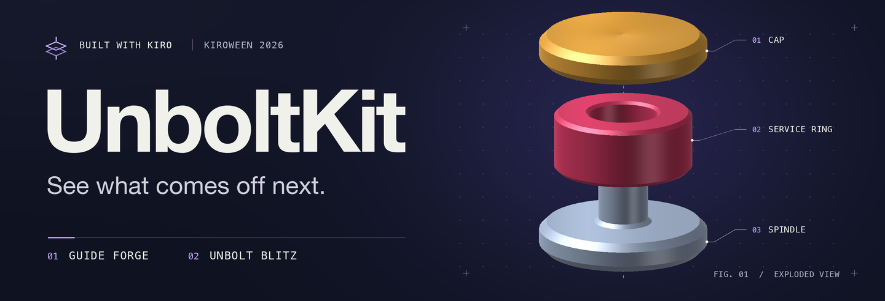
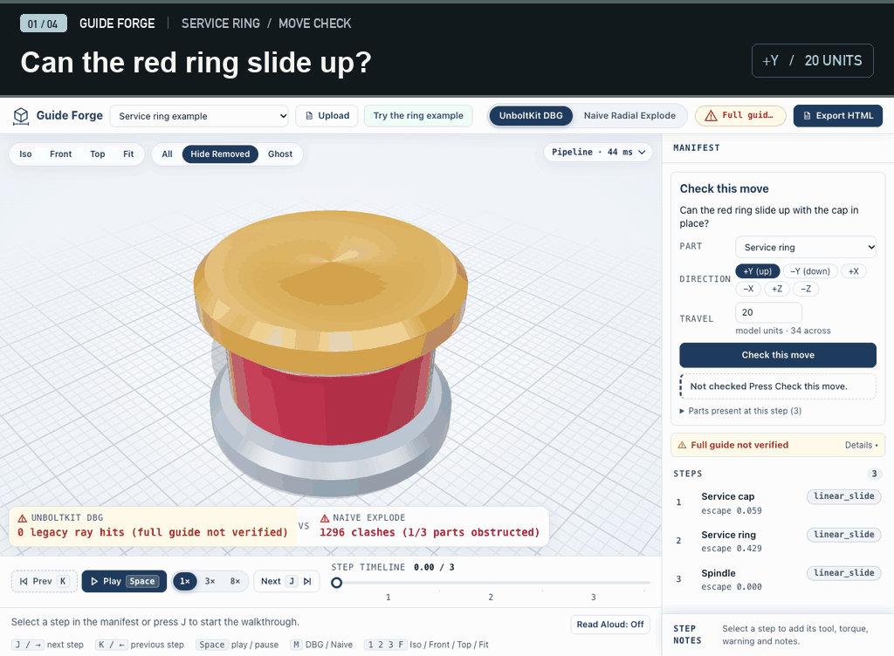
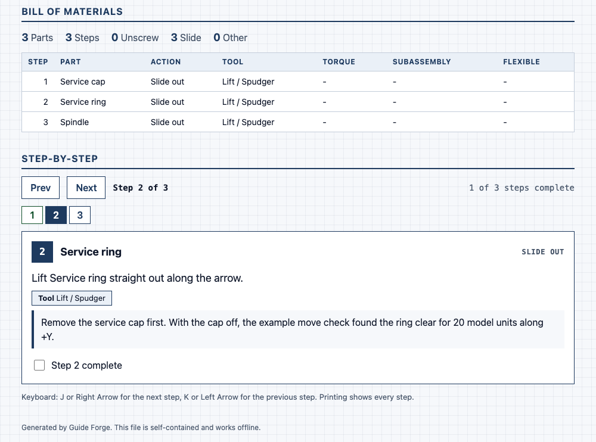
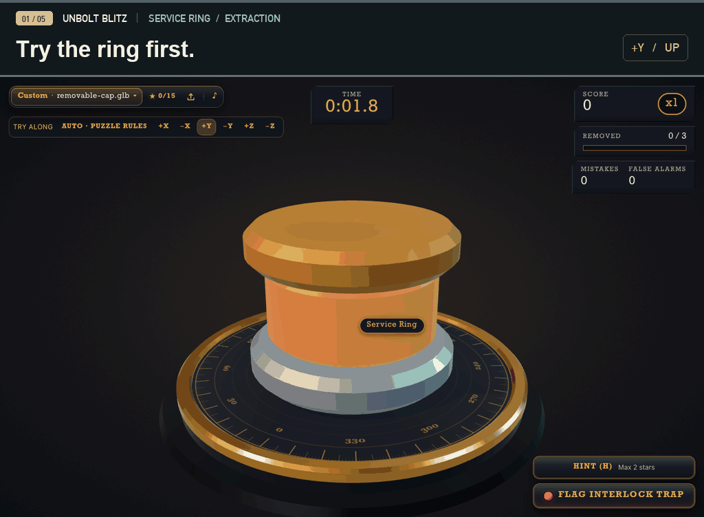

# UnboltKit



**Can you slide the red ring off without removing the spindle?** With the gold cap in place, the ring hits it. Take the cap off and the same upward pull clears the spindle.

UnboltKit is a TypeScript toolkit for finding disassembly sequences from 3D mesh geometry. **Guide Forge** uses it to write repair instructions. **Unbolt Blitz** puts the same assembly under the player's cursor and lets them try the moves.

**[Open Guide Forge](https://unboltkit-guide-forge.vercel.app/)** · **[Play Unbolt Blitz](https://unboltkit-blitz.vercel.app/)** — both run in your browser without signing in.

[Run locally](#run-locally) · [Get the ring model](apps/guide-forge/src/examples/removable-cap.glb) · [Build with the engine](#build-with-the-engine) · [How we used Kiro](#how-we-used-kiro)

## Guide Forge · Check a move before you write the instruction



**Try it:** Choose **Try the ring example → Check this move**. The selected part is the service ring, the direction is up (+Y), and the distance is 20 model units. Select **Service cap** in the Steps list to move past its removal. Press **Check this move** again. Only the parts still installed have changed.

For your own assembly, upload a GLB, review the proposed removal order, and add tools, warnings or notes to each step. **Export HTML** produces one file with snapshots and a checklist that works offline.

[Full-size screenshot](docs/media/guide-forge.png) · [Guide Forge source](apps/guide-forge)

<details>
<summary><strong>Open the actual exported repair manual</strong></summary>

This is step 2 of the ring manual: the cap is checked off and the ring is next. GitHub shows HTML as source; [download the HTML file](docs/examples/service-ring-manual.html) using **Download raw file**, then open it in your browser. The images and step controls are built in.



</details>

## Unbolt Blitz · Try the teardown yourself



The game opens on a clockwork lockbox. On your first visit, an arrow points to a lid screw you can click for a free first move. To replay the GIF, use **Upload custom .glb** with the [same ring model](apps/guide-forge/src/examples/removable-cap.glb), select **+Y** under **Try along**, then click **ring → cap → ring**. The first click is blocked; the next two remove the parts and score.

[Full-size screenshot](docs/media/unbolt-blitz.png) · [Unbolt Blitz source](apps/unbolt-blitz)

## Run locally

From the repository root, use **Node.js 22** and npm:

```sh
npm ci
npm run dev --workspace=@unboltkit/guide-forge
```

Open **http://localhost:5173** for Guide Forge. To play Blitz, open a second terminal in the same folder:

```sh
npm run dev --workspace=@unboltkit/unbolt-blitz
```

Open **http://localhost:5174**. Both apps include five sample assemblies; you can start without a CAD file.

## What a result means

| On screen | What it tells you |
| --- | --- |
| **Blocked** | The checker found an obstruction along the specified straight move. It names the blocking part or parts. |
| **Clear** | That part can travel that distance in that direction against the parts still present in the model. |
| **Unverified** | The checker could not establish the result. Treat the move as undecided. |

A solved teardown is a proposed sequence. The apps check **individual finite, straight moves** on demand; they do not certify the entire plan or screw motions. In Blitz, **Auto · puzzle rules** uses the blocking graph without requesting that check. The legacy ray-hit count is a diagnostic: zero hits alone does not establish clearance.

## Build with the engine

Both apps call the [same core package](packages/unbolt-core/src/index.ts) in a Web Worker. The engine itself runs on the CPU without the DOM or WebGL, so it can also run in Node. To use it in another TypeScript workspace in this repo, pass a Three.js scene root to `solveDisassembly`:

```ts
import { solveDisassembly } from "@unboltkit/core";
import { buildHauntedClockworkLockbox } from "@unboltkit/sample-kits";

const plan = solveDisassembly(buildHauntedClockworkLockbox());
if (plan.status === "solved") {
  console.log(plan.steps.map(step => step.partId));
} else if (plan.status === "deadlocked") {
  console.log(plan.witness.sccs); // Cycles of parts blocking one another.
} else {
  console.error(plan.error);
}
```

The planner splits the mesh into rigid parts, tests candidate directions, and builds a graph of which parts block others. It removes one part at a time or reports a blocking cycle. [Motion primitives](packages/unbolt-core/src/primitives) turn the proposed steps into animation; the [straight-move verifier](packages/unbolt-core/src/oracle/moveVerifier.ts) is a separate geometry check.

<details>
<summary><strong>Two sample results and how to reproduce them</strong></summary>

| Bundled assembly | Planner result | Legacy ray hits on the plan | Ray hits on a naive radial explode |
| --- | --- | ---: | ---: |
| Haunted Clockwork Lockbox | 13 parts, 13 proposed steps | 0 | 12,618 |
| Dumbbell and Ring | 2 parts; neither is removable in the search | 0 | 2,592 |

The cage makes the distinction concrete: the plan has zero steps to replay, so a count of zero cannot mean the ring is removable.

```sh
npm run build --workspace=@unboltkit/crew-assembly-ci
node apps/crew-assembly-ci/scripts/run-audit.mjs --kit haunted-clockwork-lockbox
node apps/crew-assembly-ci/scripts/run-audit.mjs --kit deadlock-cage-dumbbell-ring
```

The second audit intentionally exits with code 1 and identifies the blocking cycle. Each run writes `disassembly-manifest.json`; use `--out` to keep both. [Assembly CI usage and baseline comparisons](apps/crew-assembly-ci/README.md).

</details>

## How we used Kiro

A three-bar assembly exposed a bug: the old solver slid one bar through another while its ray checker counted zero hits. The [Kiro bug spec](.kiro/specs/crossed-bars-false-verified/bugfix.md) records the failing move. The [regression tests](packages/unbolt-core/test/unit/stage3-finite-step-verifier.test.ts) preserve both cases that matter: the crossing is rejected, and a nearby move with real clearance stays available.

| In this repository | What it does |
| --- | --- |
| [Specs](.kiro/specs) and [steering](.kiro/steering) | Define how the engine and both apps should behave, including the rule against special cases for named test models. |
| [Primitive sync hook](.kiro/hooks/sync-extraction-primitive.kiro.hook) and [invariant hook](.kiro/hooks/verify-dbg-invariants.kiro.hook) | A primitive edit prompts Kiro to update the registry and both consumers. A core source edit triggers the quick geometry tests. |
| [CAD Assembly Auditor Power](powers/cad-assembly-auditor/POWER.md) and [MCP server](tools/cad-auditor-mcp) | Let Kiro list kits, inspect an assembly's blockers, or compare the proposed removal order between two revisions. |
| [Assembly CI](apps/crew-assembly-ci) | Runs the auditor headlessly and writes a manifest for CI or the Kiro Crew dashboard. |

To enable the local auditor, run `npm run build --workspace=@unboltkit/cad-auditor-mcp` from the root. The [workspace MCP configuration](.kiro/settings/mcp.json) already points to the built server.

**Checks:** `npm run typecheck` checks all workspaces. `npm test` runs the full suite. For a faster geometry check, run `npm run test:quick --workspace=@unboltkit/core`.

[MIT license](LICENSE)
