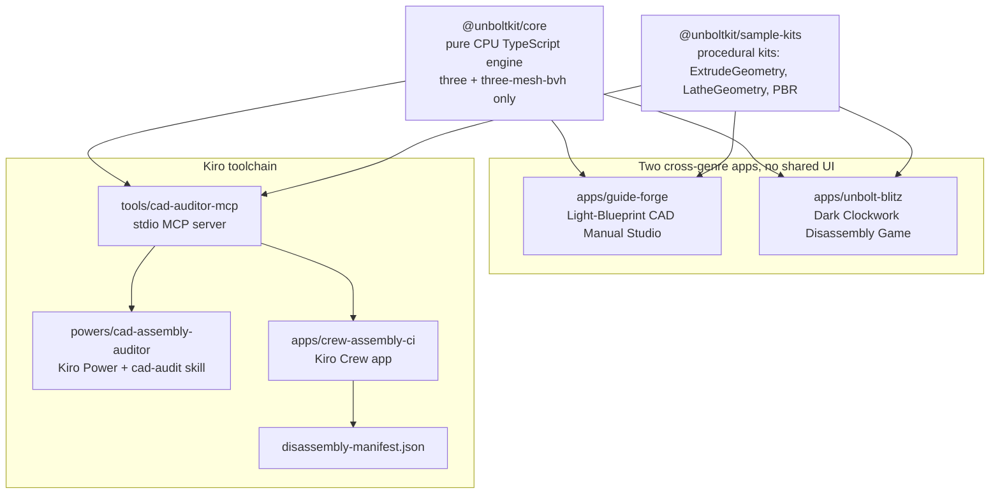

# UnboltKit

**Naive Radial Explode shreds 3D models through solid walls. UnboltKit computes mathematically verified, zero-clash 3D disassembly sequences from pure mesh geometry.**

Kiroween 2026 entry. One pure-TypeScript engine, two completely different apps built on it, and a Kiro toolchain (spec, steering, hooks, power, MCP server, Kiro Crew app) that audits assemblies in CI.

## Problem and vision

Every exploded-view tool, repair manual and teardown animation has the same shortcut: push each part away from the center. On a real assembly that drags parts through housings, shafts and each other. Someone then fixes the sequence by hand.

UnboltKit reads a `.glb` and works the sequence out from the geometry alone. It never uses part names, a CAD feature tree or hand-authored hints. For each part it asks which directions are physically free, builds a directional blocking graph, and peels parts off in an order that no step collides. If no order exists, it says why: the exact cycle of parts that lock each other in. An independent clash checker replays every plan to confirm it.

Measured on the bundled sample kits (from `apps/crew-assembly-ci`):

| Kit | Result | Clashes, DBG plan (oracle) | Clashes, naive radial explode |
| --- | --- | --- | --- |
| `haunted-clockwork-lockbox` (13 parts) | solved in 13 steps | **0** | 12,618 |
| `deadlock-cage-dumbbell-ring` (2 parts) | deadlocked, witness `{dumbbell, captive_ring}` | **0** | 2,592 |

## Architecture



- `@unboltkit/core` runs the identical code in browser Web Workers, Vitest and headless Node. It has no DOM, WebGL or `window` access.
- Both apps run the solver in a Web Worker, never on the main thread. They share no dashboard shell, CSS theme or app chrome.
- `crew-assembly-ci` bundles the same auditor source the MCP server uses, so CI and the agent give the same answers.

## Core engine highlights

- **Pipeline.** Stage 0 parses the scene and splits meshes into parts (weld plus Union-Find). Stage 1 normalizes every assembly to `maxExtent = 1.0`, builds one BVH per part and generates 26 canonical plus 6 PCA candidate axes. Stage 2 builds the directional blocking graph (DBG). Stage 3 peels parts. Stage 4 compiles motion primitives (`linear_slide`, `helical_unscrew`, `two_step_l_slide`).
- **OBB-pruned bidirectional swept-ray DBG.** Part pairs whose oriented bounding boxes cannot touch along a direction are pruned with an exact hull-distance test, and the rest are tested with stratified rays cast both ways.
- **Stage 3 Coarse-to-Fine Lazy Exact Step Verification.** The coarse graph picks a candidate removal. An exact check of that single step runs only when it is about to be taken, and it can add blocking edges the sampling missed.
- **Tarjan SCC deadlock witnesses.** When no part can move, an iterative Tarjan pass returns the cycles with the blocking edges and directions. This is the evidence, not just a failure flag.
- **Independent `Clash_Checker` oracle.** A separate implementation replays each step against the parts still in place. The tests also check that it shares no code with the solver.
- **Deterministic.** Seeded PRNG only, no `Math.random()` in solver logic or property tests.

### Test counts

Observed on this checkout (`npm test` per workspace, Vitest 3):

| Workspace | Test files | Tests passed |
| --- | --- | --- |
| `@unboltkit/core` | 48 | 465 |
| `@unboltkit/sample-kits` | 3 | 10 |
| `@unboltkit/guide-forge` | 7 | 120 |
| `@unboltkit/unbolt-blitz` | 13 | 88 |
| `@unboltkit/cad-auditor-mcp` | 1 | 36 |
| `@unboltkit/crew-assembly-ci` | 1 | 18 |
| **Total** | **73** | **737** (all passing) |

- `npm run test:quick` in core skips the heavy invariant runs: 34 files, 451 tests.
- The core invariant suite (clash-free plans, rigid-motion invariance, split-back of merged meshes on the 3-stage planetary gearbox) takes about 6.5 minutes. Vitest's worker RPC can time out during that run, and during the full `guide-forge` run, and report an error, although every test passes.

## The `.kiro/` showcase

| Kiro feature | What is here | Where |
| --- | --- | --- |
| Spec | `unbolt-core-engine`: requirements, design (pipeline, 39 correctness properties) and tasks for the engine | `.kiro/specs/unbolt-core-engine/` |
| Spec | `guide-forge-part-1`: the blueprint manual studio | `.kiro/specs/guide-forge-part-1/` |
| Spec | `unbolt-blitz-part-1`: the clockwork puzzle game | `.kiro/specs/unbolt-blitz-part-1/` |
| Steering | `geometry-invariants`: core stays pure CPU, normalize to `maxExtent = 1.0`, solver runs in a worker | `.kiro/steering/geometry-invariants.md` |
| Steering | `no-spec-gaming`: no hardcoded fixtures, no swallowed errors, seeded randomness, real geometric assertions | `.kiro/steering/no-spec-gaming.md` |
| Steering | `ui-separation`: the two apps keep separate identities, play on mute, show upload recovery states | `.kiro/steering/ui-separation.md` |
| Steering | `macos-shell-guard`: quoted paths, no GNU `timeout`, sequential shell calls, distrust bare exit code -1 | `.kiro/steering/macos-shell-guard.md` |
| Hook | `sync-extraction-primitive`: when a motion primitive changes, an agent syncs the registry, Guide Forge wording and Unbolt Blitz cues, then runs the checks | `.kiro/hooks/sync-extraction-primitive.kiro.hook` |
| Hook | `verify-dbg-invariants`: on save of core source, runs the quick core suite (no agent credits) | `.kiro/hooks/verify-dbg-invariants.kiro.hook` |
| Power | `cad-assembly-auditor`: `POWER.md`, `mcp.json` and the `cad-audit` skill | `powers/cad-assembly-auditor/` |
| MCP server | `cad-auditor-mcp`: stdio JSON-RPC server with `list_sample_kits`, `inspect_assembly_dbg`, `diff_repairability` | `tools/cad-auditor-mcp/` |
| Kiro Crew app | `crew-assembly-ci`: manifest, agent, skill, CI script, dashboard UI | `apps/crew-assembly-ci/` |

## The two apps

| | `apps/guide-forge` | `apps/unbolt-blitz` |
| --- | --- | --- |
| Genre | CAD manual authoring | Puzzle game |
| Look | Light blueprint | Dark clockwork |
| Loop | Load a `.glb` or kit, review the solved sequence, edit step text, export a manual | Click parts out in a legal order, build combos, flag genuine interlock traps |
| Dev port | 5173 | 5174 |

Both show a recovery state for a single-island monolithic `.glb` and for an oversized one, and both are fully usable on mute.

## Quickstart

Requires Node 20 or newer.

```sh
npm install
```

Run the apps (separate terminals):

```sh
npm --workspace=@unboltkit/guide-forge run dev     # http://localhost:5173
npm --workspace=@unboltkit/unbolt-blitz run dev    # http://localhost:5174
```

Build and run the MCP server:

```sh
npm --workspace=@unboltkit/cad-auditor-mcp run build
node tools/cad-auditor-mcp/dist/server.js          # newline-delimited JSON-RPC on stdio
```

Register it in Kiro by creating `.kiro/settings/mcp.json`:

```json
{
  "mcpServers": {
    "cad-assembly-auditor": { "command": "node", "args": ["tools/cad-auditor-mcp/dist/server.js"] }
  }
}
```

Run the Assembly CI audit (exit 0 pass, 1 fail, 2 usage error):

```sh
npm --workspace=@unboltkit/crew-assembly-ci run build
node apps/crew-assembly-ci/scripts/run-audit.mjs --kit haunted-clockwork-lockbox       # passes
node apps/crew-assembly-ci/scripts/run-audit.mjs --kit deadlock-cage-dumbbell-ring     # fails with a Tarjan SCC witness
node apps/crew-assembly-ci/scripts/run-audit.mjs --baseline main.glb --candidate pr.glb
```

Each run writes `disassembly-manifest.json` in the current directory. See [`apps/crew-assembly-ci/README.md`](apps/crew-assembly-ci/README.md).

Test and typecheck:

```sh
npm run typecheck                                  # all workspaces
npm test                                           # everything, includes the ~6.5 min core invariant suite
npm --workspace=@unboltkit/core run test:quick     # core without the heavy invariant runs
```

## Repository layout

```
packages/unbolt-core        engine (pure CPU TypeScript)
packages/sample-kits        five procedural kits: 3 showcase, 2 deadlock cages
apps/guide-forge            light-blueprint manual studio
apps/unbolt-blitz           dark clockwork puzzle game
apps/crew-assembly-ci       Kiro Crew app
tools/cad-auditor-mcp       stdio MCP server
powers/cad-assembly-auditor Kiro Power
.kiro/                      specs, steering, hooks
```

## License

MIT. See [LICENSE](LICENSE).
